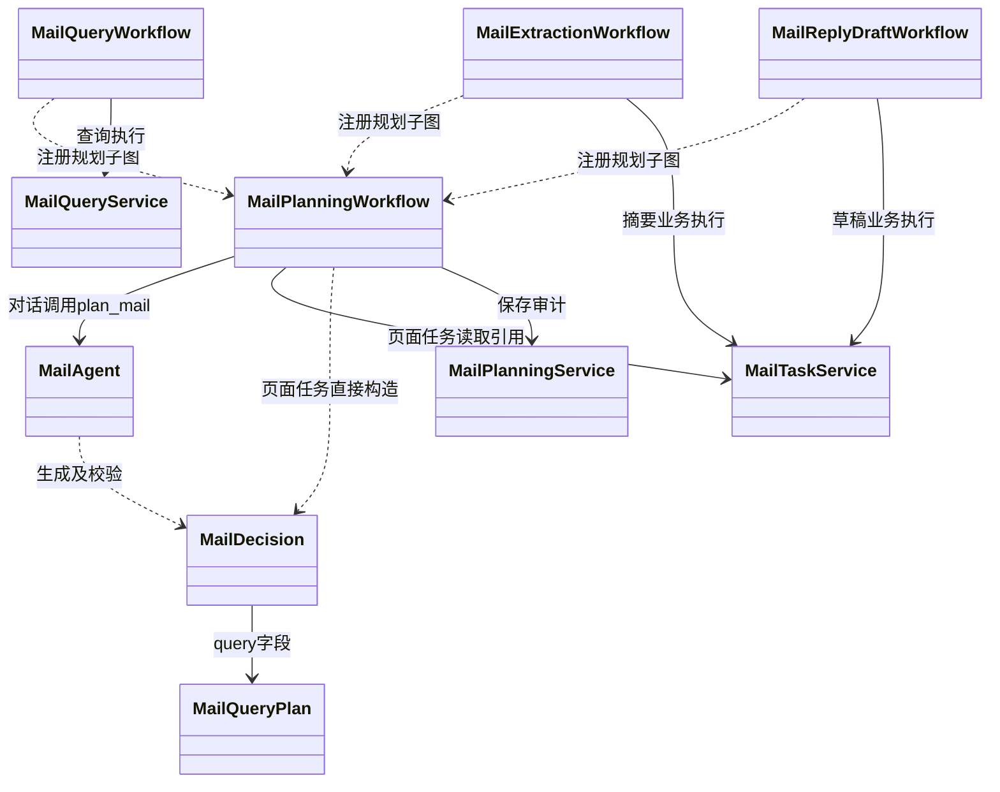

# Aegis Agent 工程化与结构化协作开发计划

> 目标：在已有 LangGraph、MCP、Redis、PostgreSQL、审批恢复、SSE 与 OpenTelemetry 的基础上，逐步建设可路由、可治理、可检索、可评测的 Agent 系统。本文是**后续实施计划**；除明确标注为“当前已具备”的内容外，均不代表已完成。

## 1. 总体原则

本项目不以堆叠框架或中间件为目的。每项技术必须解决明确问题，并有可演示的业务路径、测试和指标。

```text
用户任务 / 页面操作
  → 根图选择工作流
  → 领域 Agent 生成受限的结构化计划
  → Workflow 编排 Service / ToolGateway
  → MCP 工具或领域服务执行
  → 可信工具结果、业务引用与 SSE 事件
  → 前端卡片 / 审批页 / 最终回复
```

职责边界：

- **Agent / Graph**：理解任务、生成受限计划、选择子图、编排节点、暂停与恢复。
- **Service**：事务边界、业务状态迁移、上下文装配、审批与事件编排。
- **Repository**：SQL 与领域数据持久化。
- **ToolGateway**：工具白名单、参数校验、连接与 scope、租户隔离、工具调用审计。
- **MCP Server**：无状态地封装日历、邮件等外部系统能力。
- **策略层**：权限、外部写入、审批、敏感信息规则必须由代码决定，不能只相信 LLM。

禁止写入 LangGraph Checkpoint 的数据包括完整邮件正文、附件、OAuth 凭据、模型思维过程及未经脱敏的外部原始响应。

### 1.1 结构化契约的目录边界

`agent/contracts/` 按“跨领域公共模型 + 领域模型”组织，而不是按每个工具建立一个文件：

```text
agent/contracts/
├── common.py       # ToolResultSummary、ConversationArtifact、JSON 大小限制
├── calendar.py     # CalendarReadPlan、日历 Artifact 构造规则
├── mail.py         # 后续：MailQueryPlan、邮件 Artifact 构造规则
└── research.py     # 后续：ResearchQueryPlan、来源 Artifact 构造规则
```

`CalendarReadPlan` 是“日历时间范围读取”这一**工作流类别**的计划，不是某个工具的包装类。因此新增 `calendar.list_events_by_calendar` 一类同语义工具时，应扩展该计划的 action 与参数校验；`calendar.create_event` 等写操作、`calendar.list_calendars` 等输入结构明显不同的读取操作，则分别建立独立计划和工作流。所有领域共享 `ToolResultSummary` 与 `ConversationArtifact`，避免重复定义结果和卡片基础模型。

## 2. 当前基线

当前已具备：

- `TaskGraph`、日历与邮件领域工作流，以及 `run_id` 对应的 LangGraph Checkpoint 恢复；
- Calendar / Email MCP Server、统一 `ToolGateway`、工具连接和 scope 校验、工具调用审计；
- 任务状态、逐项审批、Redis 队列恢复、SSE 实时事件；
- Redis 短期队列、PostgreSQL 租户隔离与 RLS、长期记忆的基础业务接口；
- OpenTelemetry 基础接入和结构化日志；
- 日历、邮件领域 Agent，以及受限主决策 Agent 和结构化专家交接；领域内仍保留部分确定性参数解析规则。

当前主要缺口：

- 日历读取已经具备 `plan`、`tool_result`、`artifacts` 的首个实现；邮件等其他领域尚未迁移；
- 主对话邮件查询候选 Artifact 后端已完成，前端卡片与操作按钮待对接；
- 缺少统一的 Agent Harness（策略 Hook、幂等、重试、失败治理）；
- 受限主路由已初步接入，尚需路由评测与模型选择；动态 Skills、Hybrid RAG 和量化评测体系仍未实现；
- 可观测性尚未形成 Trace、Metric、Log 联动看板。

## 3. 目标结构化状态契约

在保留既有稳定字段的基础上，逐步扩展 `TaskGraphState`：

```python
class TaskGraphState(TypedDict, total=False):
    # 身份与运行标识
    run_id: str
    tenant_id: str
    user_id: str
    conversation_id: str
    run_type: str

    # 路由与计划
    intent: str
    workflow: str
    main_decision: dict[str, Any]     # 经校验的主 Agent 决策：交接、澄清或普通回复
    handoff: dict[str, Any]           # 领域专家接收的任务要求和已核验业务引用
    plan: dict[str, Any]              # 经 Schema 校验、尚未执行的受限计划

    # 可信执行结果与前端可展示引用
    tool_result: dict[str, Any]       # 脱敏、大小受限的结果摘要
    artifacts: list[dict[str, Any]]   # 稳定业务对象 ID 与展示字段

    # 对话与输出
    history: list[dict[str, Any]]
    memory_context: str
    assistant_content: str
```

`plan` 描述“准备做什么”，并非事实。例如：

```json
{
  "domain": "calendar",
  "action": "read_events",
  "tool_name": "calendar.list_events",
  "arguments": {"start_at": "...", "end_at": "..."},
  "risk_level": "read"
}
```

`tool_result` 仅保存后续节点和最终回答所需的可信摘要。完整事实仍保存在 `tool_calls`、`run_events` 及各领域业务表中。`artifacts` 保存如 `email_id`、`draft_id`、`calendar_draft_id` 等稳定对象 ID 与脱敏卡片字段，不能保存完整正文。

### 3.1 日历读取的首个闭环：计划、事实与展示数据分离

日历读取已经作为首个实现，验证以下分层不是“多包装一层对象”，而是将不同用途的数据明确隔离：

```text
用户：“查看我明天的日程”
  ↓
CalendarAgent
  └─ 理解用户表达，提出候选工具调用
  ↓
CalendarReadPlan
  └─ 固化并校验“准备做什么”
  ↓
ToolGateway / Calendar MCP
  └─ 校验权限后取得“实际发生了什么”
  ↓
ToolResultSummary
  └─ 为后续图节点和 LLM 提供可信、安全摘要
  ↓
ConversationArtifact
  └─ 为前端卡片筛选最小展示字段
  ↓
PostgreSQL 持久化 + SSE artifacts_ready
  ↓
前端读取 Artifact 并渲染卡片；LLM 基于可信摘要生成自然语言回复
```

旧的简单调用链为：

```text
CalendarAgent → ToolInvocation → ToolGateway → Calendar MCP → LLM 回复
```

其中 `ToolInvocation` 仍是实际调用 ToolGateway 的内存对象；新增的 `CalendarReadPlan` 是可版本化、可校验、可进入 LangGraph State 的计划契约。例如：

```json
{
  "version": 1,
  "domain": "calendar",
  "action": "list_events",
  "tool_name": "calendar.list_events",
  "arguments": {"start_at": "...", "end_at": "..."},
  "risk_level": "read"
}
```

当前校验包括：只允许已声明的日历只读工具；`action` 必须与 `tool_name` 匹配；必须包含 `start_at`、`end_at`；参数及结果必须为大小受限的 JSON。通过后才会重建 `ToolInvocation` 并进入 ToolGateway。

| 数据 | 表示的含义 | 持久化位置 | 面向对象 |
| --- | --- | --- | --- |
| `CalendarReadPlan` | Agent 决定**准备做什么** | LangGraph Checkpoint / `TaskGraphState` | 工作流恢复、审计、后续专家交接 |
| `ToolResultSummary` | 工具调用后**可信且脱敏的结果摘要** | LangGraph Checkpoint / `TaskGraphState`；完整事实另存 `tool_calls` | 后续节点、LLM 回复 |
| `ConversationArtifact` | 前端**应展示什么卡片** | `conversation_message_artifacts` | 主对话卡片、历史会话恢复、短期指代 |
| 原始工具响应 | 外部服务返回的完整技术事实 | `tool_calls.response_payload` | 审计、排错；不直接展示 |

`ConversationArtifact` 当前仅包含日程标题、起止时间、时区与稳定外部标识等最小字段，不包含日程描述、参会人、OAuth 凭据或 MCP 原始响应。持久化后发布 `artifacts_ready` SSE 事件；事件只通知前端刷新，前端使用 `GET /conversations/{conversation_id}/artifacts?run_id={run_id}` 读取卡片数据，不从 SSE 或 LLM 文本中解析卡片。

### 3.2 会议安排中的可信候选与 LLM 草稿生成

日历可用时间不能由模型计算或补全。`calendar.find_free_time` 仍由 Calendar MCP Server 基于日程数据确定性地返回多个候选；Worker 将候选转换为带稳定 `slot_id` 的 `CalendarFreeTimeCandidate`，再调用 `CalendarAgent` 生成仅供确认的会议草稿：

```text
Calendar MCP available_slots
  → CalendarFreeTimeCandidate[]（代码生成 slot_id）
  → LLM 输出 CalendarMeetingDraftProposal（主题、描述、邮箱参会人、候选 ID、理由）
  → 校验 selected_slot_id / alternative_slot_ids 均属于候选集合，主题/描述长度及邮箱格式有效
  → calendar_event_drafts / approval_items
  → interrupt() 等待用户确认
```

`CalendarMeetingDraftProposal` 允许模型完善主题、描述和邮箱参会人，并选择 `selected_slot_id`、`alternative_slot_ids` 与推荐理由；模型不能构造候选集合外的时间。模型输出 JSON 无效、引用不存在的时段、无效邮箱或重复候选时，工作流停止在草稿创建前。确认项的冻结预览保存草稿、推荐理由和备选时段；用户仍可核对、批准或拒绝。外部 `calendar.create_event` 只在批准并恢复同一 `run_id` 后调用，绝不再次调用 LLM。

## 4. 分阶段路线图

### 阶段 0：建立可回归的基线（先完成）

**目的：** 后续引入 LLM 路由和多 Agent 时，能证明没有破坏已完成的审批、SSE 和 MCP 链路。

1. 整理日历、邮件、审批、恢复任务的端到端测试脚本和固定 Mock 数据。
2. 对每条关键链路记录 run 状态、SSE 事件顺序、工具调用审计和最终业务数据。
3. 补齐错误分类：参数错误、连接缺失、MCP 不可用、LLM 超时、审批拒绝、恢复失败。

**验收：** 可重复验证“查询日历”“创建会议并审批”“邮件摘要”“起草邮件并发送确认”四条链路；失败能得到稳定错误码和可追踪 `run_id`。

### 阶段 1：结构化计划、结果与 Artifact（优先）

**目的：** 让领域 Agent、子图、页面和后续多 Agent 通过受约束数据协作，而不是传递自由文本。

> **实现状态（2026-10-09）：** 已完成日历读取最小闭环：`CalendarReadPlan`、`ToolResultSummary`、`ConversationArtifact` Pydantic 契约；`TaskGraphState` 对应字段；`CalendarReadWorkflow` 的计划校验、工具结果摘要与 Artifact 构建；`conversation_message_artifacts` 迁移、持久化与 `GET /conversations/{conversation_id}/artifacts` 查询接口。邮件查询计划、跨消息指代解析和邮件 Artifact 留待阶段 2。

1. 为 `Plan`、`ToolResult`、`Artifact` 定义 Pydantic 模型和版本字段，初期支持 `CalendarReadPlan`、`MailQueryPlan`。
2. 在 `TaskGraphState` 加入 `plan`、`tool_result`、`artifacts`，在节点写入前进行字段白名单、脱敏和大小校验。
3. 将 `CalendarReadWorkflow` 迁移为：

   ```text
   CalendarPlanningWorkflow → CalendarAgent.plan_calendar → CalendarDecision
   → CalendarReadPlan（代码映射到白名单读取工具）
   → state.plan
   → 校验工具白名单与参数
   → ToolExecutionService / ToolGateway
   → state.tool_result
   → 日历 Artifact
   → generate_reply
   ```

4. 新增 `conversation_message_artifacts` 表、迁移和 Repository，保存短期对话候选引用，支持“第一封邮件”“刚才那个会议”等指代。

**验收：** 日历查询能产生可审计计划、可信结果和卡片引用；Checkpoint 中不含敏感正文；越权、过期或歧义引用不会自动执行。

### 阶段 1.5：主决策 Agent 与领域专家交接（阶段 2 前完成）

**实现状态（2026-10-12）：** 已接入独立 `MainDecisionWorkflow` 子图。根图 `load_context → main_decision` 后根据子图返回的 workflow 分流；子图调用 MainAgent 推理并形成已核验 handoff。页面后台任务和审批恢复不重复调用主 Agent。主对话开放日历查看、空闲查询、会议安排和邮件卡片导航；邮件摘要、待办、起草由卡片／页面按钮触发，不能自然语言直达生成子图。邮件目标优先来自阶段2的当前会话候选卡片，无查询卡片时提供最近20条快照；草稿修改及多专家复合任务仍在后续阶段实施。

实现文件包括 `agent/contracts/decision.py`、`agent/specialists/main_agent.py`、`agent/workflows/main/decision_workflow.py`、`service/runtime/decision_context_service.py`、`repository/decision_repository.py`。原 DecisionService 已拆除，LLM 调用、能力校验、澄清分支和交接组装均在图层；Service 只读取业务引用、核验归属与版本、保存审计。领域工厂通过 `GraphRegistry.register_capability` 声明对话入口。主决策校验失败返回澄清，模型服务失败按现有 LLM 错误结束任务；未启用关键词兜底。决策记录复用 `run_events` 的 `main_decision_completed`，无需新增表或配置。主 Agent 与领域专家共用现有模型客户端；多模型选择仍留待阶段 4。

**目的：** 由主决策 Agent 理解用户请求、选择领域专家并生成结构化交接计划，让日历、邮件等专家能够接收清晰的任务要求及业务对象引用。第一版一次只交接给一个专家，先接入已经具备的领域能力。

职责划分：

| 组件 | 职责 | 建议位置 |
| --- | --- | --- |
| `MainAgent` | 调用 LLM，理解请求，输出交接、澄清或普通回复决定 | `agent/specialists/main_agent.py` |
| `MainDecision`、`ResourceReference`、`AgentHandoff` | 约束领域、意图、任务说明与对象 ID／版本 | `agent/contracts/decision.py` |
| `MainDecisionWorkflow` | 编排推理、能力校验、澄清、交接与审计节点 | `agent/workflows/main/decision_workflow.py` |
| `DecisionContextService` | 读取脱敏业务引用、核验归属及版本、持久化审计；不调用 LLM | `service/runtime/decision_context_service.py` |
| 根图及路由 | 保存已校验决定，通过条件边进入注册的领域子图 | `agent/graph/`、`agent/routing/` |
| `CalendarAgent`、`MailAgent` | 接收交接计划，生成领域内计划或草稿，解释可信工具结果 | `agent/specialists/` |
| Service／ToolGateway | 事务、权限、审批和工具执行 | 现有领域服务及工具层 |

1. **定义受限决策与交接契约。** `MainDecision` 包含 `version`、`decision`（`delegate / clarify / reply`）、`domain`、`intent`、`instruction`、可选 `target` 和 `clarification_question`。字段采用白名单及大小限制；按决策类型校验必填字段与互斥组合。意图按领域声明，不能使用任意字符串直接查找 Python 方法或图节点。
2. **从注册能力构造可选范围。** 向主 Agent 提供当前已注册且可用的领域意图、必要上下文及脱敏业务引用。先支持已有日历读取／会议安排与明确目标的邮件摘要／起草能力；未实现的邮件查询、草稿修改等动作不能被主 Agent 选中。后续能力接入后再扩展清单。
3. **实现主 Agent 推理节点。** 普通对话在 `load_context` 后调用 `MainAgent`，输出 JSON 并经 Pydantic 校验。校验后的决定写入 `state.main_decision`；核验后的领域交接写入 `state.handoff`。领域子图读取交接要求和目标引用，再生成自己的 `state.plan`；主 Agent 不负责填写任意工具名、SQL 或批准标记。

   当前主决策子图为：

   ```text
   load_decision_context（Service 读取引用）
     → infer_main_decision（MainAgent 调用 LLM）
     → validate_decision_capability
          ├─ 需要目标 → validate_decision_target（Service 核验归属与版本）
          └─ 无目标或已转澄清 → 跳过目标核验
     → assemble_agent_handoff
     → record_decision_audit（Service 保存事件）
   ```

   候选列表、校验结果与耗时保存在子图局部状态；根图只共享 main_decision、handoff、intent、workflow 等稳定协议字段。非法模型输出或目标转为澄清；模型故障先登记失败审计再交由任务生命周期结束任务。
4. **实现目标引用解析与核验。** “刚才的会议”“第一封邮件”等指代只能关联服务端提供的可访问对象；目标引用包含 `resource_type`、`id` 和可选 `version`。通过 Service／Repository 查询归属和最新状态。候选有歧义、目标过期或版本变化时进入澄清，不自动猜测或执行。前端明确传入的目标也须同样核验。
5. **接入根图条件路由。** 页面指定且已经完成业务参数校验的任务继续进入对应子图。普通对话由主 Agent 决策，根图只根据已核验的领域意图映射路由。第一版复用现有注册表及领域工厂，交接通过 State 和子图完成，无需新增专家进程。

   ```text
   START → select_run_workflow
     ├─ 页面指定任务 → 对应领域子图
     └─ 普通对话 → load_context → MainAgent → 决策／目标校验
                                              ├─ calendar → 日历专家子图
                                              ├─ mail → 邮件专家子图
                                              ├─ clarify → 返回澄清问题
                                              └─ reply → generate_reply
   ```

6. **处理失败和执行边界。** 模型超时、非法 JSON、未知意图或不存在的专家均不能产生工具调用。只允许明确且匹配已有能力的确定性规则作为兜底，其余情况返回澄清或可重试错误。权限、连接、scope、外部写入和人工审批仍由代码策略执行；主 Agent 决策不能替代这些检查。
7. **记录并验证交接。** 保存脱敏决策摘要、能力清单版本、目标引用、模型信息、耗时与 Trace 关联，不保存模型思维过程。测试覆盖明确任务、自然表达、歧义指代、非法输出、过期版本、越权目标及页面任务直达；继续回归现有审批与恢复链路。

**实例：** 用户说“把刚才的总结会议改到明天下午，仍然开 50 分钟”。当“修改会议草稿”能力已接入且只有一个明确草稿目标时，主 Agent 生成：

```json
{
  "version": 1,
  "decision": "delegate",
  "domain": "calendar",
  "intent": "revise_meeting_draft",
  "instruction": "将会议移到明天下午，保持50分钟及原有主题",
  "target": {
    "resource_type": "calendar_draft",
    "id": "11111111-1111-4111-8111-111111111111",
    "version": 1
  }
}
```

该示例是后续能力扩展目标，当前尚未实现草稿修改链路。只有注册了对应能力后，才允许此意图。目标核验通过后，日历专家决定查询空闲候选、生成修改计划，Service 保存新版草稿并使旧确认项失效，等待用户重新确认。若存在多个可能草稿，则返回 `clarify`；不能恢复旧批准分支直接执行新内容。

**验收：** 普通对话可通过受限 LLM 决策进入现有日历或邮件专家流程；专家能读取结构化交接要求。页面指定任务不额外经过主模型分类。未知能力、歧义目标和非法输出不会执行工具；主 Agent 无法绕过权限与审批。多领域拆解、并行、循环调用和结果汇总留至阶段 8。

### 阶段 1.6：CalendarAgent 受控 LLM 规划（阶段 1.5 后完成）

**实现状态（2026-10-12）：** 已实现受控日历规划链路。CalendarReadWorkflow 和 CalendarConfirmationWorkflow 均先调用 CalendarPlanningWorkflow；CalendarAgent.plan_calendar 调用 LLM 生成 CalendarDecision，代码校验后映射到白名单读取工具。旧同步 plan_read／plan_meeting 仅保留兼容入口，正式工作流不再调用。正则仅用于核验原始输入中的明确日期时间、数字分钟时长和邮箱，不再承担工作流选择。

已支持 explicit_interval 的确定性冲突检查和非工作时段提示；自动推荐仍由 MCP 工作时段计算。明确时间或时长不符合原文、无效计划和读取升级写入均不会进入工具执行。无模型配置时受控失败，不默认取首个时段。领域审计复用 calendar_plan_completed 事件；无需新增配置或迁移。当前冲突检查仍是 Mock 当前用户日历，不能保证双方日历都已查询。模型理解自然语言的准确率仍需后续真实模型评测。

规划输出无效时允许一次受限修复（最多两次规划模型调用），每次均重新验证相同约束；连续失败才返回提示。日志与领域审计只记录字段路径、错误类型和稳定约束代码，不保存原始模型响应；明确日期时间、时长及范围校验不能因修复而放宽。

**职责：** MainAgent 选择日历专家并提供任务要求、必要上下文和可信目标引用；CalendarAgent 理解日历领域参数并提出受限动作；Workflow 校验计划、选择分支并编排执行；Service 负责业务核验与持久化；Calendar MCP 确定性查询和计算日历事实。领域专家不得扩大主 Agent 已核验的任务范围，例如读取任务不能升级为创建会议。

1. **定义 CalendarDecision。** 在 `agent/contracts/calendar.py` 中增加领域规划契约，带 version；允许 `list_events / find_free_time / prepare_meeting / clarify`。字段包括时间范围、时区、会议时长、主题、邮箱参会人、偏好、澄清问题。采用按动作区分的 Schema 或等效的严格字段组合校验；拒绝额外字段、未知动作、反向时间范围、超长范围、非法时区、时长、邮箱或文本长度。该契约是专家的领域决策，现有 CalendarReadPlan 仍作为工具执行计划使用，二者不重复定义同一职责。
2. **明确时间请求语义。** 使用 `time_mode=explicit_interval / search_window`：
   - explicit_interval：用户明确指定起止时段，检查整个请求时段的日程冲突；不按工作时间裁掉请求。非工作时段可生成明确提示，冲突时澄清或请求重新选择，不静默改期。
   - search_window：用户仅给出日期范围或“明天下午”等搜索窗口，按工作时间和忙碌日程生成多个可信候选，随后推荐。
   - 未注明时区默认北京时间；明确的 Z／偏移量按原标记换算。用户同时给出起止时间和不一致的会议时长时进入澄清，不能自行取舍。当前时间由服务端注入，模型不自行猜测“今天”。
3. **增加日历规划子图／节点。** 建议新增 `agent/workflows/calendar/planning_workflow.py`，供读取与会议确认工作流复用；它调用 CalendarAgent 的异步规划方法并校验 CalendarDecision，写入 `calendar_decision`。推理与分支在 Agent／Workflow 中，Service 不调用 LLM。提供原始用户要求、主 Agent handoff、当前时间、时区和允许动作；不提供数据库凭据或完整原始外部响应。
4. **以受控 action 映射执行能力。** 将 list_events／find_free_time 决策转为已有 CalendarReadPlan，再转换为 ToolInvocation 交给 ToolExecutionService／ToolGateway；prepare_meeting 进入查询候选、生成草稿、逐项审批流程；clarify 直接返回问题。工具名称与参数映射由代码固定，模型不能输出任意工具名或自行调用 calendar.create_event。
5. **补齐指定时段的确定性冲突检查。** 初期可用现有 calendar.list_events 查询请求范围，按半开区间重叠规则在业务服务中验证冲突；没有冲突时由代码构造绑定该范围的可信候选供草稿流程使用。不得让 LLM 宣称时间无冲突，也不得复用当前只返回工作时间候选的 find_free_time 来判断凌晨的指定会议。自动推荐仍使用 calendar.find_free_time。
6. **保留事实候选与草稿两阶段处理。** 初始 CalendarDecision 只描述准备做什么；取得 MCP 事实后，CalendarMeetingDraftProposal 才选择可信候选并完善主题、描述、参会人和理由。用户要求与初始计划中的时长、明确时段等硬约束仍由代码复核；最终外部写入只读取用户确认后的草稿版本，不再调用模型。
7. **逐步切换并验证。** 先接入日程读取与空闲查询，再接入会议安排；确定性日期、邮箱等解析可作为辅助校验，逐步退出关键词主决策。模型输出无效时返回澄清，模型不可用时返回受控失败，不静默退回未来七天或默认第一个候选。记录领域决策版本、动作、模型、耗时及校验结果，不保存模型思维过程。

调用关系：

```text
MainDecisionWorkflow → 日历 handoff
  → CalendarPlanningWorkflow → CalendarAgent 调用 LLM
  → CalendarDecision 校验及任务范围复核
      ├─ list_events → CalendarReadPlan → 日程工具 → Artifact
      ├─ find_free_time → CalendarReadPlan → 空闲工具 → Artifact
      ├─ prepare_meeting
      │    ├─ explicit_interval → 查询日程 → 确定性冲突检查
      │    └─ search_window → 查询工作时间内的可信空闲候选
      │  → LLM 完善草稿 → 校验硬约束 → 保存 → interrupt → 批准后写入
      └─ clarify → 返回澄清问题
```

**示例：** 用户要求“明天下午安排 50 分钟总结会议”，在服务端当前时间为北京时间 2026-10-12 时，专家可提出以下计划：

```json
{
  "version": 1,
  "action": "prepare_meeting",
  "time_mode": "search_window",
  "timezone": "Asia/Shanghai",
  "start_at": "2026-10-13T12:00:00+08:00",
  "end_at": "2026-10-13T18:00:00+08:00",
  "duration_minutes": 50,
  "title": "总结会议",
  "attendees": [],
  "preferences": "下午"
}
```

若用户改为“2026-10-15 03:00～03:50安排会议”，则使用 explicit_interval，按北京时间凌晨三点检查冲突，不能换算成上午十一点或因工作时间限制直接判定没有空闲。

**MCP 提示词约定：** 领域规划 Prompt 位于 CalendarAgent；MCP Server 提供清晰的工具说明与参数 Schema。当前不需要 MCP Prompts，只有多个调用方需要共用模板时再引入。

**验收：** 非关键词表达可由 LLM 生成可校验计划；日期、时区、明确时段、时长与参会人经过代码校验；任务越界、未知动作、非法字段、冲突和歧义均不会直接执行外部写入。测试覆盖普通查询、跨日／偏移时间、凌晨指定时段、时间冲突、时长不一致、读取升级写入、模型故障及审批恢复。第一版一次只生成一个领域计划，有限 ReAct 循环和多次重规划在后续扩展。

### 阶段 2：主对话邮件查询与统一领域子图

**统一领域规划补充（2026-10-12）：** 查询、摘要和起草入口共享 MailDecision／MailPlanningWorkflow。当前产品交互收敛为两种卡片：主对话浏览、笼统摘要请求展示列表；完整主题或有效序号定位唯一邮件后展示单封操作卡片。普通对话仅开放 query／clarify，不直接生成摘要、待办或回复。摘要／起草子图只供卡片或页面按钮创建的明确后台任务使用，代码阻断自然语言直达生成。主模型提出旧 extract／draft_reply 意图时也转换为卡片导航。

query 可携带已核验 target，或以 MailQueryPlan.subject_equals 精确匹配完整主题；候选 Artifact.display_mode 为 list／single。目标不唯一时返回候选列表，不擅自选取一封。生成仍须用户点击卡片按钮调用已有业务接口。统一契约保留后台 extract／draft_reply，发送继续由审批工作流控制。

MailPlanningService 只保存 mail_plan_completed 审计，不进行推理；MailTaskService 只提供页面任务可信引用。MailDecision 写入 State.mail_decision，后续 Workflow 才预检、读取或生成内容。非法计划和澄清均阻止工具执行；后台参数错误按任务失败处理，不能伪装成成功。旧 MailAgent.plan_query 为兼容入口，正式图不调用。

统一后的核心类关系：



**实现状态（2026-10-12）：** 已完成后端最小链路。新增 MailQueryPlan、MailQueryWorkflow、MailQueryService、MailQueryRepository，领域工厂注册 query_mail 意图。MainAgent 交接后由 MailAgent 使用 LLM 提取查询条件，代码确定性筛选现有 mail.messages.list 返回的元数据；暂不新增 search 工具。共用 email_messages 快照唯一键、权限和来源版本失效规则，候选保存到已有 Artifact 表。正式模型和 PostgreSQL／Redis／MCP 端到端联调仍需在部署环境完成。

通知统一使用 artifacts_ready + GET /conversations/{conversation_id}/artifacts，类型为 mail_candidates；不单独发送 mail_candidates_ready。查询成功为空也保存空 Artifact；失败不伪装成空成功。候选按接收时间倒序，默认最多10条、上限20条，并受字节预算限制，截断显式标记。主 Agent 后续指代优先读取当前会话最新卡片并核验归属与来源版本，空或过期候选不回退替换目标。前端渲染及按钮对接见第01期-接口设计.md的3.3步骤1.2。

**目的：** 让邮件管理页面和主对话框复用同一领域能力。

1. 新增 `MailQueryWorkflow`：

   ```text
   用户：“找本周续约邮件”
   → MailPlanningWorkflow → MailAgent.plan_mail → MailDecision.query（MailQueryPlan）
   → ToolGateway 调用 mail.messages.list，服务端按计划筛选元数据
   → 邮件候选 Artifact
   → 持久化 conversation_message_artifacts
   → SSE: artifacts_ready，前端 GET artifacts
   → 主助手回复并由前端渲染邮件卡片
   ```

2. 卡片操作继续调用现有后端 API（查看、摘要、加入待办草稿、起草回复），前端不得直连 Email MCP Server。
3. 统一领域子图协议：

   | 子图 | 输入 | 输出 |
   | --- | --- | --- |
   | `CalendarReadWorkflow` | `CalendarReadPlan` | 日程 / 空闲时间 Artifact |
   | `CalendarConfirmationWorkflow` | 会议计划或草稿 ID | 审批 / 事件 Artifact |
   | `MailQueryWorkflow` | `MailQueryPlan` | 邮件候选 Artifact |
   | `MailExtractionWorkflow` | 明确 `email_id` | 摘要与待办候选引用 |
   | `MailReplyDraftWorkflow` | 明确 `email_id` | `draft_id` Artifact |

**验收：** 对话中查询邮件与页面中查询邮件结果一致；用户点击候选卡片可进入已有流程，不能通过客户端伪造 Artifact 访问他人邮件。

### 阶段 3：最小 Agent Harness、受限 ReAct 与草稿完善

**实现状态（2026-10-13）：** 已实现阶段3的最小产品链路：HarnessExecutor／GuardedLLMClient 统一模型与工具预算；严格工具参数契约；MailCollectionWorkflow 的有界只读 ReAct；独立用户补充请求、检查点就绪通知和同一 run 恢复；MailRevisionWorkflow 正文修改及版本保护；前端补充表单和草稿 AI 修改入口。新增迁移008_agent_harness，必须部署后才能启动新版 Worker。测试使用模拟模型、数据库和内存 Checkpointer；正式模型与 PostgreSQL／Redis／MCP 的部署端到端联调仍需进行。

实际组件及边界：

| 内容 | 实现 |
| --- | --- |
| 执行约束 | harness/policy.py、context.py、executor.py；预算及审计SQL在 repository/execution_repository.py，模型包装在 llm/guarded_client.py |
| 参数 Schema | tool/argument_schemas.py；默认工具严格校验，自定义工具在生产 Harness 中必须声明 Schema |
| 预算／调用记录 | run_execution_budgets、run_execution_attempts；原子预占次数，计数跨恢复保留，记录风险模式标签，不保存 Prompt |
| 信息收集 | agent/workflows/mail/collection_workflow.py；MailAgent.collect_information 决策，Service执行只读工具与审计 |
| 用户补充 | run_input_requests；input_required；独立 resume_input_id 队列字段，与审批恢复互斥 |
| 草稿修改 | mail_draft_revision_requests；mail_draft_revision 任务；更新只含 body、version、updated_at |
| 前端 | RunInputPanel；邮件卡片及邮件管理显示补充问题；草稿窗口“保存并按要求修改” |
| 后置治理 | 只读有限重试、脱敏尝试记录和 Redis dead-letter 失败标识已接入；Redis Streams及进程崩溃后的可靠队列回收仍为后续增强 |

实际默认值为每 run 最多10次模型调用、6次工具尝试、120秒活跃时间，单次模型最多60秒、工具最多20秒；ReAct最多5轮。相较原建议3轮／4工具，增加额度用于“相关邮件列表 → 读取历史邮件 → 日历查询 → 询问用户 → 生成”样例，同时给恢复后的事实核验、最终原邮件读取和正文生成保留预算。等待用户时间不计入活跃时间，问题24小时过期；当前通过查询输入接口按当前用户惰性处理过期，并发布终态事件。

用户回答后，会重新读取直接依赖的历史邮件和日历结果，对比结果哈希；发生变化时返回 `COLLECTED_SOURCE_CHANGED`，不使用旧事实生成草稿。核验同样占用工具预算，多次提问可能耗尽预算，必须重新发起任务。SQLAlchemy 已隐藏绑定参数，避免数据库异常日志泄露邮件正文和补充回答。

2026-10-13已完成Harness职责拆分：`harness/policy.py`定义策略，`context.py`维护协程上下文，
`executor.py`负责预算／超时／审计编排，`exceptions.py`提供错误；SQL集中于
`repository/execution_repository.py`，模型包装迁至`llm/guarded_client.py`。
`InputRequestService`保留在service层管理业务暂停／恢复，JSON修复仍由Agent负责。
旧集中实现文件已移除，接口、预算及数据库表保持不变。详见[Harness说明](../src/aegis_agent_worker/harness/README.md)。

邮件收集决定、摘要、起草及正文修改已启用供应商 JSON mode，再由原有 Schema 校验字段及动作。非 JSON、空响应或业务字段非法时最多修复一次，修复不放宽工具范围／参数约束，且继续占用累计模型预算；网络或预算错误不触发格式修复。连续失败使用 `MODEL_OUTPUT_INVALID` 结束 run 并发布 `run_failed`，不默认调用工具或生成草稿，也不把非法模型输出及含敏感值的校验异常写入日志或修复提示词。

检查点就绪处理：嵌套子图 interrupt 时父图尚未收到子图 State 更新，Orchestrator 从 __interrupt__ 的问题载荷取 question_id；只有 ainvoke 已返回、检查点写入完成后，才将问题 ready=true 并发布 input_required。回答接口在 ready=false 时拒绝；重复回答安全幂等，已消费问题不再次恢复。

**实施顺序：** 先完成3.1的最小 Harness，再开放3.2的只读 ReAct；3.3补齐询问用户和恢复，3.4实现已保存草稿的 AI 修改。3.5可靠队列等治理增强可后置，不作为首版 ReAct 的全部前提。每一步单独验收，避免先让模型自主循环再补执行约束。

**产品边界：** 保持阶段2确定的卡片交互。主对话只浏览／定位邮件卡片；用户点击“起草回复”，或在草稿窗口提交补充要求，才启动相应后台任务。ReAct 不开放自然语言自动发送，也不改变现有发送审批流程。

#### 3.1 最小 Harness：统一执行约束（先完成）

目标是将现有固定流程和未来循环共同需要的约束放到统一执行入口，避免在每个领域 Service 重复实现。先采用显式策略函数和小型管线，不引入庞大的插件框架。

1. **定义代码控制的任务策略。** 增加版本化 TaskExecutionPolicy，声明允许工具、模型轮次、工具尝试次数、上下文大小、执行时限和重试范围。策略依据可信 run_type 与用户入口选择，不接受 LLM 修改预算、连接、身份或审批标记。查询和起草使用不同策略；信息收集阶段只允许读取。
2. **统一工具输入校验。** ToolDefinition／注册关系关联参数 Schema，Gateway 对所有调用校验，不能只依赖领域 Agent 或 MCP 校验。保留“是否注册、任务工具范围、租户、用户、连接、scope、风险”检查；未知参数和任意工具名拒绝执行。连接和身份由服务端注入，不能由模型参数覆盖。
3. **引入可恢复的预算。** 图层每次调用模型、工具层每次实际尝试前，通过业务服务预占本 run 的预算；模型格式修复与工具重试也计数。计数需持久化并可原子更新，防止多个 Worker 或恢复后重置；可新增预算表／字段及迁移。Checkpoint 保存必要引用和执行状态，不能成为模型可修改的预算权威。
4. **统一执行与结果处理。** 在现有 ToolGateway 和 Service／Repository 基础上统一成功、失败、步骤与事件，不让通用工具层直接堆入 SQL。工具网络调用在数据库事务结束后发生，结果／审计／步骤在短事务中保存；事件提交后发布。限制输入输出大小，工具结果使用明确字段白名单和来源标签，完整正文仅在受控节点局部使用。
5. **明确重试与幂等。** 首版只对明确可重试的只读网络失败允许有限重试；参数、权限和来源错误不重试。写入保持原有审批、冻结版本、参数哈希及幂等键；不能只凭 allow_confirmed_write 布尔值代替业务层审批核验。模型重复决策和队列重复投递不能重复发送邮件或创建日历。
6. **保护上下文边界。** 邮件正文、工具响应、记忆均作为业务数据，不能改变工具白名单、执行预算或审批策略。输入检测规则用于标记风险，不承诺关键词检测能完全防住 Prompt Injection；最终执行边界必须由代码校验。

建议首版可配置上限（开发默认值，需根据延迟测试调整）：

| 项目 | 建议上限／规则 |
| --- | --- |
| ReAct 信息收集决策轮次 | 当前实现5轮；无效收集决定受控失败，不自动无限修复 |
| 工具尝试次数 | 当前实现6次；重试也占用次数 |
| 只读调用重试 | 每次逻辑调用最多1次，仍须满足总尝试预算 |
| 活跃执行时限 | 信息收集总计120秒，并设置单次模型／工具超时 |
| 结构化 State／Artifact 大小 | 复用现有 JSON 字节限制，按结果数量和字段裁剪 |
| 等待用户输入 | 单独设置等待期限；不计入活跃执行耗时 |

模型内容生成也须计入总请求／耗时预算，但与信息收集轮次分别记录，避免收集结束后没有生成草稿的预算。首版可先限制字符／字节和请求次数；以后客户端提供真实 usage 时再加入 Token／成本预算，不能把字符数冒充实际 Token 消耗。跨进程恢复保存累计活跃耗时，不能直接跨重启复用 monotonic 时间值。

```text
调用前：Schema → 任务工具范围 → 身份／连接／scope → 写入审批 → 原子预占预算
调用中：执行时限 → 有限重试
调用后：来源与响应校验 → 安全摘要 → 步骤／审计持久化 → 提交后发布事件
```

**验收：** 原有日历、邮件链路通过回归；越权工具、伪造身份、非法参数、预算耗尽均在外部调用前阻断。重试计数正确、恢复不重置预算；工具异常没有遗留 running 步骤；批准与幂等不能被模型绕过。

#### 3.2 邮件起草的只读受限 ReAct（3.1验收后）

先在用户点击“起草回复”后的 MailReplyDraftWorkflow 中增加“信息收集子图”，保留当前固定起草路径用于简单请求。第一版不扩展主 Agent 的自主循环，也不引入独立专家进程。

1. 定义 ReActDecision，允许 call_tool、ask_user、generate_draft、finish_unavailable。按决定类型校验必填与互斥字段；call_tool 只能指向策略声明的只读能力，generate_draft 仅表示准备起草，不能表示发送。只保存动作、参数、简短业务说明和结果引用，不保存模型思维过程。
2. 由 MailAgent 的信息收集方法根据用户要求、原邮件必要信息、已知事实和结果摘要决定下一步。Workflow 负责循环和条件边，Service 执行业务及工具调用，Repository 持久化。阶段1.5的主 Agent 仍只负责入口导航和交接。
3. 首个跨工具样例是“回复客户续约邮件，并结合上次沟通内容和下周可用时间”：允许读取相关邮件及查询日历；模型生成受限查询参数，代码校验连接与范围，工具执行后将可信结果摘要写回 State。复用 mail.messages.list／get、calendar.list_events／find_free_time，不因“上次沟通”就默认引入向量库。
4. 区分工具事实与用户决定：历史沟通和日历空闲可尝试查询；续约价格、对客户的承诺、用户愿意接受的时间等，无可信来源时必须询问，不能编造。只有当前用户 Mock 日历时，不能声称已验证双方空闲。
5. 达到轮次／尝试／耗时预算时终止收集，返回明确缺失信息。字段不可验证、连接不可用或关键事实缺失时，不生成含虚构承诺的草稿。不得无限循环或静默扩大查询范围。
6. 信息充分后调用既有草稿生成方法，验证收件人、主题、正文等字段并保存站内草稿。完整邮件正文在节点局部读取；State 只保留必要摘要、来源和业务引用。不同来源结果须明确标识，不能把模型计划当成工具事实。

```text
读取起草任务及原邮件
  → 信息收集决策
      ├─ call_tool → Harness校验及执行 → 保存安全结果 → 回到决策
      ├─ ask_user → 3.3暂停与补充（该能力未接入前返回缺失信息并结束本次处理）
      ├─ generate_draft → LLM起草 → 校验 → 保存 → 通知用户核对
      └─ finish_unavailable／预算耗尽 → 明确结束
```

**验收：** 简单起草不做无必要查询；复杂要求可读取相关邮件、查询日历并根据真实结果起草；工具调用受到3.1限制。恶意邮件要求调用发送工具时被拒绝；所有结果有来源；重复决策、不可用工具和预算耗尽可追踪。3.3未完成前，ask_user 不宣称已具备可恢复问答，可用 INPUT_REQUIRED 错误结束并返回缺失信息，让页面补充要求重新发起任务；没有生成 draft_id 时不得发布“草稿已保存”的完成事件。

#### 3.3 用户补充信息、暂停与恢复

这是信息收集中的用户问答，不是“批准外部写入”。不能将用户回答塞入现有 approval_decision 或让回答字符串被解释为 approved。

1. 持久化 InputRequest，包含 run_id、目标邮件／草稿引用、question_id、需要的信息、结构化回答 Schema、状态、有效期和版本。问题必须围绕当前任务，不能要求用户提交密码、Token 等工具凭据。
2. 增加独立 waiting_input 任务状态及必要迁移、主后端查询／提交回答接口、Redis 输入恢复消息类型和 Worker 领取逻辑；不能只增加 SSE 而不补数据库状态约束和接口。
3. LangGraph 通过专门输入节点 interrupt()，沿用 thread_id=run_id 与 PostgreSQL Checkpointer。输入请求、业务状态和持久事件需具备明确提交顺序；只有 checkpoint 已就绪时接受恢复，避免接口比暂停点更早提交回答。
4. SSE 发布 input_required，携带问题引用及安全展示信息。前端在起草任务／草稿窗口显示补充表单，而非要求用户在主聊天里直接执行邮件业务。断线后从主后端加载权威问题记录，不能只依赖 Pub/Sub。
5. 用户提交 question_id、expected_version、结构化回答和幂等标识；后端核验登录用户、租户、目标、问题状态及期限，事务提交后投递类型明确的 Redis 恢复消息。Worker 恢复同一 run，校验回答后继续收集或起草。重复回答只恢复一次，取消、过期或旧版本不能恢复。
6. 恢复时继续使用累计预算，重新核验连接、邮件来源版本和草稿版本；来源已变更时要求重新确认或结束，不使用旧事实继续执行。记录用户输入来源，不能把回答提升为工具调用授权或发送批准。

**验收：** 价格缺失可暂停，用户补充后同一 run 恢复；断线和 Worker 重启不丢问题；回答不能越权、重复恢复或绕过审批。取消、过期、版本冲突和预算耗尽均有明确终态与提示。

#### 3.4 已保存邮件草稿的 AI 修改

“把语气改正式一点”通常是一次受限草稿修改，不默认进入 ReAct 循环；只有补充要求确实需要外部信息时，才按任务策略启用3.2的信息收集。

1. 在草稿编辑窗口增加补充要求输入框和“按要求修改”按钮。先保存当前手工编辑，取得最新 version，再提交 AI 修改，避免模型基于旧内容覆盖尚未保存的编辑。
2. 规划新增 POST /mail/drafts/{draft_id}/revision-requests，提交 expected_version、instruction 和幂等标识；返回 run_id／events_url。主后端创建明确的草稿修改任务，Worker 读取当前草稿及原邮件必要上下文。新增 run_type 与对应请求存储／迁移，不依靠普通聊天猜测草稿对象。
3. 第一版只允许修改正文；收件人、抄送、主题由代码保留。后续开放主题等字段时，使用服务端可修改字段清单并展示差异。模型不得自行添加收件人、发送账户或发送动作。
4. 生成完成后再次核验版本和状态，在短事务内保存同一 draft_id 的新版本，并通过完成事件通知前端重新加载。版本变化时返回冲突，不覆盖用户最新编辑；模型失败时旧草稿完整保留。
5. 首版仅允许 draft 状态修改。待审批草稿须先有撤销／失效旧确认项的业务流程，才能编辑并重新提交确认；已在发送执行或已发送的草稿不允许原地修改。发送始终依据最终确认的冻结版本。

**验收：** 草稿v1根据补充要求变为v2，正文改变而其他字段保持；重复提交不重复修改，版本冲突不覆盖，失败不丢原文。用户核对新版本后才可重新提交发送确认。

#### 3.5 后置治理增强

- 根据实际失败场景完善只读重试、错误分类、取消与恢复策略。
- 保留并验证外部写入的稳定幂等键、审批人与参数哈希，任何重试都须重新核验批准范围。
- 规划失败重试和死信记录；在现有 Redis List 稳定后再评估 Redis Streams 消费组，不作为3.2的前置技术。
- 完善统一 Trace／日志／调用成本与故障看板，避免为了“完整 Harness”阻塞最小产品链路。

**阶段3总体验收：** 卡片点击起草 → 有界只读收集 → 缺信息时暂停并补充 → 生成待核对草稿 → 按补充要求修改新版 → 用户另行提交发送确认。全过程遵守当前卡片入口约定，不能通过自然语言、模型工具选择或用户补充回答绕过正式审批。

部署验证：主后端执行 python -m alembic upgrade head（本次只编写及离线生成迁移SQL，未替用户执行数据库DDL），重启API和Worker，刷新前端。先验证简单起草，再在卡片补充要求中输入“参考上次沟通并结合下周可用时间”；缺价格时应显示补充表单。草稿修改仅限 draft 状态；待审批版本需先失效审批的编辑流程，当前不允许 AI 直接修改 pending_approval／发送执行中／已发送草稿。

### 阶段 4：主决策路由增强与模型选择

**目的：** 用 LLM 改善模糊自然语言理解，但不把安全决策交给模型。

1. 基于阶段 1.5 已完成的主 Agent 和交接链路增强路由，不重复建立第二套主决策契约；保留确定性规则作为候选领域筛选和受控兜底。
2. 复用 `MainDecision / AgentHandoff`，完善候选能力筛选、歧义澄清与任务参数校验；领域专家继续产生各自计划，不再另外新增职责重叠的 `IntentPlan`。
3. `WorkflowRouter` 复核已注册工作流；Service／ToolGateway 核验工具、连接、scope 与审批要求。
4. 建立轻量模型路由：简单分类/抽取使用低成本模型，复杂总结、起草和多步骤规划使用主模型；失败时退回规则或澄清提问。

**验收：** LLM 输出未知工作流、未注册工具、无效日期或越权动作时不执行外部调用；路由决策、模型版本、耗时和成本可被记录。

### 阶段 5：Skills 动态装载

**目的：** 让新领域能力按声明接入，而不是不断膨胀根图 Prompt 与条件分支。

1. 定义 Markdown/YAML Skill Manifest：名称、版本、适用意图、Prompt 片段、允许工作流、允许工具、输入输出 Schema、风险等级。
2. 启动时校验并注册 Skill；任务执行时由代码根据已校验的 `MainDecision / AgentHandoff` 选择受允许的 Skill 注入上下文。
3. Skill 不拥有数据库凭据和直接网络能力，只能提出计划；执行仍必须经过 Workflow、Service 和 ToolGateway。
4. 先将“会议安排”“邮件检索与摘要”作为两个样例 Skill，再决定是否推广。

**验收：** 新增一个只读 Skill 不需要修改根图核心逻辑；非法 Manifest、越权工具和 Prompt 注入内容均被拒绝或隔离。

### 阶段 6：Hybrid RAG 与来源引用

**目的：** 支撑后续“信息查询与来源摘要”，让回答可复核而非凭空生成。

1. 先使用 PostgreSQL 全文检索与现有 pgvector 规划完成最小实现，不急于引入 Milvus、Neo4j 等新基础设施。
2. 文档导入包含解析、切块、元数据、权限标签、Embedding、版本和失效处理。
3. 检索流程：关键词 / 全文检索 + 向量检索 → RRF 融合 → 可选 Rerank → 生成带来源编号的回答。
4. 将检索片段摘要和来源 Artifact 写入 State；原文和访问控制仍在知识库表中。

**验收：** 答案可展示来源文档、片段和版本；无有效证据时明确说明无法确认；不同租户之间无法检索彼此资料。

### 阶段 7：记忆分层与个性化

**目的：** 让记忆成为受控上下文，而不是将所有历史文本拼入 Prompt。

1. 明确三级记忆：Redis 当前会话短期记忆、PostgreSQL + pgvector 长期摘要、实体记忆（偏好、常用联系人、时区等）。
2. 增加记忆敏感级别、来源、有效期、用户可见与可删除标记；敏感信息默认不自动写入。
3. 每次模型调用按任务类型、权限、相关性和 Token 预算检索少量记忆，并生成可审计的 `memory_context`。
4. 引入衰减、覆盖、用户确认和删除机制，避免陈旧偏好长期影响行为。

**验收：** 用户可查看、修改、删除长期记忆；检索结果遵守租户与敏感级别；Prompt 中的记忆数量和来源可追踪。

### 阶段 8：多 Agent 协同

**目的：** 在结构化协议稳定后扩展专家，不让多个 Agent 以自由文本相互“聊天”。

```text
MainAgent（分解、路由、汇总）
  ├─ CalendarAgent（计划日历查询 / 会议安排）
  ├─ MailAgent（计划邮件查询 / 摘要 / 起草）
  ├─ ResearchAgent（计划检索与来源校验）
  └─ TodoAgent（计划待办整理）

领域 Agent → plan
Workflow / Service → tool_result + artifacts
MainAgent → 基于可信结果生成最终回复
```

1. 使用 `plan`、`tool_result`、`artifacts` 进行交接，定义每个专家的输入/输出 Schema。
2. 对互不依赖的只读子任务采用受限并行；涉及同一业务对象、外部写入或审批的步骤强制串行。
3. 引入最大子任务数、总 Token/工具预算、超时和失败降级，避免递归拆解失控。

**验收：** 可演示“读取日历后筛选相关邮件，再生成会议建议”的跨领域任务；每个子任务可独立追踪、取消或失败降级。

### 阶段 9：评测、可观测性与发布门禁

**目的：** 将“看起来能运行”变为可衡量的工程质量。

1. 建立固定评测集，覆盖路由、工具选择、参数抽取、审批、RAG 引用、记忆召回和异常恢复。
2. 指标包括：路由/工具选择正确率、任务完成率、RAG Recall@K 与引用正确率、审批绕过率、平均延迟、失败率、Token 与工具成本。
3. 使用规则断言为主、LLM-as-Judge 为辅评估最终回复的相关性、准确性、完整性与有用性；关键安全规则不得只由 LLM 打分。
4. 完善 OpenTelemetry Trace、结构化日志和指标，接入可视化后端（如 Jaeger/Tempo + Prometheus/Grafana）；链路需覆盖 API、Redis、Worker、MCP 与模型调用。
5. 在发布前执行评测集、迁移检查、关键端到端测试和安全回归；不达阈值不切换默认路由策略。

**验收：** 可按 `trace_id` 关联一次用户请求的 API、Worker、工具和模型调用；版本升级前后能比较质量、延迟和成本。

## 5. 推荐实际实施顺序

```text
0. 回归基线与错误分类
1. Plan / ToolResult / Artifact Schema
2. CalendarReadWorkflow 迁移 + Artifact 持久化
3. MainAgent 受限决策 + 结构化交接（阶段 1.5）
4. CalendarAgent 受控 LLM 规划（阶段 1.6）
5. MailQueryWorkflow 与对话候选邮件卡片
6. 最小 Harness：工具范围、参数、预算、审计与失败处理（阶段3.1）
7. 邮件起草的只读受限 ReAct（阶段3.2）
8. 用户补充信息、暂停与恢复（阶段3.3）
9. 草稿窗口 AI 修改及版本保护（阶段3.4）
10. 按需推进后置治理增强（阶段3.5）
11. 主决策路由增强与模型选择
12. Skills 动态装载
13. Hybrid RAG 与来源引用
14. 记忆分层接入与治理
15. 多 Agent 协同
16. 评测、可观测性看板与发布门禁
```

路线图阶段 1、1.5、1.6、2、3、4 优先解决当前产品需求；阶段 5 至 9 在前序契约稳定后逐步实现。上方数字是具体实施步骤，和阶段编号分别管理。每阶段都应包含数据库迁移（如需要）、单元测试、SSE 事件测试、最小端到端脚本和文档更新。

## 6. 技术选型约束

- 优先复用 PostgreSQL、pgvector、Redis、LangGraph、MCP 与 OpenTelemetry，避免为“简历名词”同时引入多套同类系统。
- Milvus 仅在 pgvector 的容量、索引或检索性能确实不满足时评估；Neo4j 仅在多跳关系检索成为实际产品能力时引入。
- Redis Streams、Prometheus、Grafana、Jaeger/Tempo 均应在明确可靠消费或可视化运营需求后接入。
- 所有新增模型、工具、Skill 和检索源必须具有租户隔离、权限规则、测试数据与回滚方案。
