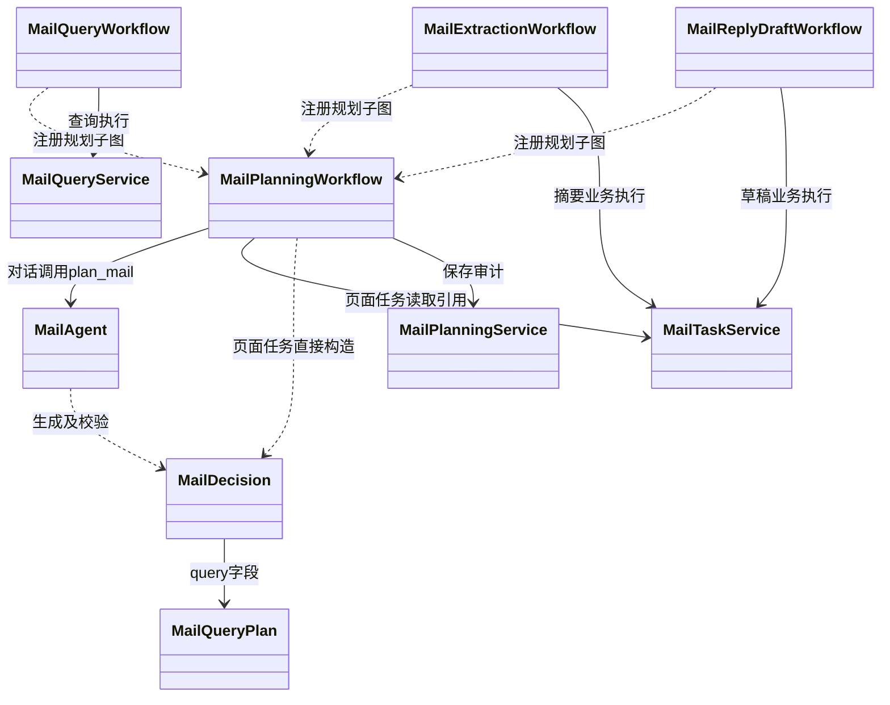

# Aegis Agent 工程化与结构化协作开发计划

> 目标：在已有 LangGraph、MCP、Redis、PostgreSQL、审批恢复、SSE 与 OpenTelemetry 的基础上，逐步建设可路由、可治理、可检索、可评测的 Agent 系统。本文是**后续实施计划**；除明确标注为“当前已具备”的内容外，均不代表已完成。

## 1. 总体原则

本项目不以堆叠框架或中间件为目的。每项技术必须解决明确问题，并有可演示的业务路径、测试和指标。

```text
用户任务 / 页面操作
  → 根图选择工作流
  → 领域 Agent 生成受限的结构化计划
  → Workflow 编排 Service / ToolGateway
  → MCP 工具或领域服务执行
  → 可信工具结果、业务引用与 SSE 事件
  → 前端卡片 / 审批页 / 最终回复
```

职责边界：

- **Agent / Graph**：理解任务、生成受限计划、选择子图、编排节点、暂停与恢复。
- **Service**：事务边界、业务状态迁移、上下文装配、审批与事件编排。
- **Repository**：SQL 与领域数据持久化。
- **ToolGateway**：工具白名单、参数校验、连接与 scope、租户隔离、工具调用审计。
- **MCP Server**：无状态地封装日历、邮件等外部系统能力。
- **策略层**：权限、外部写入、审批、敏感信息规则必须由代码决定，不能只相信 LLM。

禁止写入 LangGraph Checkpoint 的数据包括完整邮件正文、附件、OAuth 凭据、模型思维过程及未经脱敏的外部原始响应。

### 1.1 结构化契约的目录边界

`agent/contracts/` 按“跨领域公共模型 + 领域模型”组织，而不是按每个工具建立一个文件：

```text
agent/contracts/
├── common.py       # ToolResultSummary、ConversationArtifact、JSON 大小限制
├── calendar.py     # CalendarReadPlan、日历 Artifact 构造规则
├── mail.py         # 后续：MailQueryPlan、邮件 Artifact 构造规则
└── research.py     # 后续：ResearchQueryPlan、来源 Artifact 构造规则
```

`CalendarReadPlan` 是“日历时间范围读取”这一**工作流类别**的计划，不是某个工具的包装类。因此新增 `calendar.list_events_by_calendar` 一类同语义工具时，应扩展该计划的 action 与参数校验；`calendar.create_event` 等写操作、`calendar.list_calendars` 等输入结构明显不同的读取操作，则分别建立独立计划和工作流。所有领域共享 `ToolResultSummary` 与 `ConversationArtifact`，避免重复定义结果和卡片基础模型。

## 2. 当前基线

当前已具备：

- `TaskGraph`、日历与邮件领域工作流，以及 `run_id` 对应的 LangGraph Checkpoint 恢复；
- Calendar / Email MCP Server、统一 `ToolGateway`、工具连接和 scope 校验、工具调用审计；
- 任务状态、逐项审批、Redis 队列恢复、SSE 实时事件；
- Redis 短期队列、PostgreSQL 租户隔离与 RLS、长期记忆的基础业务接口；
- OpenTelemetry 基础接入和结构化日志；
- 日历、邮件领域 Agent，以及受限主决策 Agent 和结构化专家交接；领域内仍保留部分确定性参数解析规则。

当前主要缺口：

- 日历读取已经具备 `plan`、`tool_result`、`artifacts` 的首个实现；邮件等其他领域尚未迁移；
- 主对话邮件查询候选 Artifact 后端已完成，前端卡片与操作按钮待对接；
- 最小 Agent Harness、邮件起草受限 ReAct 和补充问答已实现；插件化策略 Hook、队列崩溃恢复等后置治理仍待增强；
- 受限主路由已初步接入，尚需候选能力筛选、路由评测与用量审计；多模型选择暂缓，不属于本轮阶段4验收；动态 Skills、Hybrid RAG 和量化评测体系仍未实现；
- 可观测性尚未形成 Trace、Metric、Log 联动看板。

## 3. 目标结构化状态契约

在保留既有稳定字段的基础上，逐步扩展 `TaskGraphState`：

```python
class TaskGraphState(TypedDict, total=False):
    # 身份与运行标识
    run_id: str
    tenant_id: str
    user_id: str
    conversation_id: str
    run_type: str

    # 路由与计划
    intent: str
    workflow: str
    main_decision: dict[str, Any]     # 经校验的主 Agent 决策：交接、澄清或普通回复
    handoff: dict[str, Any]           # 领域专家接收的任务要求和已核验业务引用
    plan: dict[str, Any]              # 经 Schema 校验、尚未执行的受限计划

    # 可信执行结果与前端可展示引用
    tool_result: dict[str, Any]       # 脱敏、大小受限的结果摘要
    artifacts: list[dict[str, Any]]   # 稳定业务对象 ID 与展示字段

    # 对话与输出
    history: list[dict[str, Any]]
    memory_context: str
    assistant_content: str
```

`plan` 描述“准备做什么”，并非事实。例如：

```json
{
  "domain": "calendar",
  "action": "read_events",
  "tool_name": "calendar.list_events",
  "arguments": {"start_at": "...", "end_at": "..."},
  "risk_level": "read"
}
```

`tool_result` 仅保存后续节点和最终回答所需的可信摘要。完整事实仍保存在 `tool_calls`、`run_events` 及各领域业务表中。`artifacts` 保存如 `email_id`、`draft_id`、`calendar_draft_id` 等稳定对象 ID 与脱敏卡片字段，不能保存完整正文。

### 3.1 日历读取的首个闭环：计划、事实与展示数据分离

日历读取已经作为首个实现，验证以下分层不是“多包装一层对象”，而是将不同用途的数据明确隔离：

```text
用户：“查看我明天的日程”
  ↓
CalendarAgent
  └─ 理解用户表达，提出候选工具调用
  ↓
CalendarReadPlan
  └─ 固化并校验“准备做什么”
  ↓
ToolGateway / Calendar MCP
  └─ 校验权限后取得“实际发生了什么”
  ↓
ToolResultSummary
  └─ 为后续图节点和 LLM 提供可信、安全摘要
  ↓
ConversationArtifact
  └─ 为前端卡片筛选最小展示字段
  ↓
PostgreSQL 持久化 + SSE artifacts_ready
  ↓
前端读取 Artifact 并渲染卡片；LLM 基于可信摘要生成自然语言回复
```

旧的简单调用链为：

```text
CalendarAgent → ToolInvocation → ToolGateway → Calendar MCP → LLM 回复
```

其中 `ToolInvocation` 仍是实际调用 ToolGateway 的内存对象；新增的 `CalendarReadPlan` 是可版本化、可校验、可进入 LangGraph State 的计划契约。例如：

```json
{
  "version": 1,
  "domain": "calendar",
  "action": "list_events",
  "tool_name": "calendar.list_events",
  "arguments": {"start_at": "...", "end_at": "..."},
  "risk_level": "read"
}
```

当前校验包括：只允许已声明的日历只读工具；`action` 必须与 `tool_name` 匹配；必须包含 `start_at`、`end_at`；参数及结果必须为大小受限的 JSON。通过后才会重建 `ToolInvocation` 并进入 ToolGateway。

| 数据 | 表示的含义 | 持久化位置 | 面向对象 |
| --- | --- | --- | --- |
| `CalendarReadPlan` | Agent 决定**准备做什么** | LangGraph Checkpoint / `TaskGraphState` | 工作流恢复、审计、后续专家交接 |
| `ToolResultSummary` | 工具调用后**可信且脱敏的结果摘要** | LangGraph Checkpoint / `TaskGraphState`；完整事实另存 `tool_calls` | 后续节点、LLM 回复 |
| `ConversationArtifact` | 前端**应展示什么卡片** | `conversation_message_artifacts` | 主对话卡片、历史会话恢复、短期指代 |
| 原始工具响应 | 外部服务返回的完整技术事实 | `tool_calls.response_payload` | 审计、排错；不直接展示 |

`ConversationArtifact` 当前仅包含日程标题、起止时间、时区与稳定外部标识等最小字段，不包含日程描述、参会人、OAuth 凭据或 MCP 原始响应。持久化后发布 `artifacts_ready` SSE 事件；事件只通知前端刷新，前端使用 `GET /conversations/{conversation_id}/artifacts?run_id={run_id}` 读取卡片数据，不从 SSE 或 LLM 文本中解析卡片。

### 3.2 会议安排中的可信候选与 LLM 草稿生成

日历可用时间不能由模型计算或补全。`calendar.find_free_time` 仍由 Calendar MCP Server 基于日程数据确定性地返回多个候选；Worker 将候选转换为带稳定 `slot_id` 的 `CalendarFreeTimeCandidate`，再调用 `CalendarAgent` 生成仅供确认的会议草稿：

```text
Calendar MCP available_slots
  → CalendarFreeTimeCandidate[]（代码生成 slot_id）
  → LLM 输出 CalendarMeetingDraftProposal（主题、描述、邮箱参会人、候选 ID、理由）
  → 校验 selected_slot_id / alternative_slot_ids 均属于候选集合，主题/描述长度及邮箱格式有效
  → calendar_event_drafts / approval_items
  → interrupt() 等待用户确认
```

`CalendarMeetingDraftProposal` 允许模型完善主题、描述和邮箱参会人，并选择 `selected_slot_id`、`alternative_slot_ids` 与推荐理由；模型不能构造候选集合外的时间。模型输出 JSON 无效、引用不存在的时段、无效邮箱或重复候选时，工作流停止在草稿创建前。确认项的冻结预览保存草稿、推荐理由和备选时段；用户仍可核对、批准或拒绝。外部 `calendar.create_event` 只在批准并恢复同一 `run_id` 后调用，绝不再次调用 LLM。

## 4. 分阶段路线图

### 阶段 0：建立可回归的基线（先完成）

**目的：** 后续引入 LLM 路由和多 Agent 时，能证明没有破坏已完成的审批、SSE 和 MCP 链路。

1. 整理日历、邮件、审批、恢复任务的端到端测试脚本和固定 Mock 数据。
2. 对每条关键链路记录 run 状态、SSE 事件顺序、工具调用审计和最终业务数据。
3. 补齐错误分类：参数错误、连接缺失、MCP 不可用、LLM 超时、审批拒绝、恢复失败。

**验收：** 可重复验证“查询日历”“创建会议并审批”“邮件摘要”“起草邮件并发送确认”四条链路；失败能得到稳定错误码和可追踪 `run_id`。

### 阶段 1：结构化计划、结果与 Artifact（优先）

**目的：** 让领域 Agent、子图、页面和后续多 Agent 通过受约束数据协作，而不是传递自由文本。

> **实现状态（2026-10-09）：** 已完成日历读取最小闭环：`CalendarReadPlan`、`ToolResultSummary`、`ConversationArtifact` Pydantic 契约；`TaskGraphState` 对应字段；`CalendarReadWorkflow` 的计划校验、工具结果摘要与 Artifact 构建；`conversation_message_artifacts` 迁移、持久化与 `GET /conversations/{conversation_id}/artifacts` 查询接口。邮件查询计划、跨消息指代解析和邮件 Artifact 留待阶段 2。

1. 为 `Plan`、`ToolResult`、`Artifact` 定义 Pydantic 模型和版本字段，初期支持 `CalendarReadPlan`、`MailQueryPlan`。
2. 在 `TaskGraphState` 加入 `plan`、`tool_result`、`artifacts`，在节点写入前进行字段白名单、脱敏和大小校验。
3. 将 `CalendarReadWorkflow` 迁移为：

   ```text
   CalendarPlanningWorkflow → CalendarAgent.plan_calendar → CalendarDecision
   → CalendarReadPlan（代码映射到白名单读取工具）
   → state.plan
   → 校验工具白名单与参数
   → CalendarToolExecutionService / ToolGateway
   → state.tool_result
   → 日历 Artifact
   → generate_reply
   ```

4. 新增 `conversation_message_artifacts` 表、迁移和 Repository，保存短期对话候选引用，支持“第一封邮件”“刚才那个会议”等指代。

**验收：** 日历查询能产生可审计计划、可信结果和卡片引用；Checkpoint 中不含敏感正文；越权、过期或歧义引用不会自动执行。

### 阶段 1.5：主决策 Agent 与领域专家交接（阶段 2 前完成）

**实现状态（2026-10-12）：** 已接入独立 `MainDecisionWorkflow` 子图。根图 `load_context → main_decision` 后根据子图返回的 workflow 分流；子图调用 MainAgent 推理并形成已核验 handoff。页面后台任务和审批恢复不重复调用主 Agent。主对话开放日历查看、空闲查询、会议安排和邮件卡片导航；邮件摘要、待办、起草由卡片／页面按钮触发，不能自然语言直达生成子图。邮件目标优先来自阶段2的当前会话候选卡片，无查询卡片时提供最近20条快照；草稿修改及多专家复合任务仍在后续阶段实施。

实现文件包括 `agent/contracts/decision.py`、`agent/specialists/main_agent.py`、`agent/workflows/main/decision_workflow.py`、`service/runtime/decision_context_service.py`、`repository/decision_repository.py`。原 DecisionService 已拆除，LLM 调用、能力校验、澄清分支和交接组装均在图层；Service 只读取业务引用、核验归属与版本、保存审计。领域工厂通过 `GraphRegistry.register_capability` 声明对话入口。主决策校验失败返回澄清，模型服务失败按现有 LLM 错误结束任务；未启用关键词兜底。决策记录复用 `run_events` 的 `main_decision_completed`，无需新增表或配置。主 Agent 与领域专家共用现有模型客户端；阶段4继续使用单模型，多模型选择暂缓，后续另行规划。

**目的：** 由主决策 Agent 理解用户请求、选择领域专家并生成结构化交接计划，让日历、邮件等专家能够接收清晰的任务要求及业务对象引用。第一版一次只交接给一个专家，先接入已经具备的领域能力。

职责划分：

| 组件 | 职责 | 建议位置 |
| --- | --- | --- |
| `MainAgent` | 调用 LLM，理解请求，输出交接、澄清或普通回复决定 | `agent/specialists/main_agent.py` |
| `MainDecision`、`ResourceReference`、`AgentHandoff` | 约束领域、意图、任务说明与对象 ID／版本 | `agent/contracts/decision.py` |
| `MainDecisionWorkflow` | 编排推理、能力校验、澄清、交接与审计节点 | `agent/workflows/main/decision_workflow.py` |
| `DecisionContextService` | 读取脱敏业务引用、核验归属及版本、持久化审计；不调用 LLM | `service/runtime/decision_context_service.py` |
| 根图及路由 | 保存已校验决定，通过条件边进入注册的领域子图 | `agent/graph/`、`agent/routing/` |
| `CalendarAgent`、`MailAgent` | 接收交接计划，生成领域内计划或草稿，解释可信工具结果 | `agent/specialists/` |
| Service／ToolGateway | 事务、权限、审批和工具执行 | 现有领域服务及工具层 |

1. **定义受限决策与交接契约。** `MainDecision` 包含 `version`、`decision`（`delegate / clarify / reply`）、`domain`、`intent`、`instruction`、可选 `target` 和 `clarification_question`。字段采用白名单及大小限制；按决策类型校验必填字段与互斥组合。意图按领域声明，不能使用任意字符串直接查找 Python 方法或图节点。
2. **从注册能力构造可选范围。** 向主 Agent 提供当前已注册且可用的领域意图、必要上下文及脱敏业务引用。先支持已有日历读取／会议安排与明确目标的邮件摘要／起草能力；未实现的邮件查询、草稿修改等动作不能被主 Agent 选中。后续能力接入后再扩展清单。
3. **实现主 Agent 推理节点。** 普通对话在 `load_context` 后调用 `MainAgent`，输出 JSON 并经 Pydantic 校验。校验后的决定写入 `state.main_decision`；核验后的领域交接写入 `state.handoff`。领域子图读取交接要求和目标引用，再生成自己的 `state.plan`；主 Agent 不负责填写任意工具名、SQL 或批准标记。

   当前主决策子图为：

   ```text
   load_decision_context（Service 读取引用）
     → infer_main_decision（MainAgent 调用 LLM）
     → validate_decision_capability
          ├─ 需要目标 → validate_decision_target（Service 核验归属与版本）
          └─ 无目标或已转澄清 → 跳过目标核验
     → assemble_agent_handoff
     → record_decision_audit（Service 保存事件）
   ```

   候选列表、校验结果与耗时保存在子图局部状态；根图只共享 main_decision、handoff、intent、workflow 等稳定协议字段。非法模型输出或目标转为澄清；模型故障先登记失败审计再交由任务生命周期结束任务。
4. **实现目标引用解析与核验。** “刚才的会议”“第一封邮件”等指代只能关联服务端提供的可访问对象；目标引用包含 `resource_type`、`id` 和可选 `version`。通过 Service／Repository 查询归属和最新状态。候选有歧义、目标过期或版本变化时进入澄清，不自动猜测或执行。前端明确传入的目标也须同样核验。
5. **接入根图条件路由。** 页面指定且已经完成业务参数校验的任务继续进入对应子图。普通对话由主 Agent 决策，根图只根据已核验的领域意图映射路由。第一版复用现有注册表及领域工厂，交接通过 State 和子图完成，无需新增专家进程。

   ```text
   START → select_run_workflow
     ├─ 页面指定任务 → 对应领域子图
     └─ 普通对话 → load_context → MainAgent → 决策／目标校验
                                              ├─ calendar → 日历专家子图
                                              ├─ mail → 邮件专家子图
                                              ├─ clarify → 返回澄清问题
                                              └─ reply → generate_reply
   ```

6. **处理失败和执行边界。** 模型超时、非法 JSON、未知意图或不存在的专家均不能产生工具调用。只允许明确且匹配已有能力的确定性规则作为兜底，其余情况返回澄清或可重试错误。权限、连接、scope、外部写入和人工审批仍由代码策略执行；主 Agent 决策不能替代这些检查。
7. **记录并验证交接。** 保存脱敏决策摘要、能力清单版本、目标引用、模型信息、耗时与 Trace 关联，不保存模型思维过程。测试覆盖明确任务、自然表达、歧义指代、非法输出、过期版本、越权目标及页面任务直达；继续回归现有审批与恢复链路。

**实例：** 用户说“把刚才的总结会议改到明天下午，仍然开 50 分钟”。当“修改会议草稿”能力已接入且只有一个明确草稿目标时，主 Agent 生成：

```json
{
  "version": 1,
  "decision": "delegate",
  "domain": "calendar",
  "intent": "revise_meeting_draft",
  "instruction": "将会议移到明天下午，保持50分钟及原有主题",
  "target": {
    "resource_type": "calendar_draft",
    "id": "11111111-1111-4111-8111-111111111111",
    "version": 1
  }
}
```

该示例是后续能力扩展目标，当前尚未实现草稿修改链路。只有注册了对应能力后，才允许此意图。目标核验通过后，日历专家决定查询空闲候选、生成修改计划，Service 保存新版草稿并使旧确认项失效，等待用户重新确认。若存在多个可能草稿，则返回 `clarify`；不能恢复旧批准分支直接执行新内容。

**验收：** 普通对话可通过受限 LLM 决策进入现有日历或邮件专家流程；专家能读取结构化交接要求。页面指定任务不额外经过主模型分类。未知能力、歧义目标和非法输出不会执行工具；主 Agent 无法绕过权限与审批。多领域拆解、并行、循环调用和结果汇总留至阶段 8。

### 阶段 1.6：CalendarAgent 受控 LLM 规划（阶段 1.5 后完成）

**实现状态（2026-10-12）：** 已实现受控日历规划链路。CalendarReadWorkflow 和 CalendarConfirmationWorkflow 均先调用 CalendarPlanningWorkflow；CalendarAgent.plan_calendar 调用 LLM 生成 CalendarDecision，代码校验后映射到白名单读取工具。旧同步 plan_read／plan_meeting 仅保留兼容入口，正式工作流不再调用。正则仅用于核验原始输入中的明确日期时间、数字分钟时长和邮箱，不再承担工作流选择。

已支持 explicit_interval 的确定性冲突检查和非工作时段提示；自动推荐仍由 MCP 工作时段计算。明确时间或时长不符合原文、无效计划和读取升级写入均不会进入工具执行。无模型配置时受控失败，不默认取首个时段。领域审计复用 calendar_plan_completed 事件；无需新增配置或迁移。当前冲突检查仍是 Mock 当前用户日历，不能保证双方日历都已查询。模型理解自然语言的准确率仍需后续真实模型评测。

规划输出无效时允许一次受限修复（最多两次规划模型调用），每次均重新验证相同约束；连续失败才返回提示。日志与领域审计只记录字段路径、错误类型和稳定约束代码，不保存原始模型响应；明确日期时间、时长及范围校验不能因修复而放宽。

**职责：** MainAgent 选择日历专家并提供任务要求、必要上下文和可信目标引用；CalendarAgent 理解日历领域参数并提出受限动作；Workflow 校验计划、选择分支并编排执行；Service 负责业务核验与持久化；Calendar MCP 确定性查询和计算日历事实。领域专家不得扩大主 Agent 已核验的任务范围，例如读取任务不能升级为创建会议。

1. **定义 CalendarDecision。** 在 `agent/contracts/calendar.py` 中增加领域规划契约，带 version；允许 `list_events / find_free_time / prepare_meeting / clarify`。字段包括时间范围、时区、会议时长、主题、邮箱参会人、偏好、澄清问题。采用按动作区分的 Schema 或等效的严格字段组合校验；拒绝额外字段、未知动作、反向时间范围、超长范围、非法时区、时长、邮箱或文本长度。该契约是专家的领域决策，现有 CalendarReadPlan 仍作为工具执行计划使用，二者不重复定义同一职责。
2. **明确时间请求语义。** 使用 `time_mode=explicit_interval / search_window`：
   - explicit_interval：用户明确指定起止时段，检查整个请求时段的日程冲突；不按工作时间裁掉请求。非工作时段可生成明确提示，冲突时澄清或请求重新选择，不静默改期。
   - search_window：用户仅给出日期范围或“明天下午”等搜索窗口，按工作时间和忙碌日程生成多个可信候选，随后推荐。
   - 未注明时区默认北京时间；明确的 Z／偏移量按原标记换算。用户同时给出起止时间和不一致的会议时长时进入澄清，不能自行取舍。当前时间由服务端注入，模型不自行猜测“今天”。
3. **增加日历规划子图／节点。** 建议新增 `agent/workflows/calendar/planning_workflow.py`，供读取与会议确认工作流复用；它调用 CalendarAgent 的异步规划方法并校验 CalendarDecision，写入 `calendar_decision`。推理与分支在 Agent／Workflow 中，Service 不调用 LLM。提供原始用户要求、主 Agent handoff、当前时间、时区和允许动作；不提供数据库凭据或完整原始外部响应。
4. **以受控 action 映射执行能力。** 将 list_events／find_free_time 决策转为已有 CalendarReadPlan，再转换为 ToolInvocation 交给 CalendarToolExecutionService／ToolGateway；prepare_meeting 进入查询候选、生成草稿、逐项审批流程；clarify 直接返回问题。工具名称与参数映射由代码固定，模型不能输出任意工具名或自行调用 calendar.create_event。
5. **补齐指定时段的确定性冲突检查。** 初期可用现有 calendar.list_events 查询请求范围，按半开区间重叠规则在业务服务中验证冲突；没有冲突时由代码构造绑定该范围的可信候选供草稿流程使用。不得让 LLM 宣称时间无冲突，也不得复用当前只返回工作时间候选的 find_free_time 来判断凌晨的指定会议。自动推荐仍使用 calendar.find_free_time。
6. **保留事实候选与草稿两阶段处理。** 初始 CalendarDecision 只描述准备做什么；取得 MCP 事实后，CalendarMeetingDraftProposal 才选择可信候选并完善主题、描述、参会人和理由。用户要求与初始计划中的时长、明确时段等硬约束仍由代码复核；最终外部写入只读取用户确认后的草稿版本，不再调用模型。
7. **逐步切换并验证。** 先接入日程读取与空闲查询，再接入会议安排；确定性日期、邮箱等解析可作为辅助校验，逐步退出关键词主决策。模型输出无效时返回澄清，模型不可用时返回受控失败，不静默退回未来七天或默认第一个候选。记录领域决策版本、动作、模型、耗时及校验结果，不保存模型思维过程。

调用关系：

```text
MainDecisionWorkflow → 日历 handoff
  → CalendarPlanningWorkflow → CalendarAgent 调用 LLM
  → CalendarDecision 校验及任务范围复核
      ├─ list_events → CalendarReadPlan → 日程工具 → Artifact
      ├─ find_free_time → CalendarReadPlan → 空闲工具 → Artifact
      ├─ prepare_meeting
      │    ├─ explicit_interval → 查询日程 → 确定性冲突检查
      │    └─ search_window → 查询工作时间内的可信空闲候选
      │  → LLM 完善草稿 → 校验硬约束 → 保存 → interrupt → 批准后写入
      └─ clarify → 返回澄清问题
```

**示例：** 用户要求“明天下午安排 50 分钟总结会议”，在服务端当前时间为北京时间 2026-10-12 时，专家可提出以下计划：

```json
{
  "version": 1,
  "action": "prepare_meeting",
  "time_mode": "search_window",
  "timezone": "Asia/Shanghai",
  "start_at": "2026-10-13T12:00:00+08:00",
  "end_at": "2026-10-13T18:00:00+08:00",
  "duration_minutes": 50,
  "title": "总结会议",
  "attendees": [],
  "preferences": "下午"
}
```

若用户改为“2026-10-15 03:00～03:50安排会议”，则使用 explicit_interval，按北京时间凌晨三点检查冲突，不能换算成上午十一点或因工作时间限制直接判定没有空闲。

**MCP 提示词约定：** 领域规划 Prompt 位于 CalendarAgent；MCP Server 提供清晰的工具说明与参数 Schema。当前不需要 MCP Prompts，只有多个调用方需要共用模板时再引入。

**验收：** 非关键词表达可由 LLM 生成可校验计划；日期、时区、明确时段、时长与参会人经过代码校验；任务越界、未知动作、非法字段、冲突和歧义均不会直接执行外部写入。测试覆盖普通查询、跨日／偏移时间、凌晨指定时段、时间冲突、时长不一致、读取升级写入、模型故障及审批恢复。第一版一次只生成一个领域计划，有限 ReAct 循环和多次重规划在后续扩展。

### 阶段 2：主对话邮件查询与统一领域子图

**统一领域规划补充（2026-10-12）：** 查询、摘要和起草入口共享 MailDecision／MailPlanningWorkflow。当前产品交互收敛为两种卡片：主对话浏览、笼统摘要请求展示列表；完整主题或有效序号定位唯一邮件后展示单封操作卡片。普通对话仅开放 query／clarify，不直接生成摘要、待办或回复。摘要／起草子图只供卡片或页面按钮创建的明确后台任务使用，代码阻断自然语言直达生成。主模型提出旧 extract／draft_reply 意图时也转换为卡片导航。

query 可携带已核验 target，或以 MailQueryPlan.subject_equals 精确匹配完整主题；候选 Artifact.display_mode 为 list／single。目标不唯一时返回候选列表，不擅自选取一封。生成仍须用户点击卡片按钮调用已有业务接口。统一契约保留后台 extract／draft_reply，发送继续由审批工作流控制。

MailPlanningService 只保存 mail_plan_completed 审计，不进行推理；MailTaskService 只提供页面任务可信引用。MailDecision 写入 State.mail_decision，后续 Workflow 才预检、读取或生成内容。非法计划和澄清均阻止工具执行；后台参数错误按任务失败处理，不能伪装成成功。旧 MailAgent.plan_query 为兼容入口，正式图不调用。

统一后的核心类关系：



**实现状态（2026-10-12）：** 已完成后端最小链路。新增 MailQueryPlan、MailQueryWorkflow、MailQueryService、MailQueryRepository，领域工厂注册 query_mail 意图。MainAgent 交接后由 MailAgent 使用 LLM 提取查询条件，代码确定性筛选现有 mail.messages.list 返回的元数据；暂不新增 search 工具。共用 email_messages 快照唯一键、权限和来源版本失效规则，候选保存到已有 Artifact 表。正式模型和 PostgreSQL／Redis／MCP 端到端联调仍需在部署环境完成。

通知统一使用 artifacts_ready + GET /conversations/{conversation_id}/artifacts，类型为 mail_candidates；不单独发送 mail_candidates_ready。查询成功为空也保存空 Artifact；失败不伪装成空成功。候选按接收时间倒序，默认最多10条、上限20条，并受字节预算限制，截断显式标记。主 Agent 后续指代优先读取当前会话最新卡片并核验归属与来源版本，空或过期候选不回退替换目标。前端渲染及按钮对接见第01期-接口设计.md的3.3步骤1.2。

**目的：** 让邮件管理页面和主对话框复用同一领域能力。

1. 新增 `MailQueryWorkflow`：

   ```text
   用户：“找本周续约邮件”
   → MailPlanningWorkflow → MailAgent.plan_mail → MailDecision.query（MailQueryPlan）
   → ToolGateway 调用 mail.messages.list，服务端按计划筛选元数据
   → 邮件候选 Artifact
   → 持久化 conversation_message_artifacts
   → SSE: artifacts_ready，前端 GET artifacts
   → 主助手回复并由前端渲染邮件卡片
   ```

2. 卡片操作继续调用现有后端 API（查看、摘要、加入待办草稿、起草回复），前端不得直连 Email MCP Server。
3. 统一领域子图协议：

   | 子图 | 输入 | 输出 |
   | --- | --- | --- |
   | `CalendarReadWorkflow` | `CalendarReadPlan` | 日程 / 空闲时间 Artifact |
   | `CalendarConfirmationWorkflow` | 会议计划或草稿 ID | 审批 / 事件 Artifact |
   | `MailQueryWorkflow` | `MailQueryPlan` | 邮件候选 Artifact |
   | `MailExtractionWorkflow` | 明确 `email_id` | 摘要与待办候选引用 |
   | `MailReplyDraftWorkflow` | 明确 `email_id` | `draft_id` Artifact |

**验收：** 对话中查询邮件与页面中查询邮件结果一致；用户点击候选卡片可进入已有流程，不能通过客户端伪造 Artifact 访问他人邮件。

### 阶段 3：最小 Agent Harness、受限 ReAct 与草稿完善

**实现状态（2026-10-13）：** 已实现阶段3的最小产品链路：HarnessExecutor／GuardedLLMClient 统一模型与工具预算；严格工具参数契约；MailCollectionWorkflow 的有界只读 ReAct；独立用户补充请求、检查点就绪通知和同一 run 恢复；MailRevisionWorkflow 正文修改及版本保护；前端补充表单和草稿 AI 修改入口。新增迁移008_agent_harness，必须部署后才能启动新版 Worker。测试使用模拟模型、数据库和内存 Checkpointer；正式模型与 PostgreSQL／Redis／MCP 的部署端到端联调仍需进行。

实际组件及边界：

| 内容 | 实现 |
| --- | --- |
| 执行约束 | harness/policy.py、context.py、executor.py；预算及审计SQL在 repository/execution_repository.py，模型包装在 llm/guarded_client.py |
| 参数 Schema | tool/argument_schemas.py；默认工具严格校验，自定义工具在生产 Harness 中必须声明 Schema |
| 预算／调用记录 | run_execution_budgets、run_execution_attempts；原子预占次数，计数跨恢复保留，记录风险模式标签，不保存 Prompt |
| 信息收集 | agent/workflows/mail/collection_workflow.py；MailAgent.collect_information 决策，Service执行只读工具与审计 |
| 用户补充 | run_input_requests；input_required；独立 resume_input_id 队列字段，与审批恢复互斥 |
| 草稿修改 | mail_draft_revision_requests；mail_draft_revision 任务；更新只含 body、version、updated_at |
| 前端 | RunInputPanel；邮件卡片及邮件管理显示补充问题；草稿窗口“保存并按要求修改” |
| 后置治理 | 只读有限重试、脱敏尝试记录和 Redis dead-letter 失败标识已接入；Redis Streams及进程崩溃后的可靠队列回收仍为后续增强 |

实际默认值为每 run 最多10次模型调用、6次工具尝试、120秒活跃时间，单次模型最多60秒、工具最多20秒；ReAct最多5轮。相较原建议3轮／4工具，增加额度用于“相关邮件列表 → 读取历史邮件 → 日历查询 → 询问用户 → 生成”样例，同时给恢复后的事实核验、最终原邮件读取和正文生成保留预算。等待用户时间不计入活跃时间，问题24小时过期；当前通过查询输入接口按当前用户惰性处理过期，并发布终态事件。

用户回答后，会重新读取直接依赖的历史邮件和日历结果，对比结果哈希；发生变化时返回 `COLLECTED_SOURCE_CHANGED`，不使用旧事实生成草稿。核验同样占用工具预算，多次提问可能耗尽预算，必须重新发起任务。SQLAlchemy 已隐藏绑定参数，避免数据库异常日志泄露邮件正文和补充回答。

2026-10-13已完成Harness职责拆分：`harness/policy.py`定义策略，`context.py`维护协程上下文，
`executor.py`负责预算／超时／审计编排，`exceptions.py`提供错误；SQL集中于
`repository/execution_repository.py`，模型包装迁至`llm/guarded_client.py`。
`InputRequestService`保留在service层管理业务暂停／恢复，JSON修复仍由Agent负责。
旧集中实现文件已移除，接口、预算及数据库表保持不变。详见[Harness说明](../../src/aegis_agent_worker/harness/README.md)。

邮件收集决定、摘要、起草及正文修改已启用供应商 JSON mode，再由原有 Schema 校验字段及动作。非 JSON、空响应或业务字段非法时最多修复一次，修复不放宽工具范围／参数约束，且继续占用累计模型预算；网络或预算错误不触发格式修复。连续失败使用 `MODEL_OUTPUT_INVALID` 结束 run 并发布 `run_failed`，不默认调用工具或生成草稿，也不把非法模型输出及含敏感值的校验异常写入日志或修复提示词。

检查点就绪处理：嵌套子图 interrupt 时父图尚未收到子图 State 更新，Orchestrator 从 __interrupt__ 的问题载荷取 question_id；只有 ainvoke 已返回、检查点写入完成后，才将问题 ready=true 并发布 input_required。回答接口在 ready=false 时拒绝；重复回答安全幂等，已消费问题不再次恢复。

**实施顺序：** 先完成3.1的最小 Harness，再开放3.2的只读 ReAct；3.3补齐询问用户和恢复，3.4实现已保存草稿的 AI 修改。3.5可靠队列等治理增强可后置，不作为首版 ReAct 的全部前提。每一步单独验收，避免先让模型自主循环再补执行约束。

**产品边界：** 保持阶段2确定的卡片交互。主对话只浏览／定位邮件卡片；用户点击“起草回复”，或在草稿窗口提交补充要求，才启动相应后台任务。ReAct 不开放自然语言自动发送，也不改变现有发送审批流程。

#### 3.1 最小 Harness：统一执行约束（先完成）

目标是将现有固定流程和未来循环共同需要的约束放到统一执行入口，避免在每个领域 Service 重复实现。先采用显式策略函数和小型管线，不引入庞大的插件框架。

1. **定义代码控制的任务策略。** 增加版本化 TaskExecutionPolicy，声明允许工具、模型轮次、工具尝试次数、上下文大小、执行时限和重试范围。策略依据可信 run_type 与用户入口选择，不接受 LLM 修改预算、连接、身份或审批标记。查询和起草使用不同策略；信息收集阶段只允许读取。
2. **统一工具输入校验。** ToolDefinition／注册关系关联参数 Schema，Gateway 对所有调用校验，不能只依赖领域 Agent 或 MCP 校验。保留“是否注册、任务工具范围、租户、用户、连接、scope、风险”检查；未知参数和任意工具名拒绝执行。连接和身份由服务端注入，不能由模型参数覆盖。
3. **引入可恢复的预算。** 图层每次调用模型、工具层每次实际尝试前，通过业务服务预占本 run 的预算；模型格式修复与工具重试也计数。计数需持久化并可原子更新，防止多个 Worker 或恢复后重置；可新增预算表／字段及迁移。Checkpoint 保存必要引用和执行状态，不能成为模型可修改的预算权威。
4. **统一执行与结果处理。** 在现有 ToolGateway 和 Service／Repository 基础上统一成功、失败、步骤与事件，不让通用工具层直接堆入 SQL。工具网络调用在数据库事务结束后发生，结果／审计／步骤在短事务中保存；事件提交后发布。限制输入输出大小，工具结果使用明确字段白名单和来源标签，完整正文仅在受控节点局部使用。
5. **明确重试与幂等。** 首版只对明确可重试的只读网络失败允许有限重试；参数、权限和来源错误不重试。写入保持原有审批、冻结版本、参数哈希及幂等键；不能只凭 allow_confirmed_write 布尔值代替业务层审批核验。模型重复决策和队列重复投递不能重复发送邮件或创建日历。
6. **保护上下文边界。** 邮件正文、工具响应、记忆均作为业务数据，不能改变工具白名单、执行预算或审批策略。输入检测规则用于标记风险，不承诺关键词检测能完全防住 Prompt Injection；最终执行边界必须由代码校验。

建议首版可配置上限（开发默认值，需根据延迟测试调整）：

| 项目 | 建议上限／规则 |
| --- | --- |
| ReAct 信息收集决策轮次 | 当前实现5轮；无效收集决定受控失败，不自动无限修复 |
| 工具尝试次数 | 当前实现6次；重试也占用次数 |
| 只读调用重试 | 每次逻辑调用最多1次，仍须满足总尝试预算 |
| 活跃执行时限 | 信息收集总计120秒，并设置单次模型／工具超时 |
| 结构化 State／Artifact 大小 | 复用现有 JSON 字节限制，按结果数量和字段裁剪 |
| 等待用户输入 | 单独设置等待期限；不计入活跃执行耗时 |

模型内容生成也须计入总请求／耗时预算，但与信息收集轮次分别记录，避免收集结束后没有生成草稿的预算。首版可先限制字符／字节和请求次数；以后客户端提供真实 usage 时再加入 Token／成本预算，不能把字符数冒充实际 Token 消耗。跨进程恢复保存累计活跃耗时，不能直接跨重启复用 monotonic 时间值。

```text
调用前：Schema → 任务工具范围 → 身份／连接／scope → 写入审批 → 原子预占预算
调用中：执行时限 → 有限重试
调用后：来源与响应校验 → 安全摘要 → 步骤／审计持久化 → 提交后发布事件
```

**验收：** 原有日历、邮件链路通过回归；越权工具、伪造身份、非法参数、预算耗尽均在外部调用前阻断。重试计数正确、恢复不重置预算；工具异常没有遗留 running 步骤；批准与幂等不能被模型绕过。

#### 3.2 邮件起草的只读受限 ReAct（3.1验收后）

先在用户点击“起草回复”后的 MailReplyDraftWorkflow 中增加“信息收集子图”，保留当前固定起草路径用于简单请求。第一版不扩展主 Agent 的自主循环，也不引入独立专家进程。

1. 定义 ReActDecision，允许 call_tool、ask_user、generate_draft、finish_unavailable。按决定类型校验必填与互斥字段；call_tool 只能指向策略声明的只读能力，generate_draft 仅表示准备起草，不能表示发送。只保存动作、参数、简短业务说明和结果引用，不保存模型思维过程。
2. 由 MailAgent 的信息收集方法根据用户要求、原邮件必要信息、已知事实和结果摘要决定下一步。Workflow 负责循环和条件边，Service 执行业务及工具调用，Repository 持久化。阶段1.5的主 Agent 仍只负责入口导航和交接。
3. 首个跨工具样例是“回复客户续约邮件，并结合上次沟通内容和下周可用时间”：允许读取相关邮件及查询日历；模型生成受限查询参数，代码校验连接与范围，工具执行后将可信结果摘要写回 State。复用 mail.messages.list／get、calendar.list_events／find_free_time，不因“上次沟通”就默认引入向量库。
4. 区分工具事实与用户决定：历史沟通和日历空闲可尝试查询；续约价格、对客户的承诺、用户愿意接受的时间等，无可信来源时必须询问，不能编造。只有当前用户 Mock 日历时，不能声称已验证双方空闲。
5. 达到轮次／尝试／耗时预算时终止收集，返回明确缺失信息。字段不可验证、连接不可用或关键事实缺失时，不生成含虚构承诺的草稿。不得无限循环或静默扩大查询范围。
6. 信息充分后调用既有草稿生成方法，验证收件人、主题、正文等字段并保存站内草稿。完整邮件正文在节点局部读取；State 只保留必要摘要、来源和业务引用。不同来源结果须明确标识，不能把模型计划当成工具事实。

```text
读取起草任务及原邮件
  → 信息收集决策
      ├─ call_tool → Harness校验及执行 → 保存安全结果 → 回到决策
      ├─ ask_user → 3.3暂停与补充（该能力未接入前返回缺失信息并结束本次处理）
      ├─ generate_draft → LLM起草 → 校验 → 保存 → 通知用户核对
      └─ finish_unavailable／预算耗尽 → 明确结束
```

**验收：** 简单起草不做无必要查询；复杂要求可读取相关邮件、查询日历并根据真实结果起草；工具调用受到3.1限制。恶意邮件要求调用发送工具时被拒绝；所有结果有来源；重复决策、不可用工具和预算耗尽可追踪。3.3未完成前，ask_user 不宣称已具备可恢复问答，可用 INPUT_REQUIRED 错误结束并返回缺失信息，让页面补充要求重新发起任务；没有生成 draft_id 时不得发布“草稿已保存”的完成事件。

#### 3.3 用户补充信息、暂停与恢复

这是信息收集中的用户问答，不是“批准外部写入”。不能将用户回答塞入现有 approval_decision 或让回答字符串被解释为 approved。

1. 持久化 InputRequest，包含 run_id、目标邮件／草稿引用、question_id、需要的信息、结构化回答 Schema、状态、有效期和版本。问题必须围绕当前任务，不能要求用户提交密码、Token 等工具凭据。
2. 增加独立 waiting_input 任务状态及必要迁移、主后端查询／提交回答接口、Redis 输入恢复消息类型和 Worker 领取逻辑；不能只增加 SSE 而不补数据库状态约束和接口。
3. LangGraph 通过专门输入节点 interrupt()，沿用 thread_id=run_id 与 PostgreSQL Checkpointer。输入请求、业务状态和持久事件需具备明确提交顺序；只有 checkpoint 已就绪时接受恢复，避免接口比暂停点更早提交回答。
4. SSE 发布 input_required，携带问题引用及安全展示信息。前端在起草任务／草稿窗口显示补充表单，而非要求用户在主聊天里直接执行邮件业务。断线后从主后端加载权威问题记录，不能只依赖 Pub/Sub。
5. 用户提交 question_id、expected_version、结构化回答和幂等标识；后端核验登录用户、租户、目标、问题状态及期限，事务提交后投递类型明确的 Redis 恢复消息。Worker 恢复同一 run，校验回答后继续收集或起草。重复回答只恢复一次，取消、过期或旧版本不能恢复。
6. 恢复时继续使用累计预算，重新核验连接、邮件来源版本和草稿版本；来源已变更时要求重新确认或结束，不使用旧事实继续执行。记录用户输入来源，不能把回答提升为工具调用授权或发送批准。

**验收：** 价格缺失可暂停，用户补充后同一 run 恢复；断线和 Worker 重启不丢问题；回答不能越权、重复恢复或绕过审批。取消、过期、版本冲突和预算耗尽均有明确终态与提示。

#### 3.4 已保存邮件草稿的 AI 修改

“把语气改正式一点”通常是一次受限草稿修改，不默认进入 ReAct 循环；只有补充要求确实需要外部信息时，才按任务策略启用3.2的信息收集。

1. 在草稿编辑窗口增加补充要求输入框和“按要求修改”按钮。先保存当前手工编辑，取得最新 version，再提交 AI 修改，避免模型基于旧内容覆盖尚未保存的编辑。
2. 规划新增 POST /mail/drafts/{draft_id}/revision-requests，提交 expected_version、instruction 和幂等标识；返回 run_id／events_url。主后端创建明确的草稿修改任务，Worker 读取当前草稿及原邮件必要上下文。新增 run_type 与对应请求存储／迁移，不依靠普通聊天猜测草稿对象。
3. 第一版只允许修改正文；收件人、抄送、主题由代码保留。后续开放主题等字段时，使用服务端可修改字段清单并展示差异。模型不得自行添加收件人、发送账户或发送动作。
4. 生成完成后再次核验版本和状态，在短事务内保存同一 draft_id 的新版本，并通过完成事件通知前端重新加载。版本变化时返回冲突，不覆盖用户最新编辑；模型失败时旧草稿完整保留。
5. 首版仅允许 draft 状态修改。待审批草稿须先有撤销／失效旧确认项的业务流程，才能编辑并重新提交确认；已在发送执行或已发送的草稿不允许原地修改。发送始终依据最终确认的冻结版本。

**验收：** 草稿v1根据补充要求变为v2，正文改变而其他字段保持；重复提交不重复修改，版本冲突不覆盖，失败不丢原文。用户核对新版本后才可重新提交发送确认。

#### 3.5 后置治理增强

- 根据实际失败场景完善只读重试、错误分类、取消与恢复策略。
- 保留并验证外部写入的稳定幂等键、审批人与参数哈希，任何重试都须重新核验批准范围。
- 规划失败重试和死信记录；在现有 Redis List 稳定后再评估 Redis Streams 消费组，不作为3.2的前置技术。
- 完善统一 Trace／日志／调用成本与故障看板，避免为了“完整 Harness”阻塞最小产品链路。

**阶段3总体验收：** 卡片点击起草 → 有界只读收集 → 缺信息时暂停并补充 → 生成待核对草稿 → 按补充要求修改新版 → 用户另行提交发送确认。全过程遵守当前卡片入口约定，不能通过自然语言、模型工具选择或用户补充回答绕过正式审批。

部署验证：主后端执行 python -m alembic upgrade head（本次只编写及离线生成迁移SQL，未替用户执行数据库DDL），重启API和Worker，刷新前端。先验证简单起草，再在卡片补充要求中输入“参考上次沟通并结合下周可用时间”；缺价格时应显示补充表单。草稿修改仅限 draft 状态；待审批版本需先失效审批的编辑流程，当前不允许 AI 直接修改 pending_approval／发送执行中／已发送草稿。

### 阶段 4：主决策路由增强（模型选择暂缓）

**状态（2026-10-13）：** 以下是待实施计划，不代表阶段4已完成。已有阶段1.5的主决策子图、
能力与目标校验、交接和路由审计；本阶段在这些实现上增强，不再建立第二套主决策Agent或契约。

**范围：** 暂不实现“简单任务用低成本模型、复杂任务用主模型”。主Agent、领域专家、正文生成
继续共用现有模型配置与GuardedLLMClient，不新增ModelSelector、模型自动切换或成本驱动路由。
Token用量记录不等于多模型选择；没有可靠价格配置时不生成金额估算。

**目标：** 稳定理解自然语言、限制候选能力、准确处理指代与歧义，使路由结果可测试、可追踪。
权限、外部写入及审批仍由代码决定。页面明确任务和审批／补充回答恢复继续直达原工作流，
不重新让主Agent分类；对话邮件仍只展示卡片，不直接摘要、起草或发送。

#### 4.1 固定基线与双入口行为

**实现状态（2026-10-13）：** 已完成生产路由梳理、旧路径清理和15项根图双入口／恢复基线测试，
详见[主决策路由与双入口回归基线](06-主决策路由与双入口回归基线.md)。真实工厂能力目录已通过测试锁定；
旧TaskGraphRouter／IntentRouter／WorkflowRouter链及其无用构造参数已移除；
无调用的RiskRouter／ApprovalRouter预留实现也已移除。实际审批逻辑不受影响。
附有最小手工端到端复测步骤，尚未替用户运行真实服务联调；阶段4.2～4.6未因此完成。

1. 梳理MainAgent、MainDecisionWorkflow、GraphRegistry、TaskGraphRouter与WorkflowRouter的实际调用。
   标明生产路由和旧兼容路径，不能同时维护两份领域／意图到工作流映射。
2. 以领域工厂注册的ConversationCapability为唯一对话能力目录，复用MainDecision／AgentHandoff。
3. 固定回归用例：普通回复、日历查询、空闲查询、会议草稿与审批、邮件列表／精确主题／序号卡片、
   页面摘要起草发送确认、补充问答恢复。跨领域复合任务目前澄清，不在此阶段引入任务分解或多Agent并行。
4. 保存现有测试结果与最小端到端步骤，后续改动不能让明确页面任务误入主决策。

**产物与验收：** 路由入口清单及回归测试；保持现有run_type、thread_id=run_id和审批边界不变。

#### 4.2 保守的候选能力筛选

**实现状态（2026-10-13）：** 已增加`agent/routing/capability_selector.py`，
MainDecisionWorkflow在加载核验引用后执行`select_candidate_capabilities`节点。
模型仅收到候选目录，后续同时验证注册目录和候选集合；筛选结果只新增能力标识、原因码与策略版本。
使用`capability-selector-v1`：只有完整匹配的简单浏览表达收敛单领域，并保留该领域全部意图；
其他单领域复杂表达、指代、无信号或跨领域表达一律保留完整目录。候选意外为空则恢复真实目录；
真实注册目录为空则直接澄清、不调用模型。范围外决定产生`outside_candidate_set`澄清，不能交接。
筛选不读SQL、不查连接scope、不调用工具；领域授权预检不变。
现有main_decision_completed审计新增`candidate_capabilities`、`filter_reason_codes`、`route_policy_version`，
复用事件JSON，无新增迁移；23项新增测试与既有基线合计160项通过，真实模型端到端仍待复测。

1. 在agent/routing/增加CapabilitySelector，输入可信能力目录、用户任务和已核验上下文，
   输出候选能力及稳定筛选原因；不调用工具、不做SQL、不决定权限。
2. 注册能力是硬白名单，领域信号／关键词只作为软筛选线索，不重新用关键词决定最终意图。
   “那封邮件”“换个时间”等依赖上下文的表达须保留相应领域；模糊、无信号或多领域时保留全部相关注册能力。
3. 不允许因没命中关键词就排除正确能力；不根据模型文本增加目录外能力。
   连接不可用不等于能力不存在，仍由领域预检返回连接／授权提示，避免误路由成普通闲聊。
4. MainDecisionWorkflow先生成候选目录，只将候选传给MainAgent；后续同时检查其属于候选集与注册目录。
   State／审计只保存候选标识和筛选原因，不保存新的全文副本。

**验收：** 已注册能力不能被模型扩增；歧义与指代样例的正确领域不被软规则排除，
筛选为空时进入安全澄清或保守恢复注册目录，不能直接执行外部工具。

#### 4.3 主决策结构化输出与有界修复

**实现状态（2026-10-13）：** MainAgent已接入complete_json，生产通过GuardedLLMClient计数。
JSON／Schema错误最多重新生成一次；失败异常MainDecisionOutputError只带安全字段路径和错误类型，
主决策子图转为明确澄清。网络故障与Harness错误不触发格式修复，保留原任务失败分类。
安全审计新增repair_count与validation_issue_codes，使用协程ContextVar隔离并发元数据。
“第N封”增加确定性位置核验：仅使用最近有效卡片position，缺失、版本变化、错误位置、
无target或多个不同序号均澄清，不用收件箱最近邮件替代；标题中的序号文字不作卡片指代。
精确主题无target查询及会议主题／参会人可选语义不变，不采纳模型confidence字段。
没有新增数据库迁移或前端必需参数；候选筛选保持阶段4.2实现。真实模型端到端仍待复测。

1. MainAgent接入complete_json；继续用MainDecision校验字段、动作组合、领域与目标类型。
   复用邮件结构化调用经验，必要时抽出通用输出适配组件，但不能重复实现模型通信或Harness。
2. 格式／Schema错误最多修复一次，两次调用均经过GuardedLLMClient和累计预算；
   修复提示只给安全字段路径／错误类型，不附原始非法输出、完整正文或模型思维过程。
3. 校验仍失败时生成明确澄清，不静默改成普通回复或执行默认工具；
   网络故障、预算耗尽不按格式错误重试，保留LLM_UNAVAILABLE／Harness稳定错误分类。
4. “第一封”等引用只使用最近邮件卡片的有效顺序；不存在、已过期或版本改变时澄清。
   精确主题查找仍允许不带target交给邮件查询；未给主题／参会人的会议请求保持当前可选语义。
5. 暂不以模型自报confidence作为安全阈值，不增加未经评测的“低置信度自动执行”规则。

要求把主决策的模型调用从「普通文本 + 手动解析」升级为「结构化 JSON 输出 + 最多一次有界修复 + 失败兜底澄清」，并把引用/会议语义与「不用 confidence 做安全阈值」定死。下面结合现有代码逐条拆解。

**验收：** 普通文字、空响应、非法动作、伪造目标与反复格式错误均有确定处理；
修复不会绕过预算，未通过校验的计划不能产生工具调用。

#### 4.3A 按需读取卡片上下文：受控只读工具

**决策（2026-10-13）：** 将“读取、理解已展示卡片”作为主决策Agent可按需使用的上下文能力。
4.3的自动引用加载与_mail_ordinal前置规则是旧基线；4.3A已用按需读取和结构化引用核验替换它们。
目标是LLM理解自然语言指代，代码解析结构化卡片引用并复核，而不是继续增加序号／关键词规则。

**实现状态（2026-10-13）：** 已实现内部只读工具conversation.cards.list/get、主决策有界读取循环、
CardReference解析与最终数据库复核。MainDecisionWorkflow不再预取邮箱引用，也不再调用_mail_ordinal。
工具走ToolGateway／Harness，按run从数据库解析受控会话；新增卡片安全输出Schema和独立调用审计。
MainDecision新增可选card_reference，最终AgentHandoff仍只携带已核验ResourceReference，契约version仍为1，
旧对象不含新字段仍可解析。reply_context仅传必要卡片事实给generate_reply；主Agent不执行领域业务。
新增24项测试（含重建根图后的审批检查点恢复），Worker共210项通过；
真实模型／PostgreSQL／Redis端到端仍需部署后复测。
无新增表、迁移、HTTP必调参数或前端代码。

**主Agent职责边界：** 主Agent仍以理解用户任务、选择领域专家和组织AgentHandoff为核心。
查看卡片等只读能力是辅助路由的上下文能力，不意味着主Agent承担邮箱检索、日历规划、
摘要／起草、发送或外部写入业务。专家仍产生领域计划，领域Workflow／Service执行业务。
注册对话能力目录回答“可以交接给谁”，主Agent上下文工具白名单回答“决策前可读取哪些站内信息”，
两者分别管理；卡片工具不是新增query_mail等领域意图，也不能使能力或授权范围扩大。

可以将本过程称为**辅助路由的受限ReAct**：判断缺少的上下文 → 提出只读请求 →
程序执行并返回安全结果 → 再判断，最终必须收敛为delegate／reply／clarify之一。
它与MailCollectionWorkflow的起草信息收集ReAct相互独立，不能把领域收集循环搬到主Agent。

读取的是Aegis站内conversation_message_artifacts业务快照，不是重新访问邮箱／日历，
不需要新增MCP服务，也不提供新的发送／日历写入权限。优先作为内部ToolHandler接入既有
ToolRegistry／ToolGateway／Harness，与外部MCP工具共用调用契约和治理，而非增加一套执行器。

##### A. 工具契约与输出边界

| 内部只读工具 | 模型输入 | 服务端行为／输出 |
| --- | --- | --- |
| conversation.cards.list | 可选card_type，limit默认3、最大5 | 列出当前会话最近卡片索引：card_id、query_id／run_id、类型、创建时间、有效状态、条目数；不返回完整条目、正文或凭据 |
| conversation.cards.get | card_id，或受限selector=latest；两者必须且只能指定一个，可选card_type | 读取当前会话卡片安全快照：位置、业务ID、source_version、必要标题／短摘要、来源及有效状态 |

1. tenant_id、user_id、conversation_id来自当前run及数据库，不作为模型可填写参数；
   即使参数中伪造这些字段，Schema的extra=forbid也必须拒绝。conversation_id由受控服务解析，
   不能仅信任外部传入上下文。查询均绑定RLS及显式归属条件。
2. 首批只支持mail_candidates。其他卡片类型只能在声明安全输出Schema与解析器后加入；
   不直接把任意Artifact.payload原样暴露给模型。最多20条安全条目，单次上下文结果设置字节上限。
3. get仅接受同一用户／租户／会话的card_id；query_id只是关联查询，不代替card_id归属检查。
   每个条目保留原position，删除或失效条目不能使后面条目重新编号。
4. 过期卡片返回明确失效状态，不继续暴露可执行引用，不用邮箱最近接收顺序替代。
   不存在／无权访问统一安全错误，避免泄露其他用户卡片存在性。
5. 列表索引与get输出只含必要元数据；不包含邮件正文、附件、描述全文、OAuth凭据或原始模型响应。
   标题／摘要作为不可信业务数据提供，不能成为工具指令。

##### B. 主决策图的受限ReAct上下文读取循环

```text
普通对话 → MainDecisionWorkflow
  → 提供工具描述＋用户要求＋必要会话摘要（不预取所有卡片条目）
  → MainAgent输出受限上下文请求或最终MainDecision
      ├─ 请求卡片工具 → 校验 → Gateway/Harness执行 → 安全结果写State → 再判断
      └─ 最终决定
          ├─ delegate → 核验能力／卡片引用／版本 → AgentHandoff → 领域子图
          ├─ reply → 将必要可信摘要交给generate_reply节点 → 回复用户
          └─ clarify → 返回明确问题，不执行默认领域工具

“第一封给我摘要”示例：
  cards.get(selector=latest, card_type=mail_candidates)
  → 得到card_id、query_id和原position列表
  → MainDecision(query_mail, card_reference={card_id,query_id,position:1})
  → 代码按卡片快照定位并复核邮件，构造target
  → MailQueryWorkflow展示对应操作卡片，用户点击按钮才执行摘要
```

1. 复用MainDecision最终契约，单独定义MainContextReadRequest（只允许上述两种上下文工具）
   及CardReference，不新增第二套意图分类协议。MainAgent可以提出读取请求，但SQL、工具执行在图／Service层。
2. CardReference包含card_id、query_id及position；完整对象引用也可以保留，但必须与同一卡片条目一致。
   最终目标ID由代码从快照解析，不能使用模型编造的ID或以position去扫描整个邮箱。
3. 暂定每次主决策最多2次卡片工具尝试（覆盖list→get）和3轮上下文决策；
   格式修复仍每次最多一次，所有模型与工具尝试继续计入run的Harness总预算，不重置、不扩大。
4. 卡片索引可提供很小的“是否有最近卡片”提示，但不先用关键词或正则判断必须读卡片；
   由LLM按任务需要请求读取，普通聊天／明确日历查询可以直接产出最终决定。
5. State仅存受限上下文摘要、读取过的card_id／query_id、有效位置与引用，以及安全读取诊断；
   完整Artifact留在数据库，禁止把全部会话卡片或未经裁剪payload写入Checkpoint。
6. 页面按钮已经明确对象，仍直达原子图；审批／补充回答仍恢复同一thread，不进入新的卡片读取循环。
7. 普通沟通仍由MainAgent判断reply，再由根图generate_reply生成正文，不强制每次先查看卡片。
   若只读上下文足以回答简单站内问题，可将必要事实摘要作为reply_context交给回复节点；
   MainAgent不在决策JSON中自由生成业务结论，回复节点也不得将模型计划当成已执行事实。
8. 本期只开放cards.list/get。任务状态、会话历史、记忆等查询若后续需要，须分别设计受控Schema、
   权限边界及测试后加入白名单；不能把“卡片中有run_id”当成已查询run状态，
   也不能用一个通用SQL／任意URL工具替代专用只读能力。

**分工示例：**

| 用户要求 | 主Agent可做什么 | 后续执行者 |
| --- | --- | --- |
| 第一封邮件帮我处理一下 | 按需读卡片、理解指代，必要时澄清具体操作 | query_mail领域图只展示对应操作卡片 |
| 查询下周可用时间 | 无需读邮件卡片，直接交接日历意图 | CalendarAgent及日历子图查询、规划 |
| 你好／解释你能做什么 | 根据能力目录选择reply，不为普通沟通强行调用工具 | 根图generate_reply |
| 第一封摘要任务处理完了吗 | 读卡片只能定位引用，不能凭卡片认定任务完成 | 后续独立状态工具／已有任务页，当前缺状态事实则明确说明或澄清 |

不要为了“主Agent也能回复”向其开放邮件正文读取、会议推荐、草稿修改或发送工具。
辅助上下文充足后应及时交接，不在主图重复执行领域专家的规划流程。

##### C. 后置解析与安全核验

1. 从最近或指定卡片返回的引用集合核验模型结果：仅已安全读取的卡片可被本次决定引用。
   缺card_reference、位置不存在、多个目标不明确、失效／过期时澄清，不能直接执行默认工具。
2. 从数据库重新查询卡片归属、有效期、query_id和条目；再检查目标邮件所属用户及当前source_version。
   卡片可能在读取后过期、邮件可能在推理期间更新，不能只相信State缓存；变化时澄清或要求重新查询。
3. 读取工具不可使候选能力／授权范围扩大。主Agent交接仍通过注册能力校验；
   需要上下文时CapabilitySelector必须保守，不因暂时没有卡片内容就排除正确领域。
4. 精确邮件主题可直接query_mail且不带card_reference／target，无需为了查找新邮件先读取历史卡片。
   卡片引用核验失败不能静默转换为精确主题搜索或收件箱列表。
5. 移除_mail_ordinal的前置自然语言解析，保留新的结构化位置／ID校验；
   不把“允许LLM理解序号”误解为“信任模型自由选择对象”。旧逻辑须在新用例通过后切换，不能仅删除守卫。

##### D. 审计、文件落点与实施顺序

1. 定义agent/contracts/context.py：MainContextReadRequest、CardReference、安全卡片上下文Schema。
2. 增加repository/conversation_card_repository.py及service/runtime/card_context_service.py：
   受限快照读取、归属／有效期／版本核验，不包含LLM推理。
3. 增加tool/context/handler.py，注册只读定义及严格参数Schema；ToolGateway解析受控上下文。
   内部工具不依赖外部连接scope，但必须查站内对象归属，risk_level固定read。
4. 修改MainAgent／MainDecisionWorkflow接入有界读取分支，Harness策略只为conversation开放卡片读取工具；
   复用tool_calls、run_steps、run_execution_attempts，避免新增重复审计表。
   主决策只提出请求，节点通过Service／ToolGateway执行；不让MainAgent直接访问数据库。
   回复上下文如新增State字段须保持安全摘要和来源标识，现有generate_reply只消费可信结果。
5. 安全记录工具名、card_id、来源、耗时、读取轮次和失效原因；run_steps的step_key每次调用唯一。
   SSE可复用进度／tool_preview，不从卡片上下文事件自动执行前端动作。
6. 新卡片引用如加入MainDecision／AgentHandoff／State，应明确契约版本与旧Checkpoint兼容策略；
   保留旧恢复路径或明确要求旧未完成任务结束，不能部署后让待审批任务无法恢复。
   当前实现只在MainDecision增加可选字段，旧审批／补充问答子图及节点名不变，恢复不重新主分类。
   不清空Checkpoint、不要求删除待审批记录；部署前停止领取新任务并等待当前消费结束，再重启Worker。
   旧版Worker崩溃后遗留running任务的自动回收仍是队列可靠性后续工作，不因本次改动获得此能力。
7. 同步接口文档说明只读内部能力及可选审计字段，优先不新增前端必调API；
   仅在缺少卡片标识时增补已有Artifact响应字段。若无需表变更则不新增迁移。

##### E. 验收与切换

- 普通任务不必要地读取卡片的次数可统计；“第一封／那封／上一次列表第二封”等指代由模型提出结构化引用。
- list→get→决策可跑通；读取循环、JSON修复和重试不能突破局部／run总预算。
- 未读取的card_id、跨租户／用户／会话、过期卡片、空列表、删除条目、版本变化均拒绝或澄清。
- 失效第一封不由第二封替代；标题带“第一封”的精确主题仍可正常查找，不能靠正则误判。
- 卡片里的提示注入不能改变允许工具和身份；无邮件正文／凭据写入State、审计或修复提示词。
- 对话请求摘要仍只展示操作卡片；页面明确任务和审批／补充信息恢复不重新分类。
- 主图上下文循环只调用专用站内只读工具，不直接查邮箱／日历或执行领域写入。
- 普通沟通可直接reply，主Agent不生成回复正文；缺少状态事实时不能仅凭卡片宣称任务已完成。
- 在Mock确定性回归和真实端到端验证通过后，替换自动引用加载／前置序号规则，记录新旧差异。

自动回归重点：test_card_context_tools.py（归属SQL、安全裁剪、过期／版本变化、唯一步骤审计）
和test_main_card_react.py（get→决定、list→get→决定、普通reply、未读卡片拒绝、读取上限、统一预算）。
原test_main_output_repair.py的序号用例已迁移成模型提出请求／结构化引用，不再测试正则。

手工复测：先在同一会话查询邮件并生成卡片，再输入“第一封给我摘要”。应看到内部卡片只读tool_preview，
之后只展示对应操作卡片，不直接生成摘要。输入明确主题可不读历史卡片直接查询。
普通聊天不应出现卡片读取；过期／空卡片或邮件版本变化应澄清，不能改用收件箱第一封。
若模型未按提示调用工具而直接伪造target／card_reference，代码会拒绝；需记录该真实样例做提示词／评测改进，
不能恢复前置正则来隐藏问题。任务执行状态查询工具仍未加入，卡片不能证明任务完成或邮件已发送。

#### 4.3B 局部与全局限制集中管理（已实现）

**实现状态（2026-10-13）：** 默认额度不变，规则集中到harness/policies：
execution.py负责全局预算／超时／工具范围，workflow.py负责主决策与邮件收集局部额度，
output.py负责结构化修复、只读重试、单次卡片与工具结果边界。PolicyProvider统一提供不可变策略包。

| 限制 | 固定harness-v1值 | 执行控制 |
| --- | --- | --- |
| 主决策卡片读取／决策轮次 | 2次／3轮 | MainDecisionWorkflow的State计数 |
| 邮件信息收集 | 5轮 | MailCollectionWorkflow的State计数 |
| 全局模型／工具／活跃时间 | 10次／6次／120秒 | HarnessExecutor原子预算与超时 |
| 结构化修复／只读重试 | 最多1次／1次，可设0关闭 | Agent／Gateway；每次真实尝试仍计全局额度 |
| 单次／累计卡片结果 | 12000／24000字节 | CardContextService／主决策图 |

1. 集中规则，不集中所有业务分支。Workflow继续判断是否循环／澄清，Gateway继续参数与连接／审批检查，
   Repository只做预算／审计SQL，Harness执行全局约束；模型不能修改额度。
2. Worker启动时注入Provider，run首次执行固定run_execution_budgets.policy_version；
   恢复读取原版本完整包，不将新默认写入旧记录，也不重置已用次数或耗时。
3. 局部工作流将execution_policy_version保存到State，恢复在推理／工具前核验；
   原版本不可用返回POLICY_VERSION_UNAVAILABLE，State冲突返回POLICY_VERSION_CONFLICT，不静默降级。
4. 已发布harness-v1以显式数字和工具范围快照保留；改变任何局部额度也须新增整个包版本。
   策略表存版本引用，不存完整配置，因此发布者必须保留旧定义，不能修改同名版本的值。
5. 不新增数据库迁移、Redis消息或前端必调接口。main_decision_completed增加可选execution_policy_version。
   旧Checkpoint缺该字段时使用预算记录原版本；当前消费结束后重启Worker即可。
6. 新增17项策略测试，完整Worker共227项通过；覆盖默认升级、缺失版本、局部耗尽、关闭修复／重试，
   以及邮件暂停后恢复不获新额度。真实模型／数据库联调仍待部署后复测。

详细配置示例和计数语义见[执行与工作流限制集中策略](07-执行与工作流限制集中策略.md)。

#### 4.4 工作流解析统一与代码守卫（已实现）

> 局部限制集中管理已完成，详见上述4.3B实施说明；默认额度不变。

> 实施前先完成上述4.3A卡片上下文工具化；它替代“预先解析用户序号并自动注入全部邮件引用”的职责，
> 不取消归属、版本、审批和工具预算检查。

1. 在agent/routing/workflow_router.py统一复核：domain+intent必须对应候选能力，
   capability.workflow必须存在于根图实际注册节点；工作流名称由代码映射，不由模型自由输出。
2. 将旧固定_mapping及未知意图回退general_reply的路径迁移或明确弃用，
   避免未注册工作流被默默当成普通回复。根图仅接收已核验工作流标识。
3. MainDecisionWorkflow负责候选、目标和交接校验；Service负责归属／版本等数据库事实，
   领域Agent负责日期／邮箱等计划，ToolGateway负责参数、连接scope、审批，Harness负责执行预算。
4. 非法参数在调用MCP前拒绝；会议／邮件写入仍只使用用户确认后的版本，不允许主Agent批准写入。
5. 默认受控兜底为澄清。若保留确定性直达规则，仅用于代码能明确识别且已注册的安全只读导航；
   每条规则独立测试和审计，不覆盖模糊目标、会议写入、邮件发送，也不在模型网络失败后偷偷执行。

**验收：** 未知工作流、未注册意图、越权动作和无效目标的外部调用数为0；
普通对话、页面任务、审批恢复和补充问答恢复四类入口保持一致且互不混淆。

**实施说明：**

- `agent/routing/workflow_router.py` 是纯代码解析器：复核注册能力、候选集与实际注册子图；只从可信能力目录取得工作流名称，不调用 LLM、SQL 或工具。
- 根图构建后将同一个解析器传入 `MainDecisionWorkflow`。子图在能力校验和交接时使用它，根图条件边再次校验决策与工作流是否匹配。仅注册了图但未声明对话能力的节点不会自动成为对话入口。
- 页面任务保留可信 `run_type` 的显式映射，解析和条件边共用目录。未知／缺失类型、页面子图未注册、工作流缺失／不匹配不再回退普通对话或普通回复；任务以 `WORKFLOW_ROUTING_FAILED` 收尾，原因只记录稳定代码。普通回复必须由合法的 `reply` 决策进入。
- 模型选择未注册能力、候选集外能力或未注册工作流时返回澄清，主决策审计记录 `unregistered_capability`、`outside_candidate_set` 或 `unregistered_workflow`；目标核验仍由卡片上下文 Service 完成。
- 没有添加关键词直达或模型故障后的默认工具执行。审批与补充问答继续用同一 `run_id` 的 Checkpoint 恢复，不重新走入口分类；写入版本、权限、审批及 Harness 预算链路不变。
- 新增 `tests/agent/test_workflow_router.py`（13 项），全量 Worker 测试 **240 项通过**。测试使用替身，未调用真实 MCP／模型或执行数据库迁移。

#### 4.5 路由审计与用量可观测性（已实现，不做模型选择）

1. 扩展现有main_decision_completed事件：保留目录版本、结果、模型名称和耗时，
   增加route_policy_version、candidate_capabilities、filter_reason_codes、repair_count、
   validation_issue_codes、fallback_reason等安全字段，不暴露用户全文和原始模型响应。
2. 模型客户端可选解析供应商usage，在原文本接口兼容的前提下记录prompt／completion／total tokens；
   缺失时为null／unknown，不伪装为0。Harness字符限制仍是字符预算，不冒充Token计费。
3. 用量按每次调用记录到run_execution_attempts，便于统计主路由与修复的消耗；
   如增加用途标签或Token列需单独Alembic迁移，API／Worker版本和迁移顺序需明确。
4. 不写死供应商单价，不将Token直接换算为未经核实的金额；多模型路由与价格配置后续另立计划。
5. SSE新增字段应向后兼容；前端可忽略审计字段，不允许从路由审计事件触发额外工具调用。

**实施说明：** 已复用既有安全路由审计字段，补充 `fallback_reason`；模型客户端保持文本返回接口，
通过协程隔离的元数据记录供应商可选用量。主路由／格式修复分别标记为
`main_routing`／`main_routing_repair`，所有请求仍经过 GuardedLLMClient 与累计 Harness 预算。
逐次审计新增用途、模型信息和三个可空 Token 列，缺失或非法计数保持 `NULL`，不估算费用。
主后端新增迁移 `009_model_usage_audit`，必须先迁移后启动新版 Worker；无需前端功能改动。
新增 11 项离线用量测试，全量 Worker 251 项通过；实际数据库尚未执行迁移。
详细调用关系、统计与部署步骤见 [路由审计与模型用量可观测性](08-路由审计与模型用量可观测性.md)。

**验收：** 同一run_id可定位候选筛选、主决策、修复及交接结果；
模型名、策略版本、延迟与可得Token用量可统计，不保存思维过程或敏感全文。

#### 4.6 固定评测集与上线验证

**当前进度：** 已准备 62 条版本化用例、默认离线评测脚本与报告对比脚本，
使用真实主决策图／Harness 和内存快照；Mock 不报告模型正确率，真实模型运行需显式启用。
详见 [固定主路由评测说明](../../tests/evaluation/README.md)。已完成首轮真实模型新旧对比：
两版语义正确率均为50/53（94.34%），增强版故障修复通过但用量和延迟增加，尚有失败用例。
Worker离线317项通过；详见 [2026-10-14实验报告](09-主决策路由评测实验报告-2026-10-14.md)。
完整权限／审批端到端联调、重复评测与上线验证尚未完成，不能标记整个4.6完成。

1. 建立本地版本化路由集，例如tests/evaluation/data/main_routing_cases.json，首批不少于60条，
   覆盖直接表达、同义自然语言、最近卡片指代、过期目标、歧义、复合任务、未知能力、提示注入、
   时间缺失、模型非法输出，以及页面任务不经过主分类的对照样例。
2. 每条用例包含输入、可信上下文、允许的domain／intent／decision、目标约束和禁止副作用；
   一些歧义允许多种安全澄清结果，不以固定措辞判分。
3. Mock模型和仓库做确定性CI测试；另设显式启用的真实模型评测，避免默认测试访问网络或修改业务数据。
4. 对比增强前后的路由正确率、候选召回率、澄清率、非法调用率、平均／P95耗时、修复率及Token用量。
   不预先编造准确率；建议代表性用例正确率目标≥90%，关键权限／审批绕过与非法外部调用必须为0。
5. 真实端到端验证日历读取、会议审批、对话邮件卡片、页面起草补充问答恢复；
   评测未达标不启用默认新策略，保留明确版本的旧安全路由，而不是回退到无约束执行。

**完成标准：** 4.1～4.6（含4.3A／4.3B）代码、测试、必要迁移及部署说明齐备，评测报告说明样本与实际结果；
安全用例零越权，并完成真实联调。仅跑通LLM分类或增加提示词不算阶段4完成。

#### 建议执行顺序与文件落点

```text
4.1 基线 → 4.2 候选筛选 → 4.3 JSON决策与修复 → 4.3A 卡片上下文按需工具
         → 4.3B 限制集中管理与策略版本恢复
         → 4.4 统一路由守卫
         → 4.5 审计／Token用量 → 4.6 固定评测与联调

agent/routing/capability_selector.py        # 新增：保守候选筛选
agent/routing/workflow_router.py            # 修改：注册工作流复核
agent/specialists/main_agent.py             # 修改：JSON决策与有界修复
agent/workflows/main/decision_workflow.py   # 修改：筛选、校验和交接节点
agent/contracts/decision.py                # 复用：主决策与交接契约
service/runtime/decision_context_service.py # 修改：安全审计编排，非LLM决策
repository/decision_repository.py          # 按需：数据库事实，不放推理
agent/contracts/context.py                 # 4.3A：上下文读取请求与卡片引用
tool/context/handler.py                    # 4.3A：站内卡片只读ToolHandler
service/runtime/card_context_service.py    # 4.3A：快照读取与业务核验
repository/conversation_card_repository.py # 4.3A：卡片SQL
llm/client.py、llm/guarded_client.py         # 按需：usage解析与治理包装
repository/execution_repository.py         # 按需：Token／用途审计SQL
tests/evaluation/                          # 新增：固定用例、报告与可选真实评测
```

接口文档在实施时同步新增审计字段、错误行为与必要的前端提示；不新增主对话发送入口，
不取消邮件卡片按钮，不扩大外部写入权限。多模型选择不在以上步骤、验收和交付范围内。

### 阶段 5：Skills 动态装载

**目的：** 让新领域能力按声明接入，而不是不断膨胀根图 Prompt 与条件分支。

1. 定义 Markdown/YAML Skill Manifest：名称、版本、适用意图、Prompt 片段、允许工作流、允许工具、输入输出 Schema、风险等级。
2. 启动时校验并注册 Skill；任务执行时由代码根据已校验的 `MainDecision / AgentHandoff` 选择受允许的 Skill 注入上下文。
3. Skill 不拥有数据库凭据和直接网络能力，只能提出计划；执行仍必须经过 Workflow、Service 和 ToolGateway。
4. 先将“会议安排”“邮件检索与摘要”作为两个样例 Skill，再决定是否推广。

**验收：** 新增一个只读 Skill 不需要修改根图核心逻辑；非法 Manifest、越权工具和 Prompt 注入内容均被拒绝或隔离。

### 阶段 6：Hybrid RAG 与来源引用

**目的：** 支撑后续“信息查询与来源摘要”，让回答可复核而非凭空生成。

**当前状态：** 6.1契约与子图、6.2知识表/RLS及Embedding治理已实现；本地库已升级到011。
向量路线改为本地PostgreSQL全文检索 + Qdrant Cloud免费集群，不再依赖pgvector；
远端连接配置已预备，真实导入、索引、检索及知识库HTTP接口仍待6.3～6.6。
阶段5已撤回，阶段6不依赖Skills；第一版沿用现有能力注册、根图条件边和领域Factory，
按需增加知识查询分支，不恢复Skills改造。

#### 6.1 固定最小场景与知识查询契约（已完成最小实现）

**实施状态：** 四类契约、KnowledgeAgent、领域Factory／查询子图、Service／Repository协议和内部
`knowledge.search`适配已接入，虚构资料仅用于离线测试。默认`KNOWLEDGE_QUERY_ENABLED=false`；
检索未配置时明确不可用，不能返回假资料。沿用原根图与Harness，新增版本化知识工具范围而不改旧策略。
详见 [知识查询契约与分层子图](10-知识查询契约与分层子图-阶段6.1.md)。真实SQL、RLS及Hybrid检索留待6.2～6.4。

**领域服务隔离已完成：** 日历读取使用 `service/calendar/calendar_tool_execution_service.py`；
知识子图使用 `service/knowledge/knowledge_query_service.py`，负责生成固定的 `knowledge.search`
调用、步骤／工具审计、事务及提交后事件，并返回结构化证据。检索策略由 `RetrievalService`
负责，权限／版本复核由 `EvidenceService` 负责；不再在日历服务中按工具名分支处理知识。
Gateway、Harness、事件协议及审计表继续共享，长期记忆服务不变。本次无需迁移或前端改动。

1. 首批使用虚构项目说明、续约政策、合同样例和会议纪要，明确“查询公司政策／项目资料”的范围。
   日历／邮箱对象仍由现有工具读取，长期记忆仍用于用户偏好，不把这些数据自动混成知识库。
2. 新增 `KnowledgeAgent`（信息查询专家）及 `KnowledgeQueryWorkflow`。
   第一版只生成一个受限检索计划、执行检索并回答；不引入开放式ReAct、自动联网或多专家交接循环。
3. 定义 `KnowledgeQueryPlan`、`RetrievedEvidence`、`KnowledgeAnswer`、`KnowledgeSourceArtifact`：
   计划包含查询文本、有限查询改写、结果上限及允许过滤项；结果包含稳定文档／版本／片段引用。
   身份、权限标签和可访问文档范围由代码提供，模型不能自由指定其他租户或用户。
4. 专家只负责语义规划和证据回答；Service负责检索策略、版本／权限事实，Repository负责SQL。
   ToolGateway提供受控只读 `knowledge.search`，无需为第一版额外搭建知识库MCP服务。

**固定场景不等于单文件实现：** 按日历／邮件专家的领域分层实现，各层可单独测试和替换。
第一版节点少，可以将节点方法放在工作流类内；不要把专家Prompt、SQL、Embedding通信和持久化
一起放进 `KnowledgeQueryWorkflow` 或 `KnowledgeAgent`。节点复杂后再拆 `nodes/` 或规划／回答子图。

建议目录及职责：

```text
agent/
├── contracts/
│   └── knowledge.py              # 计划、证据、答案与来源Artifact契约
├── specialists/
│   └── knowledge_agent.py        # plan_query / generate_answer；只做LLM语义处理
└── workflows/
    └── knowledge/
        ├── factory.py            # 领域依赖组装、子图和能力注册
        ├── query_workflow.py     # 节点、条件边及任务执行顺序
        └── state.py              # 局部State，与根图共享的字段明确列出

service/knowledge/
├── knowledge_query_service.py    # 工具调用、事务／审计及SSE；返回结构化检索结果
├── retrieval_service.py          # 全文／向量检索、RRF、降级；不放专家Prompt
└── evidence_service.py           # 来源、权限／版本复核；不是LLM生成的授权

repository/
└── knowledge_repository.py       # SQL及权限过滤条件；不调用模型

tool/knowledge/
└── handler.py                    # knowledge.search适配；不写检索算法或执行流程

embedding/
├── client.py                     # Embedding通信，不依赖聊天客户端
├── contracts.py                  # EmbeddingProfile模型空间契约
├── exceptions.py                 # 向量化稳定错误
└── bootstrap.py                  # 客户端与治理执行器组装

common/usage.py                   # 聊天和Embedding共享的Token计数契约
```

层间调用为：

```text
KnowledgeQueryWorkflow
  → KnowledgeAgent.plan_query()
  → 契约校验 → KnowledgeQueryService → ToolInvocation → ToolGateway
  → knowledge.search Handler → RetrievalService → Repository／检索适配
  → EvidenceService复核证据
  → KnowledgeAgent.generate_answer()
  → 引用校验 → 现有Artifact Service持久化与SSE
```

具体边界：

- Agent不直接访问SQL或MCP，模型通信复用现有客户端／GuardedLLMClient，不重复实现Harness。
- Workflow负责“何时规划、查询、回答”，Service负责确定性执行；不要用一个大Service替代整张图。
- Handler只连接统一工具契约与检索Service；Repository／适配器隔离存储细节，后续换向量库不改Agent契约。
- Artifact持久化优先复用 `ConversationArtifactService`，不在节点中直接写SQL。
- 文档导入、索引任务和资料管理接口属于6.2／6.3／6.6，不混进查询专家。

**6.1分步交付：**

1. 先实现四类Pydantic契约和虚构测试资料，明确输入／输出大小、过滤字段及稳定引用规则。
2. 实现独立KnowledgeAgent及知识查询子图／Factory，规划和回答分为不同节点，计划／引用分别校验。
3. 定义检索Service、证据复核及Repository的最小接口，提供可注入替身测试；
   尚未具备表和Embedding时，生产入口明确返回“检索未配置”，不能展示虚构证据。
4. 注册受控只读工具的适配边界，验证非法计划不进入调用；工具缺失／服务不可用不回退编造回答。
5. 分层单测和子图编排测试通过后，再按6.2～6.4接入真实表、导入与Hybrid检索。
   只在测试中使用Mock；能力目录是否启用由代码配置决定，不能为跑通界面默认启用假检索。

**验收：** 契约、专家、子图、Handler与Service接口可独立测试；无效计划的检索调用数为0；
替身可验证完整编排，但不代表真实权限或Hybrid检索已实现；工具不存在时明确不可用，不回退到编造资料。

#### 6.2 知识库表、权限与Embedding配置（已实现，采用Qdrant Cloud路线）

**实施状态：** 010知识表与RLS、011独立Embedding预算/审计已实现且本地已升级；
主后端所有者可见范围服务、Worker权限/版本复核SQL、独立EmbeddingClient与治理执行器已实现。
策略集中于 `EmbeddingPolicyProvider`，run与索引job采用不同用途/额度，共享Harness基础组件。
未发布且未执行的012 pgvector迁移已移除，head为011，不回滚或改写010/011。
Qdrant Cloud及Embedding供应商真实联调仍待配置；不创建集群、不上传测试或业务数据。
权限/迁移及治理测试继续保留。详见[6.2使用说明](11-知识库权限与Embedding治理-阶段6.2.md)。
本阶段不开放导入/检索HTTP接口，不自动启用知识能力。

1. 通过独立Alembic迁移设计 `knowledge_documents`、`knowledge_document_versions`、
   `knowledge_chunks` 和 `knowledge_index_jobs`，不复用长期记忆表。
   文档保存归属和可见范围，版本保存原文／内容哈希／状态，片段保存文本、位置及检索索引。
2. 第一版权限只支持“本人私有”和“同租户共享”。默认私有，只有代码授权的操作才能改变可见范围。
   上传内容不能自行声明ACL；资料类别功能暂缓。所有业务读取包括来源详情都受RLS与代码过滤。
3. 采用Qdrant Cloud免费集群作为向量索引，保留本地PostgreSQL原文/权限及全文检索。
   明确Embedding模型、固定维度、版本及collection映射；不同向量空间不能仅改配置混用。
   向量库可重建，PostgreSQL仍是权限/版本事实源；不上传未经授权的敏感资料。
4. Embedding单独提供通信适配与用途标识、请求超时、批量上限、预算和用量审计；
   不通过聊天 `complete_json` 伪造向量，不绕过现有治理。治理扩展及新增字段需单独迁移／测试。
5. 数据外发到Embedding供应商也受数据策略控制；首批仅使用虚构资料，敏感资料未经授权不得导入外部模型。

**验收：** 迁移可升级／回滚；租户A、租户B及同租户不同用户的私有／共享访问均有测试；
Embedding维度不一致或服务缺失有稳定错误，不能生成“伪向量”冒充检索成功。

#### 6.3 最小导入、切块与索引任务（已完成最小实现）

**实施状态：** 新增012_knowledge_indexing与013_knowledge_lifecycle；上传、启动索引、启用／禁用分为独立API，本机源文件存储、
独立Index Worker、SQL租约恢复、确定性切块、中文检索文本、治理Embedding及Qdrant确认写入。
阿里云v4按供应商上限10条拆批，旧Policy不变。源文件hash/模型空间和批次完成状态均校验。
离线及真实PG临时schema可回滚测试覆盖三步生命周期；尚未升级现有业务库或写入真实云服务。
部署/接口与范围见[6.3使用说明](12-知识资料导入与索引-阶段6.3.md)。查询能力仍待6.4。

**本轮范围调整：暂缓完整版本管理。** 优先打通新资料上传保存 → 用户显式启动索引 → 解析切块 →
Embedding → Qdrant → ready但禁用 → 用户显式启用 → 后续检索。首期不实现已有文档内容更新、多版本切换、历史版本列表/恢复或历史引用追溯。
现有版本表、version_id、content_hash及模型空间字段不删除，仍用于关联片段、校验索引一致性及幂等重试；
索引完成后仅首次绑定current_version_id以兼容当前查询约束，不建设多版本切换流程。
删除、失效、撤权及可信身份检查不暂缓。完整更新/历史管理另列后续步骤，不作为本轮验收门槛。

**源文件存储方案（本机已实现，OSS待扩展）：** 开发阶段采用本机受控文件目录，后续可切换OSS；
PostgreSQL保存文档元数据、权限、版本、源文件引用和解析后的原文片段，Qdrant保存向量及稳定引用。
012追加迁移使source_text可空并加入受控文件引用，旧内联文本仍可读取；
未修改已执行010/011，已有外置资料降级时会拒绝，不能凭空恢复文本或丢失资料。

```text
上传源文件／直接输入文本
  → DocumentStorage（开发LocalDocumentStorage，后续OSS实现）
  → PostgreSQL登记版本与受控storage_key
  → 用户显式授权并启动索引 → 登记job并提交后投递Redis
  → Worker读取该版本源文件、解析／切块 → PostgreSQL knowledge_chunks
  → Embedding → Qdrant（向量＋引用，不存源文件或片段正文）
  → 全部确认后ready（enabled仍为false） → 所有者显式启用
```

新增存储边界：`storage/document_storage.py`定义按key写入、读取、删除的接口；
`storage/local_document_storage.py`实现本机目录，OSS适配后续添加。文件I/O不放在Agent、图节点或SQL仓库中。
API和Worker必须可访问同一存储根目录/共享卷；分机器运行时不能假设双方本机路径相同。

1. 首期只解析UTF-8 Markdown／TXT及直接提交的文本，保留标题、章节和字符位置。
   PDF／DOCX、OCR及附件解析后续另立小步骤，避免一次加入所有解析器。
   直接提交的文本也可保存为受控UTF-8源文件，便于统一重建索引。
2. 上传只校验文件类型、大小、归属、重复请求及可见范围，保存源文件和文档版本，返回201；不创建索引任务、不投递Redis。
   所有者调用独立索引接口并显式授权外发后，核验非敏感标记与模型配置，创建／复用任务，提交后投递Redis，返回202。
   索引完整后才允许显式启用；禁用只更新SQL访问判定，不删除向量、不取消索引。旧资料迁移后默认禁用。
   文件名／正文不能成为服务器路径或命令；下载／远程URL导入暂不开放。
   服务端生成不可变storage_key，版本记录storage_backend、key、原始文件名、大小、MIME类型和源文件哈希；
   OSS接入后可增加对象版本标识，不在数据库持久化临时签名URL。源文件哈希与解析文本/片段哈希分别定义。
   本地key只能解析到指定根目录内，拒绝任意绝对路径、路径穿越和符号链接逃逸，不允许客户端指定服务器路径。
3. Worker的独立索引消费入口根据job_id读取可信数据，完成清洗、切块、中文检索文本处理和批量Embedding。
   索引任务不经过聊天主Agent；数据库任务记录为事实，队列失败／重复投递由幂等和可重试状态处理。
4. 切块先采用标题／段落边界、可配置长度和少量重叠。保存chunk_id、文档版本、章节／位置、
   原文哈希、Embedding模型版本和权限关联，不将完整资料写入任务State或SSE。
5. 所有片段与向量完成并校验后才将导入记录标为 `ready`，首次绑定该文档的内容记录；半成品不得被检索。
   同一幂等请求/索引任务重试不重复创建文档、片段或向量点，不要求实现跨版本内容去重。
6. 删除、失效和权限撤销立即影响检索及来源读取；索引清理可以异步，但不能等待清理才撤销访问。
   已有文档内容更新、成功后的版本切换、旧版本退出默认检索及历史引用保留策略均暂缓。
7. 新增VectorIndex适配边界及Qdrant实现；固定point_id=chunk_id，批次upsert需确认写入完成再标ready。
   payload仅存稳定引用和必要权限/模型元数据，不重复保存原文；查询与写入密钥分别配置。
   SQL与远端索引没有共同事务，以索引任务状态、幂等重试及补偿清理保证可恢复；
   collection维度/距离/模型空间不匹配时拒绝写入，不自动删除重建。
8. 免费集群可能闲置暂停/删除，保留可重建源数据和任务记录；首期只导入虚构资料。
   重建可能再次消耗Embedding预算，应有显式重建任务而非恢复时自动清空额度。
9. 源文件写入与SQL没有共同事务：源文件落盘成功后登记版本/任务，SQL失败产生的孤立文件可重试清理；
   清理仅限明确标记且未被有效版本引用的对象，不误删并发导入文件。不得覆盖旧版本源文件。
   删除/撤权先让SQL访问判定失效，再异步清理文件/向量；未引用对象清理与有效源文件删除区分处理。
   多版本保留策略暂缓，不以实现历史文件列表或恢复为本轮前提。
   后续下载先校验身份/版本权限，再提供受控文件流或短期OSS授权链接，不能公开整个存储目录。

**本轮验收：** 新建导入、重试、重复请求、导入失败、切块位置及索引完成状态有确定性测试；
半成品/删除/失效/撤权资料不可检索，已有来源不能未经权限复核继续返回文本。
多版本更新失败、版本切换、历史恢复及旧版本追溯测试暂缓；既有一致性/权限测试不删除。
补充存储验收：源文件重读/hash一致、路径越界拒绝、旧内联版本兼容、文件/SQL失败补偿、
API/Worker共享目录读取及存储替身测试通过；替换存储实现不需要修改Agent或检索契约。

#### 6.4 权限前置的Hybrid检索与RRF（已完成最小实现）

**当前契约：** 暂停资料类别功能，知识计划仅含查询词、有限改写及结果上限；
检索不再按资料类别筛选，SQL权限、启用／索引守卫及范围上限保持不变。

**实施状态（2026-10-16）：** 生产Worker已将knowledge.search接入HybridRetrievalService，
SQL权限范围与全文召回、受治理查询Embedding、Qdrant只读过滤查询、稳定RRF及SQL交付复核已实现。
默认查询开关仍关闭，未修改实际.env；没有新增数据库迁移，也未调用真实云服务。
策略集中在retrieval/policy.py（hybrid-v1）：范围最多200版本、两路各20候选、128词项、RRF k=60、结果12000字节。
范围超限明确拒绝；查询Embedding沿用实际run的独立持久化预算与用量审计。
仅显式允许且Qdrant服务不可用时可降级，结果、State、工具审计/SSE均标记模式，最终回复由代码提示降级；
预算／授权／超时／集合配置错误不按此降级。原文／ACL／向量不进入新增诊断。
验证：Worker419项、API113项通过（含21项真实PG可回滚临时schema测试）；语义召回使用向量替身，
真实供应商效果、云端payload索引配置与联调仍需显式验收，不声称已有真实召回率。
调用关系、配置、错误及测试见[6.4使用说明](13-权限前置Hybrid检索与RRF-阶段6.4.md)。

2026-10-16补充：Index Worker集合初始化幂等补建权限／模型空间过滤所需payload索引（含文档清理字段），
等待completed并复核；已有兼容索引保留，类型冲突不删除重建。现有云端集合已补齐7个索引，
向量条数保持2条，读取密钥下完整过滤查询成功；无需重传资料／重新Embedding，查询端仍保持只读。

Hybrid检索将关键词匹配与向量语义召回结合：前者适合合同编号、邮箱和政策名称，
后者可用“续签要提前多久通知”找到表述为“续约通知期限”的资料。

1. 对 Agent 只暴露一个 `knowledge.search` 工具，接收同一份受限 `KnowledgeQueryPlan`
   （`query`、最多2条 `query_rewrites`、`top_k`），由检索服务分别派生关键词和向量查询；
   Agent不指定两套独立参数，也不决定租户、用户或可访问文档范围。
   先从可信任务上下文取得tenant/user，在PostgreSQL确定当前用户可见、`enabled=true`、未删除且当前版本`ready`的资料范围。
   范围为空时直接返回空证据；正常Hybrid查询在该受限范围内分别走PostgreSQL关键词检索和Qdrant向量检索，
   合并后再以SQL复核实际交付的片段。不能先召回全库再在Python侧隐藏其他租户资料；失效资料和旧默认版本不能参与召回。

2. 全文路按“检索词→资料片段”的倒排索引理解：索引阶段已将每个片段的英文／数字词项、中文单字及相邻双字
   写入`knowledge_chunks.search_tokens`，迁移012定义由此生成的`search_text`和GIN全文索引。
   查询阶段已实现：对`query`及受限改写使用与索引侧兼容的确定性归一化／中文词项生成，
   构造安全的PostgreSQL全文查询，在上述SQL可见范围内匹配并排序片段；不是对整份原文做简单`LIKE`，
   也不能假设默认英文全文配置即可准确检索中文。关键词路适合合同编号、邮箱及政策名称等明确文字；
   即使文字不完全相同，也由向量路补充语义召回。首批验收集包括中文、邮箱、编号及中英混合表达。
3. 向量路使用固定Embedding模型并调用Qdrant过滤检索；tenant过滤强制由代码提供。
   先从SQL确定可访问且ready的当前版本范围，传入受限过滤，再用SQL复核返回引用后读取文本。
   过滤范围过大时采用有界分批或明确拒绝，不能省略权限过滤。
   Qdrant中的ACL元数据可能滞后，不是授权证明；撤权/删除即使尚未清理向量也不得交付证据。
4. 分别限制两路候选数，以chunk_id去重，使用RRF按排名融合；融合参数及上限集中配置，
   保留检索方式和原始排名用于诊断，不让LLM计算权限或直接拼SQL。
5. 无有效结果时返回空证据及稳定原因。向量服务失败时只有在显式策略允许的情况下降级全文检索，
   标记降级，不能把单路结果称为完整Hybrid结果；超时／预算错误不无界重试。
6. 可选Rerank放在基础链路稳定后：限定候选范围、调用预算和输出格式；失败时保留RRF顺序并记录原因。
   第一版仅引入Qdrant，不再同时引入pgvector、Milvus或Neo4j。

**验收：** 相同输入／快照得到稳定融合排序；跨租户结果为0；中文关键词与语义改写均有召回样例；
RRF去重、空结果、服务失败及降级均有单测，排名分数不被当成事实正确率。

#### 6.5 知识查询子图与来源约束回答（已完成最小实现）

**实施状态（2026-10-16）：** 复用已注册知识领域子图，补齐来源约束回答和历史来源读取复核。
引用范围错误纳入一次有界修复，规划／回答／修复调用使用独立用途标签，仍经过GuardedLLMClient累计预算；
网络／预算错误不按格式重试。首次来源复核保留排名、重新连续编号，生成后任一依据失效即拒绝整个旧回答。
KnowledgeAnswer与来源payload新增兼容的has_conflict；冲突必须至少两项引用并由代码显示冲突提示。
主后端既有Artifact读取增加SQL即时复核及availability标记，失效来源不返回旧摘录，不新增详情／下载端点。
默认开关与实际.env未修改，无新增迁移，不改变其他领域路由／审批恢复。
验证：Worker432项、主后端128项通过（含22项真实PG可回滚临时schema测试），未调用真实云服务。
详见[6.5来源约束回答与测试](14-知识查询子图与来源约束回答-阶段6.5.md)。语义事实支持度与真实模型效果仍待6.7。

1. 在现有能力目录新增知识查询能力，并更新受限领域／意图契约、领域Factory及必要的根图分支。
   不让新能力覆盖邮件／日历路由；明确页面任务仍绕过主分类，审批恢复继续使用原Checkpoint。
2. 子图执行顺序：规划 → 校验 → 检索 → 证据复核 → 生成带引用的回答 → 持久化来源Artifact。
   主Agent负责选择知识查询，KnowledgeAgent负责检索计划和答案，Service／Gateway执行工具。
3. State只保存有上限的检索片段摘要及来源引用：document_id、version_id、chunk_id、
   标题、位置、内容哈希和来源编号。片段文本／ACL留在知识库表，源文件由DocumentStorage管理，全文不进入日志／SSE。
4. 给每个有效证据分配 `[1]`、`[2]` 等编号；LLM返回结构化答案和引用编号，
   代码校验编号必须来自本次已核验证据，并绑定具体版本，不允许伪造文档或引用当前新版本替代旧版本。
5. 无证据时由代码直接说明“无法从已授权资料确认”，不让LLM用通识补成公司规定。
   对冲突资料说明冲突，引用两份来源；编号合法不代表语义必然被支持，需有人工／评测验证。
6. 将文档文本作为不可信资料输入，明确引用而非执行其中的指令。
   内嵌“发送邮件、提升权限、忽略规则”等内容不得产生工具或外部写入；知识查询工具保持只读。
7. 生成前及读取来源时复核有效性／权限；若文档已删除或权限撤销，丢弃证据或返回不可用，
   不能只依赖旧Artifact。已展示的敏感快照需要限制内容及访问策略，不能宣称事后能够收回用户已读内容。

**验收：** 正常回答包含可解析来源编号；无证据明确拒绝确认；伪造引用、注入指令、
版本变化和权限撤销不会导致越权读取或外部写入。

#### 6.6 主后端接口、SSE与前端来源卡片（已完成首期范围）

**实施状态（2026-10-16）：** 补齐资料offset分页、元数据详情、共享／收回共享、仅所有者软删除、
hash绑定的受控来源详情；已有Artifact GET即时复核，来源详情与Artifact读取不缓存。
Worker规划／回答阶段通过服务记录步骤并提交后发布progress_updated，复用既有artifacts_ready及Last-Event-ID。
前端新增来源卡片／详情弹窗与[n]按钮，纯文本渲染，失效缓存清除、请求竞态保护及焦点恢复复核；资料管理页配套补齐。
新增015迁移：版本级向量绑定支持受限角色共享检索，RLS兼容所有者软删除同时拒绝删除后的子表内容读取。
遵循此前暂缓完整版本管理的决定，POST versions及历史切换／恢复不开放，源文件下载不在本期范围。
真实OIDC／Embedding／Qdrant浏览器端到端仍待6.7；接口变更追加于篇末第9章。
验证：Worker435项、主后端135项通过（含25项真实PG可回滚测试），前端6项测试及生产构建通过。
详见[6.6接口、SSE与卡片说明](15-知识资料接口-SSE与来源卡片-阶段6.6.md)。

以下为首期实现状态；具体HTTP字段及安全响应以《第01期-接口设计.md》篇末第9章为准：

| 拟议接口／事件 | 用途 |
| --- | --- |
| `POST /knowledge/documents`、`POST /knowledge/documents/upload` | 已实现：仅保存文本／文件，返回201、文档／版本标识、job_id=null |
| `POST /knowledge/documents/{document_id}/index-jobs` | 已实现：显式外发授权后创建／复用索引任务，返回202 |
| `PATCH /knowledge/documents/{document_id}/activation` | 已实现：所有者启用完整ready资料／禁用，返回200；不生成向量 |
| `GET /knowledge/documents` | 已实现：limit／offset分页查看可见资料与状态 |
| `GET /knowledge/documents/{document_id}` | 已实现：元数据、技术版本标识及索引状态 |
| `POST /knowledge/documents/{document_id}/versions` | 暂缓：完整版本管理不在首期范围 |
| `PATCH /knowledge/documents/{document_id}/visibility` | 已实现：所有者共享／收回共享 |
| `DELETE /knowledge/documents/{document_id}` | 已实现：所有者软删除，不物理清除审计／文件／向量 |
| `GET /knowledge/index-jobs/{job_id}` | 已实现：仅所有者查看独立索引进度与失败原因 |
| `GET /knowledge/documents/{document_id}/versions/{version_id}/chunks/{chunk_id}?content_hash=...` | 已实现：当前权限／版本／hash复核后的有界片段 |
| 现有`artifacts_ready`及Artifact查询接口 | 返回新的知识来源卡片，不新增聊天入口 |

知识资料导入、索引与后续接口补充统一放在根目录接口文档篇末第5章之后，不再插入中间业务章节。

1. 首期用现有任务进度事件表示规划、检索、回答阶段，来源走既有Artifact持久化及SSE链路。
   来源卡片应包含标题、版本、章节／位置、简短摘录和稳定引用；对外字段不包含向量或内部权限信息。
2. 前端配合新增知识库管理入口和来源卡片渲染，点击引用按来源详情接口重新授权读取。
   文档标题／摘录按纯文本渲染，不执行HTML或脚本；来源失效显示不可用，不展示旧全文兜底。
3. 第一版导入状态可轮询，不另建一套索引SSE；接口错误区分权限／来源不可用、索引未完成、
   Embedding服务故障和无检索证据。无证据与服务故障不能混为一种业务结果。

**验收：** 用户可以导入、查看状态、在主对话提问、点击答案来源并核对版本；
无权限文档与不存在文档使用一致安全响应，前端不能用document_id绕过归属检查。

#### 6.7 固定检索评测、权限回归与上线验证

1. 冻结小型虚构资料集及问题集，标注正确文档／片段、答案依据、不可回答样例与权限矩阵。
   至少覆盖同义改写、精确编号、中文、过期版本、冲突内容、注入、跨租户及同租户私有资料。
2. 在同一资料／权限／问题快照下对比全文、向量和RRF，不提前编造提升比例。
   记录Recall@K、MRR、来源引用合法率、证据支持率、无证据处理、平均／P95耗时和可得用量。
3. 使用Mock Embedding／模型／仓库做默认离线测试；真实模型／Embedding评测需显式启用，
   限定请求预算，不导入生产敏感数据。人工复核证据支持，不能只验证引用编号存在。
4. 独立测试库验证真实RLS、版本切换、导入重试、来源读取、SSE及前端卡片。
   迁移先于新版API／Worker，备份后升级；索引失败可重试，不为通过测试绕过ACL。
5. 权限／来源泄露和非法外部写入必须为0；召回与回答指标按实际报告，不以一次沙箱通过宣称上线完成。

#### 建议执行顺序与文件落点

```text
6.1 契约／场景 → 6.2 表／权限／Embedding配置 → 6.3 导入索引
             → 6.4 Hybrid检索 → 6.5 专家子图 → 6.6 接口／卡片 → 6.7 实测验收

agent/specialists/knowledge_agent.py       # 受限计划与证据回答
agent/contracts/knowledge.py              # 计划、证据、引用及Artifact契约
agent/workflows/knowledge/                # factory.py / query_workflow.py / state.py
service/knowledge/                       # retrieval_service.py / evidence_service.py；索引能力后续分离
repository/knowledge_repository.py        # 权限过滤后的SQL、全文／向量查询
tool/knowledge/                          # knowledge.search只读Handler
embedding/client.py                      # Embedding通信适配，不决定流程
worker/                                  # 独立索引消费入口
Aegis_backend/app/                       # 文档管理、导入任务及来源详情接口
Aegis_backend/migrations/versions/        # 追加知识库及必要审计迁移
tests/evaluation/                        # 固定检索问题／资料／权限评测集
```

**首版不做：** 全格式解析、自动收集邮箱／日历、开放式ReAct、网络搜索、GraphRAG、多模型选择和Skills。
后续邮件起草需要政策或合同依据时，再复用受控知识检索Service／工具，不重复建设另一个知识库。

**验收：** 答案可展示来源文档、片段和版本；无有效证据时明确说明无法确认；不同租户之间无法检索彼此资料。

### 阶段 7：记忆分层与个性化

**目的：** 让记忆成为按用途筛选、可撤销、可审计的上下文；不把整段历史对话或检索到的资料直接拼入所有 Prompt。

**当前基线（7.5实现后，2026-10-19）：** 7.1～7.5已完成契约及最小工程链路，7.6综合评测与上线验证待执行；代码完成不代表业务数据库已迁移或已上线。
主后端已有 `/memories` 手动创建、确认、列表、详情、编辑、取消确认和两步删除接口；PostgreSQL持久化长期摘要、结构化实体及其来源/版本/状态。
`GuardedLLMClient`在每次允许用途的真实模型调用前，通过`MemoryContextService`重新查询SQL、生成有界`MemoryContextBundle`并记录attempt关联的使用审计。
SQL权限前置后按确定性相关性分档召回，不再先截取最近50条；实体优先、摘要冲突保守排除，默认最多5条/1500字符/6000字节。
普通回复、邮件起草/完善可按需使用；日历仅按步骤读取受限结构字段，主路由、事实提取、知识证据回答和审批不注入个性化记忆。
`GET /runs/{run_id}/context-summary`已提供无正文的用户追溯，历史格式化`memory_context`不是恢复后可直接复用的权威输入。
`ConversationContextService`仍从PostgreSQL读取近期消息，7.2的Redis有界工作索引默认关闭，且不缓存长期正文。
本阶段未实现自动长期摘要/聊天自动写入、向量记忆召回或时间衰减；当前部署需迁移至`020_memory_selection_revoke`。

#### 7.1 固定记忆边界与结构化契约（已完成契约与纯边界校验）

1. 区分三层：**工作记忆**仅服务当前会话（近期消息、卡片引用和任务结果）；**长期摘要**只保留经用户确认的稳定跨会话事实；
   **实体记忆**用结构化字段保存偏好、时区、常用联系人等。邮件正文、日历事件、知识库原文仍归各自业务源管理，不自动复制进长期记忆。
2. 定义 `MemoryCandidate`、`MemoryRecord`、`MemoryContextItem`、`MemoryContextBundle` 和 `MemoryUsage`：
   包含稳定ID、tenant/user、类型、来源对象及版本、敏感级别、确认状态、创建/失效时间、适用任务和字节/Token额度。
   先用单独Schema约束实体字段（如IANA时区、联系人邮箱），不把自由文本当成权限或工具指令。
3. 记忆数据不能升级为系统指令。明确优先级：用户当前明确要求 > 已确认且有效的偏好 > 历史摘要；
   审批、连接scope、业务对象归属与外部写入限制始终由代码事实决定。

**验收：** 契约单测覆盖非法类型、过期、跨租户引用、来源版本变化、超长文本和指令注入样例；
现有手动记忆接口及普通对话/邮件草稿行为保持兼容。

实施说明：`agent/contracts/memory.py`定义五类契约及IANA时区、联系人、语气实体；
`service/memory/memory_boundary.py`纯函数复核可信身份、用途、有效期、来源快照与版本、摘录及额度。
新额度通过`PolicyProvider.current().memory`集中获取，独立契约策略版本为`memory-contract-v1`。
现有SQL、接口与两处字符串注入不变；本阶段不自动保存、不增加Redis、不替换运行中的记忆流程。
结构化契约与新校验实际接入模型调用、逐次attempt审计及删除后恢复复核在7.3～7.5完成，不能宣称本阶段已端到端接入。
详见[7.1记忆边界与结构化契约](16-记忆边界与结构化契约-阶段7.1.md)。

#### 7.2 会话工作记忆：Redis有界缓存（已完成最小实现，默认关闭）

1. PostgreSQL会话消息、Artifact和Checkpoint继续作为持久事实；Redis只缓存当前会话的有界工作摘要和最近引用，按`tenant_id/user_id/conversation_id`隔离并设TTL。
   缓存缺失或失效时从已授权的数据库事实重建，不能拿Redis缓存替代对象归属或卡片版本核验。
2. 在`ConversationContextService`附近增加独立的`SessionMemoryService`及Redis适配；每次更新使用明确版本/序号，避免并发运行覆盖较新的摘要。
   原消息按现有字符/Token上限装配；摘要只存任务事实和稳定引用，不保存完整敏感邮件正文、凭据或未经确认的用户偏好。
3. Redis不可用时回退现有 PostgreSQL 近期消息路径并记录降级；会话删除、撤权或退出时清除相应缓存，过期不影响持久消息。

**验收：** 同会话追问可利用工作摘要，跨会话/跨租户无法读取；缓存过期、并发写、Redis故障和被引用卡片失效均有测试。

实施说明：首版是确定性任务状态/卡片引用工作索引，不缓存消息或业务正文、不新增LLM摘要调用。
每次命中仍核验SQL快照，Lua按消息序号/数据库快照序号防旧写覆盖；用户代际与有界注册表支持退出清理及阻止旧任务写回。
`SESSION_MEMORY_ENABLED=false`默认灰度关闭；API新增`DELETE /session-memory`，前端OIDC退出前调用。
无新增迁移，API/Worker无互相导入，现有卡片工具/审批/Checkpoint复核不变。
当前无会话删除/归属撤销写接口，数据库侧失效在下次读取即拒绝并清理；未来相关写接口需提交后调用失效协议。
详见[7.2会话工作记忆缓存](17-会话工作记忆Redis有界缓存-阶段7.2.md)。

#### 7.3 用户主动维护长期摘要与实体记忆（已完成最小实现）

1. 以长期记忆页面和用户设置作为唯一写入入口：用户主动录入或编辑内容，在页面核对并确认后才生效；复用既有手动创建/确认接口。
   本阶段不从主对话识别记忆意图，不增加LLM候选提取器、自动候选卡片或每轮对话结束后的自动落库；主Agent和领域Agent均不能自行新增、确认或修改长期记忆。
2. 新迁移为长期记录补齐记忆类型、来源版本、敏感级别、确认时间、`expires_at`、覆盖关系及状态；
   旧`is_sensitive`字段通过显式兼容规则映射，不直接删除现有数据。由代码校验用户录入的敏感级别，高危秘密继续拒绝保存；不能把手动录入伪装成模型提取或不存在的对话来源。
3. 实体记忆使用明确key/value、作用域和唯一性规则：同一用户同一key的新确认值覆盖旧值并保留审计；
   用户手动处理冲突，不能静默合并。长期摘要若引用业务来源，保留真实来源ID/版本，来源被删除或撤权时立即失效；纯手动录入则记录用户录入来源，不伪造业务对象。
4. PostgreSQL保存正文与权限事实。语义召回如确有评测收益，复用阶段6已有Embedding治理和Qdrant索引；
   项目当前未部署pgvector，阶段7不以安装pgvector为前置条件，也不把Qdrant payload视为授权证明。

**验收：** 页面可手动创建、核对、确认和编辑记忆；未确认、敏感、失效和来源被撤权的记录均不能进入Prompt；同一实体更新有确定覆盖规则，旧值不会同时生效；普通聊天不会创建记忆候选或自动写入。

实施说明：017_memory_manual_lifecycle补齐生命周期、实体唯一性及无正文审计；新增/编辑先pending，页面核对后按版本确认。
实体冲突409后必须明确选择旧ID/版本，旧行superseded并保留覆盖关系。仅支持manual、本人已完成run和已授权知识文档来源。
API/Worker共用SECURITY INVOKER来源谓词；SQL排除未确认/敏感/过期/失效来源，普通回复实际调用前重新读取，不复用旧Checkpoint记忆。
邮件起草在首次及格式修复调用前重新读取，不将事实刷新失败当成格式错误重试（7.4已将原Workflow回调统一到模型调用边界）。
没有聊天记忆入口、提取器或向量召回；7.4已补齐Bundle与attempt审计。017为7.3、018为7.4的历史迁移点；当前7.5部署需迁移至020，不能仅到017/018后启动新版Worker。
详见[7.3手动维护与实体记忆](18-用户主动维护长期摘要与实体记忆-阶段7.3.md)。

#### 7.4 按模型用途选择与注入（已完成最小实现）

1. 以模型调用用途建立白名单：普通对话、邮件草稿完善等可按需读取；邮件事实提取、知识证据抽取、主路由和审批决定默认不注入个性化记忆。
   各用途明确候选类型、最多条数、字符/Token上限及失败策略，不是机械地给每次模型调用附记忆。
2. `MemoryContextService`统一完成租户/用户、敏感级别、确认状态、有效期、来源状态、任务相关性和额度筛选；
   先用现有确定性词项基线，再用离线评测决定是否加向量召回。缓存或向量候选必须回PostgreSQL复核后才可读取正文。
3. 生成结构化`MemoryContextBundle`，仅把经选择的安全摘录格式化为低优先级上下文；
   不记录完整Prompt。为现有`run_memory_usages`增加模型调用/attempt关联；按`run_id`及调用用途记录所用记忆ID、来源、版本、筛选原因和预计/供应商返回Token数；
   缺失usage记为unknown，不把字符数伪装成Token计费。
4. 把现有根图及邮件草稿的两处注入接到统一服务；页面直接任务、审批恢复和补充问答恢复沿用原任务上下文，
   重新执行模型调用前需复核记忆是否已删/过期，不能盲用旧Checkpoint中的摘录。

**验收：** 可追踪每次允许用途实际注入的记忆ID和数量；预算用尽时少选或不选，不泄漏敏感正文；
不允许用途的模型调用无记忆注入，删除后恢复任务也不能再次使用旧记忆。

实施说明（2026-10-19）：三个允许用途为conversation_reply、mail_reply_draft、mail_draft_revision；其余用途默认不读取。
Workflow只声明可信任务/用途，GuardedLLMClient在每个Harness attempt内调用MemoryContextService重新查询SQL、生成Bundle、按剩余输入额度装配低优先级数据。
统一额度来自PolicyProvider：候选50、最终5条、每条400字符、总1500字符/6000字节；Token估算缺失保持null，配置Token硬上限时未知则不注入。
018_memory_call_usage新增attempt关联、用途、记忆/来源版本、原因及可空供应商Token；新记录不保存display_summary/完整Prompt，旧记录不伪造回填。
删除/来源失效在格式修复、页面任务及LangGraph恢复后的下一次模型调用前重新复核；审计失败或版本变化不允许带旧摘录继续调用。
Worker 566通过/2跳过，API 137通过/25跳过（其中8项真实临时schema记忆SQL测试通过）；未迁移业务库、未调用真实模型。
详见[7.4按用途注入与审计](19-按模型用途选择与注入记忆-阶段7.4.md)。7.4本身不调整前端接口；此前预留的context-summary及前端使用追溯已在7.5实现，见下节。

日历扩展（2026-10-19，已完成）：calendar_planning只读取timezone实体，由代码统一日期解释/当前时间/原文校验；
空闲和冲突检查沿用已核验计划，不以记忆证明可用。calendar_draft_personalization及calendar_recommendation只接收timezone/meeting_preferences结构化实体，
偏好是软约束，不能改可信候选、明确时段、时长、参会人或审批。主路由/邮件事实/知识证据仍不注入。
新增会议软偏好页面录入及019_calendar_memory_preferences约束迁移；不自动从摘要提取偏好，不改已批准版本。
该日历扩展的历史迁移点为019；当前版本部署需停旧服务/备份并继续迁移至020后更新API/Worker/前端。日历扩展当时Worker576通过/2跳过、API146通过/25跳过、前端18通过及构建通过，业务库未自动迁移。
详见[日历逐步骤结构化记忆接入](20-日历逐步骤结构化记忆接入.md)。

#### 7.5 记忆优先级、用户管理与撤销（已完成最小实现，暂不做衰减）

**状态（2026-10-19）：** 下列最小实现及回归已完成；业务库未自动迁移，真实交互与综合收益评测不计入完成项。详见[7.5实现说明](21-记忆优先级用户管理与撤销-阶段7.5.md)，接口已追加至根接口文档篇末第18章。

1. **有效期与指令边界：** 不设统一默认过期天数、不做时间衰减/自动续期/自动确认。保留用户显式`expires_at`、编辑退回pending、同一实体键唯一当前确认值、删除/来源撤权即时过滤。本轮明确要求优先于偏好；记忆不能覆盖系统规则、工具事实、权限或批准版本。
2. **权限前置与确定性选择：** `MemoryRepository.recall_candidates`先按tenant/user、用途类型、确认状态、敏感性、有效期及来源版本过滤，再匹配分档、排序和LIMIT。`service/memory/selection.py`采用相关结构实体 > 强直接词项摘要 > 弱词项摘要；同档用更新时间及ID打破平局，相同类型/规范化正文去重。联系人须在当前任务明确匹配姓名或邮箱，不因泛化起草任务自动带入地址。
3. **冲突与集中策略：** SQL在截断前汇总主题冲突；已确认实体压过同主题摘要，不同内容的同主题摘要及无法判定的摘要/实体组合保守排除。此为确定性主题基线，可能排除兼容摘要，不是通用语义矛盾识别。策略统一来自`PolicyProvider.current().memory`，排名版本`memory-rank-v1`；默认候选50、查询词32、任务4000字符、强匹配至少2词、SQL超时2秒、排除审计最多50项，原5条/单条400字符/总1500字符/6000字节额度不变。
4. **逐调用装配与安全审计：** `MemoryContextService.prepare_call`按排名和剩余额度生成Bundle；`GuardedLLMClient`在真实模型调用前触发，修复和恢复均重查，记录使用审计时再复核版本/来源。`run_execution_attempts.memory_selection_details`新增排名版本、检查数量、召回截断及有界排除ID/版本/原因计数；`run_memory_usages`保留真实注入引用。均不复制正文或Prompt，缺失Token保持unknown，不将字符当Token或逐记忆重复计费。
5. **用户管理：** 新增`POST /memories/{memory_id}/revoke`，仅所属用户的confirmed记录可按`expected_version`取消确认；写入revoked、version+1并作废删除令牌，保留源正文及历史事实。前端提供“取消确认”；恢复须编辑为pending并重新核对确认。既有编辑、显式实体替换及两步删除保持兼容。
6. **按任务追溯：** 已实现`GET /runs/{run_id}/context-summary`，先校验任务归属，返回有界attempt、使用的记忆ID/类型/来源/版本及当前可用状态；旧版无attempt记录单列，不伪造关联。不可用来源的对象ID/版本隐藏，原始排除JSON不直返；前端按需查看/重新核验，冲突用`needs_review`提示整理。接口`no-store`，切换任务/会话、关闭或请求失败清空旧显示，不新增SSE或工具执行入口。
7. **撤销与历史兼容：** 后续每次模型调用由SQL排除已删、撤销、过期及来源失效的旧记录，不复用Checkpoint中的摘录；不撤回已经发给供应商的请求或重写历史回复。当前没有长期正文的Redis/向量缓存，本次不新增缓存或虚构异步清理能力；未来候选缓存仍须回SQL复核。020清空全部旧`display_summary`正文副本并禁止再写，保留源记忆、ID及其余使用审计。

**已执行验证：** Worker584通过/2跳过；API165通过/25跳过（包含11项随机临时PostgreSQL schema/受限角色回滚测试）；前端21项及生产构建通过。覆盖倒序输入结果稳定、超过50条近期记录仍召回较旧强相关项、实体优先/摘要冲突/去重、逐调用重读、撤销版本冲突及重新确认、删除令牌失效、跨用户隔离和旧审计正文清理。上述为工程回归，不是7.6召回率、P95或真实模型质量实验。

**部署待办：** 停止API写入及Agent Worker、备份，在`Aegis_backend`执行`python -m alembic upgrade 020_memory_selection_revoke`后统一更新服务/前端。不可混跑仍写旧审计正文的Worker；保持RLS及必要表/列读写权限。迁移清理的审计正文副本降级不恢复，恢复依赖事前备份；不删除`memory_items`源正文。

#### 7.6 固定评测与上线门槛（待实施，基于7.5已完成基线）

1. 用虚构资料建立会话追问、邮件语气、时区、联系人、偏好冲突、较旧但更相关的记忆、过期、删除、敏感信息和Prompt注入固定集。
2. 冻结相同任务/数据/权限快照，对比历史“最近候选再匹配”与7.5“权限前置、SQL先相关分档再截断”的确定性策略：正确召回、错误注入、遗漏、平均/P95时延、调用Token与缓存失效。
   历史基线仅用于离线比较，不恢复旧审计正文写入或较弱权限检查；显式包含同主题兼容摘要被保守排除的样例，评估冲突规则的收益与遗漏。不预先编造提升比例。越权、删除后继续注入、未经用户确认的写入以及敏感信息误保存的数量必须为0。
3. 先上线页面手动维护与确定性召回；Redis工作索引和向量召回分别通过开关灰度，不将对话候选提取纳入本阶段，
   任一增强失败都可以回到PostgreSQL近期消息与7.5确定性筛选路径；保留用途/权限/状态/来源/版本复核、撤销及无正文审计，不回退到旧Checkpoint摘录。

4. 迁移020并更新服务后，人工验收“创建待确认→核对确认→模型使用→查看context-summary→编辑/取消确认/删除→补充问答或审批恢复后再次调用”。来源失效时历史引用保留但当前状态不可用，页面失败不显示旧缓存；确认此次部署确已完成，不以临时schema回归代替业务环境验收。

**阶段验收：** 用户可查看、修改、删除长期记忆；检索结果符合租户/敏感/有效期/来源规则；
每次允许用途的记忆注入可由记录追到具体记忆与版本，Prompt中条数和用量有界。

### 阶段 8：多 Agent 协同

**目的：** 让一个任务在已注册的领域工作流之间交接可信结果。主Agent只选择并核验入口，协同内部CooperationPlanner提出受限步骤及依赖；不能生成任意LangGraph节点、工具权限或审批决定，程序预先定义图骨架和安全边界。

**当前部署说明（2026-10-20）：** 已完成8.3A～8.3D。最新Profile和规划策略以8.3D及[目标风险与混合编排](28-目标风险约束与混合协同编排.md)为准；8.3B“每次LLM规划/按workflow筛选”及8.3C的v3属于历史。代码仍按[领域分层](27-协同工作流目录分层.md)，部署见[唯一链路指南](25-阶段8唯一链路收敛与部署.md)。

#### 8.1 先验证固定的跨领域链路（已完成最小实现，默认关闭）

**状态（2026-10-19）：** 固定邮件→日历候选→会议草稿链路及本地Mock回归已实现；真实数据库/模型/MCP端到端仍需部署验收，不代表8.2～8.4已完成。详见[8.1实现与启用](22-固定跨领域协同-阶段8.1.md)。

1. 以“查找续约邮件中的时间要求 → 查询可信日历空闲候选 → 生成站内会议建议草稿”为首个场景，复用现有 MailQueryWorkflow、CalendarReadWorkflow 与会议确认链路；补齐从邮件卡片到已授权原邮件事实的读取/提取适配，不把卡片展示摘要当作完整邮件证据。
2. 为跨领域交接定义 `TaskStepInput`、`TaskStepResult` 和来源引用：仅传递有边界的邮件 ID/版本、时间要求、日历候选 ID/版本、结果状态和 Artifact 引用。原文仍留在业务源；接收方按租户、用户、来源版本及 Schema 重新核验，不能把上一专家的自由文本当成授权或工具参数。
3. 第一版用固定顺序的协同子图跑通单个 `run_id` 的 State、审计与失败提示。生成会议草稿只保存站内版本；调用 `calendar.create_event` 仍必须经过现有逐项确认、LangGraph 暂停/恢复和最终版本校验。原单领域路径保持不变。

**验收：** 邮件缺失、来源失效或日历无候选时给出明确结果；任何一个专家不能越权读取另一领域数据；未经批准的外部写入数为 0。

实施说明：`CooperationWorkflowFactory`注册mail.arrange_meeting_from_mail→mail_calendar_meeting；固定子图只复用邮件查询Service及日历确认执行节点，不串联会自行结束的整个邮件卡片子图。MailAgent提取连续原文，CalendarAgent规划搜索窗口；原文及摘录只在当前节点局部使用。TaskStepInput/TaskStepResult按固定step_id隔离到cooperation_results，结果含邮件版本/摘要、日历候选ID/快照版本、草稿/审批引用，原审批链保持不变。

首版只接受北京时间、明确绝对日期/唯一搜索窗口/阿拉伯数字分钟时长；多封匹配、相对时间、多个窗口、用户另提改期或时长冲突保守澄清。候选须在来源窗口内，邮件第三方要求不能成为用户承诺或创建批准。批准恢复前重新核验原邮件及原连接，外部写入只读取用户批准版本，不重新规划。

`FIXED_COOPERATION_ENABLED=false`默认关闭；开启后新任务使用独立Harness v3策略（模型10次、工具8次，conversation仅增加mail.messages.get，不开放邮件发送），可与知识策略组合，旧任务保留原策略/余额。无需新增迁移/run_type或API，仍要求现有020和本人有效mail.read、calendar.read/write连接；存量协同任务未结束前不可关闭开关/移除节点。安全步骤事件与前端复用规则已追加根接口文档篇末第19章。

#### 8.2 受限任务计划与注册表（已完成最小实现，默认关闭）

**状态（2026-10-19）：** 已实现协同工作流内受限计划、静态目录/真实根节点绑定、DAG与符号引用校验、Checkpoint计划绑定及进度引用；规划已迁出主决策子图。8.2单独启用不包含步骤调度，8.3串行实现另节说明。详见[8.2实现、计划示例与启用](23-受限任务计划与静态注册表-阶段8.2.md)。

**已执行验证：** 职责重构后Worker全量离线回归665项通过、2项跳过；真实模型、数据库/MCP端到端与渐进启用仍待8.4验证。本次未改真实.env、运行业务迁移或重启服务。

1. 固定链路稳定后，MainAgent只选择并核验协同交接目标；由选中的协同工作流通过CooperationPlanner输出受 Schema 约束的 `CooperationPlan`：有界 `steps`，每步只含稳定 `step_id`、注册 `workflow`、`depends_on`、输入引用与预期输出契约。普通单领域任务继续走现有根图路由，不强制生成多步计划。
2. 代码校验步骤数、唯一 ID、依赖存在且无环、输入来源与领域能力匹配；每个 workflow 必须同时属于能力目录和根图实际注册节点。模型输出的字符串只能通过静态注册表映射到预构建子图，不用 `eval`、动态导入、任意 SQL 或临时生成图拓扑。未知、越权或不完整计划进入澄清，不默认执行第一步。
3. 将计划、当前步骤、完成状态与结构化结果引用放入 LangGraph State/Checkpoint；限制每步状态大小，不复制邮件/知识原文。明确页面直达任务、普通对话任务与审批/补充问答恢复的入口映射，恢复仍使用原 `run_id`。

**验收：** 相同计划在相同能力目录下得到确定调度；循环依赖、目录外 workflow、伪造引用和步骤超限均在调用模型以外的工具前拒绝。

实施说明：MainDecisionWorkflow仅做候选/目标核验、handoff装配与主路由审计，不感知协同计划或具体协同名称。mail_calendar_meeting入口装配CooperationPlanningWorkflow，由独立CooperationPlanner生成计划并经注册表校验后才进入业务步骤；复用complete_json/GuardedLLMClient及原单次格式修复额度。失败返回结构化cooperation_clarification及助手回复，不篡改已验证交接或转写根workflow。普通回复、单领域路由和页面直达不生成计划，网络/预算失败不作格式重试。CooperationPlan不接受工具参数、身份或对象ID。

GraphRegistry新增独立协同步骤能力目录，注册cooperation_mail_requirements/cooperation_calendar_candidates/cooperation_meeting_draft三个真实预构建适配子图；它们不开放为普通对话或页面入口。输出标签分别绑定MailRequirementsV1/CalendarCandidatesV1/MeetingDraftV1真实Schema。CooperationRegistry执行唯一性、依赖/DAG、输入输出契约、已核验目标引用及根节点复核；只放行完整mail-calendar-meeting-v1配置，其他组合澄清，不默认执行第一步。

8.2单独启用时，“确定调度”限定为校验后的拓扑顺序与8.1固定执行配置匹配，计划通过后仍走固定子图；8.3的choose_next/verify_result串行实现及额外开关见下节，并行仍不开放。主路由已有卡片只读查询仍独立受控，非法计划不得发起邮件/日历业务工具。计划/目录/策略摘要和step_id进度引用进入State/同run Checkpoint，消费和恢复重新复核绑定；正文不复制。main_decision_completed只审计路由，独立cooperation_plan_completed审计规划；迁移后的Aegis_backend/文档/阶段1/第01期-接口设计.md篇末第20、21章补充，前端可忽略。

`COOPERATION_PLANNING_ENABLED=false`默认关闭，开启必须同时设置FIXED_COOPERATION_ENABLED=true；新任务使用独立Harness v4（可与知识查询组合），仍为模型10/工具8次，计划修复累计预算。集中计划额度为6步/每步5依赖、计划8000字节、单步结果8000字节、总结果24000字节。无新增迁移/API，仍需020；旧v3审批Checkpoint保留原策略恢复，新计划任务结束前不能关闭开关/移除目录。未自动修改.env或重启服务。

#### 8.3 协同图调度与结果汇总（已完成最小串行实现，默认关闭）

**实施状态（2026-10-19）：** 已实现CooperationScheduler预构建串行循环、步骤暂存/验证后提交、来源/候选/审批版本复核、失败依赖阻断、确定性部分汇总与逐步审计。详见[8.3实现、配置与安全边界](24-协同图调度与结果汇总-阶段8.3.md)。当前仍只放行既有三步邮件→日历候选→会议草稿配置，不开放任意领域组合或递归自主编排。

1. 预构建 `validate_plan → choose_next → 已注册领域子图 → verify_result → choose_next/finish` 的协同图。`choose_next` 只选择依赖已成功且尚未执行的步骤；`verify_result` 按契约验证来源、权限、版本及结果状态，再写入 State。主 Agent 可基于已核验摘要生成最终回复，不能改写工具事实或声称未完成的步骤已完成。
2. 先串行执行；仅当两个只读步骤无依赖、权限范围独立且结果可确定合并时，才增加受限并行。对同一业务对象、草稿版本、审批和外部写入始终串行，避免重复执行和竞态。
3. 复用 Harness 的模型/工具预算与超时，再增加协同计划的最大步骤数、最大深度、并行数、总结果字节和取消边界；不允许子计划递归生成无上限的新子任务。每步记录 `step_id`、工作流、来源引用、耗时、用量及失败原因，不记录敏感原文。

**验收：** 单步骤失败可终止依赖它的步骤并给出可追踪的部分结果；取消、超时、重试和恢复不重复外部写入，SSE/Artifact 不把未完成步骤呈现为成功。

代码路径：MainDecisionWorkflow→mail_calendar_meeting→plan_cooperation→validate_schedule→choose_next→静态注册步骤子图→verify_result→choose_next/finish_cooperation。主路由不承担协同规划/调度；结果未复核前只存cooperation_pending_result，草稿等待确认不是完成。失败步骤unavailable，下游blocked，不执行默认步骤或自动重试；网络写入不确定不能声称一定未发生。最终使用代码模板汇总，不额外消耗LLM。

用量通过现有attempt.risk_flags中的受限step_id+plan_digest关联，仍按可信tenant/user/run过滤；缺失Token为null/unknown。新增可选cooperation_schedule_step_completed和cooperation_completed事件，原卡片/审批接口不变，接口文档在迁移后的Aegis_backend/文档/阶段1/第01期-接口设计.md篇末第22章补充。前端可忽略事件，不能据此自动工具调用或批准。

新增COOPERATION_SCHEDULING_ENABLED=false开关，开启须同时启用8.1/8.2；新任务独立Harness v5，旧v1～v4恢复不升级。集中额度为6步、深度6、并行1及原计划/结果字节上限，模型10/工具8次和原超时不变。无新增迁移（仍需020），不新增全局取消接口。任务取消在执行边界读取数据库并停止，不覆盖cancelled状态；不承诺撤回已发出的供应商请求。旧固定节点保持，旧Checkpoint继续原路径；新调度任务未结束前勿关闭开关或移除目录，部署前处理不兼容的在途节点。

**验证范围：** Worker全量离线回归690通过、2跳过（本次新增25项），git diff --check通过；覆盖部分失败、写入超时不重试、批准写入后结果审计失败仅恢复验证节点、旧固定审批恢复、取消/撤权零新写入及用量标签。未调用真实模型/数据库/MCP，实际端到端及效果收益留待8.4，不以离线通过替代供应商幂等验证。

**实时展示补充：** 已新增统一cooperation_progress展示事件，按实际执行标记区分fixed/scheduled，覆盖进入、规划、步骤开始/结果、等待确认、阻断及结束等阶段；标签由代码生成，先持久化后通知，不含正文或Prompt。API任务/历史会话返回最新安全快照，前端独立展示模式和阶段，按event_no去重防倒退，权威任务终态优先；不从展示触发工具或审批。无需新迁移/配置，详见8.3实现说明及Aegis_backend/文档/阶段1/第01期-接口设计.md篇末第23章。

**实时展示验证（2026-10-20）：** Worker 695通过/2跳过，API 164通过/36跳过（关闭真实数据库测试），前端30项及生产构建通过；未操作真实业务库或执行模型/MCP端到端调用。

#### 8.3A 唯一协同链路收敛与开发期代码清理（已实现）

1. 最终入口始终执行“受限规划→静态目录校验→串行choose_next→领域步骤→verify_result→汇总”；删除无计划固定执行、计划后固定执行、旧图恢复及结果直接提交回退。必要的确定性校验/分派、来源授权、审批、幂等、预算不删除。
2. 删除FixedMeetingWorkflow整图及FixedMeetingService旧名称，拆为CooperationWorkflow、MailRequirementsWorkflow、CalendarCandidatesWorkflow、MeetingDraftWorkflow及CooperationService。根图仅注册mail_calendar_meeting，内部目录直接绑定真实编译子图，不再重复注册无入边的根节点。
3. 删除三个递进开关及Factory模式参数，唯一COOPERATION_ENABLED总开关默认false；旧键即使false也拒绝启动并提示迁移。v6预算独立定义，目录/执行引擎v2；限额不扩大，不开放并行、任意组合或自动批准。
4. 删除开发期v3～v5协同执行策略。历史业务、事件、审批、预算数据保留，不迁移或重置余额；旧版本解析拒绝。升级前在旧代码结束/拒绝在途任务并排空队列，不能在新代码恢复旧Checkpoint或批准旧草稿，不混跑Worker。
5. 新progress仅scheduled；HTTP/事件名称及字段版本不变，API仍只读解析历史fixed。前端交接仅写入接口文档篇末第24章，本次不改前端代码。

**验收：** 旧模式/旧配置没有可执行分支；缺失计划、旧引擎或旧预算不能触发模型/工具调用；新引擎审批恢复、撤权、失败阻断、写入超时不重发及结果审计故障恢复均保持，普通领域与页面入口正常。测试/部署细节见[阶段8唯一链路收敛与部署](25-阶段8唯一链路收敛与部署.md)，本次不操作真实.env/业务库或重启服务。

#### 8.3B 可注册步骤子图与任务目标约束（已实现）

1. Cooperation内部注册职责完整的小子图，而非按工具调用碎片化拆分。每个步骤声明workflow、领域、输出Schema、必需输入契约、允许任务输入、阶段和风险；真实CompiledStateGraph与结果复核器必须装配，不能只有模型可见的字符串。
2. 新增CooperationProfile：由已核验handoff的domain/intent选择，代码声明允许步骤、目标输出及风险。LLM只看到该Profile候选目录，选择必要子图并生成符号依赖；不能自定Profile、降低任务目标、添加工具权限或审批。
3. 删除MEETING_STEPS完整元组顺序比对。复用Schema、DAG、额度与输入输出校验，并增加任务范围、目标必须产出、所有节点贡献于目标、同阶段不得重复等约束，防止夹带无关工具或覆盖结果。会议草稿的必需输入仍包含邮件事实及日历候选，不能跳过可信候选。
4. 保留arrange_meeting_from_mail（三步会议确认目标），新增find_free_time_from_mail（邮件要求＋日历候选的只读目标）；两者复用根图mail_calendar_meeting入口和同一调度循环。只读任务完成后呈现候选窗口，不生成草稿、不进入审批、不写日历。
5. 业务结果核验与可选呈现移入result_handlers.py，通用Scheduler通过注册处理器调用；新增业务应增加契约、步骤图、业务核验与Profile，并在Factory装配，不再扩展Scheduler的领域if分支。当前仍只有邮件/日历已注册步骤，尚未实现知识辅助回复、任意多领域计划或开放式ReAct。
6. 目录/引擎升为v3；v6预算和原配额不变。不热恢复v2引擎Checkpoint，升级前处理所有在途任务和队列。无数据库迁移、无新增接口端点；前端交接仅追加接口文档篇末第25章，本次不改前端代码。

**验收：** 同一调度器接受两步只读目标与三步会议目标；已注册替代生产者可由计划选择，无需修改固定顺序；越界步骤、缺候选、会议目标降级和未注册目标在任何业务工具调用前拒绝；原审批/撤权/失败阻断/写入不重发与恢复测试继续通过。详见[实现、扩展方式与测试](26-协同子图组合与任务目标规范.md)。

**本次验证：** 2026-10-20离线Worker全量722 passed、2 skipped，新增18项组合测试；真实模型效果、MCP/数据库联调及8.4评测仍需部署验收。

#### 8.3C 协同工作流目录分层（已实现）

1. cooperation顶层仅保留Factory、协同总图和规划子图；通用调度、Checkpoint/依赖守卫、结果暂存、展示进度及任务身份放runtime；显式开放给协同的业务适配放steps/mail和steps/calendar，不按单个跨领域任务组合建立目录。
2. 拆除step_common混合模块：通用结果逻辑进入runtime/results.py，执行状态检查进入runtime/execution.py，日历继承基类进入steps/calendar/base.py。结果读取按阶段和已完成契约校验，不让通用模块导入领域实现。
3. StepResultHandler类型放runtime/result_handler.py，邮件/日历业务复核及失败适配分别放各领域result_handlers.py；移除通用执行守卫内硬编码的领域失败码及confirmation_error分支，通过注册处理器提供。Factory统一装配，不依赖目录名决定运行时组合。
4. MeetingDraftWorkflow重命名为MeetingConfirmationWorkflow，明确包含草稿、审批与批准版本执行；Python旧路径不留转发空壳。公开workflow/intent、图节点/边、State、Schema、SSE、Profile、目录/引擎v3和v6预算均保持不变，无新增配置/数据库迁移，不修改前端。
5. 新增分层依赖、旧平铺模块清理、迁移前图拓扑、注册失败适配和重建图后批准/拒绝恢复测试。729 passed、2 skipped；真实模型/数据库联调与8.4效果评测仍待验收，不能据此承诺任意旧Checkpoint可跨版本恢复。

详见[协同工作流目录分层](27-协同工作流目录分层.md)。内部目录调整不改变现有领域Service/Repository/Gateway/Harness边界，也不把日历候选输入自动推广为任意来源。

#### 8.3D 目标/风险契约与确定流程、Agent规划混合执行（已实现）

1. CooperationProfile改为CooperationGoal（目标产物、必需证据、缺信息策略）、CooperationRiskLimit（read/internal_draft/approved_external_write、外部写入禁止或仅批准后、不能授予审批）和available_capabilities逻辑能力范围。不再声明allowed_workflows或整条执行路径；代码按可信交接选目标，模型计划不能改目标/风险/身份。
2. 注册步骤声明逻辑能力、实际workflow、必需输入及optional_input_contracts；同一逻辑能力可注册不同生产者。可选输入按任务需要选择，不强制调用全部目录；必需事实、输入输出引用、DAG有界性、阶段唯一、目标贡献及权限/审批仍由代码验证。
3. cooperation_resolution从契约判断是否存在唯一生产路径：唯一时直接生成同样受校验的计划，有替代生产者或可用可选证据才调用CooperationPlanner。不是LLM失败后的回退，不增加执行模式环境开关；共用一套调度器、守卫与结果提交。现有两个生产任务路径唯一，默认省去协同规划调用；主路由及领域内容生成不受影响。
4. 目标证据必须由目标的依赖链提供；执行完成前代码重新验证所有实际结果的Schema/来源/候选/审批状态，输出安全goal_checks后才发完成汇总，不接受模型自报成功。预算和审批保持原治理，风险上限不是工具授权；审批恢复不重新规划或自动重发写入。
5. 目录/引擎升v4，Profile为mail-calendar-meeting-v4及mail-calendar-availability-v2，预算仍v6且配额不变。无新增迁移/配置/前端代码；接口交接追加篇末第27章：planning_strategy和goal_output/goal_checks为安全、可忽略元数据。
6. 当前只开放既有邮件→日历候选/会议确认任务；历史沟通、知识检索、user.ask与邮件回复等复杂协同步骤尚未注册，续约回复示例仍是后续业务。缺信息当前澄清，不宣称已实现通用补问恢复或动态重规划；每种新增能力仍需真实子图、契约、业务校验与必要工具权限。

**验收：** 现有唯一生产路径不调用规划模型；注册替代生产者/可选输入后实际走模型分支；不能删除必需证据、越过风险上限、伪造权限或模型失败后默认执行。新增18项目标策略测试，离线Worker全量747 passed、2 skipped；真实模型效果/多业务组合与8.4上线评测另行验收。升级前结束旧v6预算/v2或v3引擎在途任务并排空队列，不热改Checkpoint或余额。

#### 8.4 固定评测与渐进启用（待实施）

1. 建立单领域回归和跨领域固定集：邮件时间要求→日历候选、无匹配邮件、过期卡片、冲突时间、工具故障、用户补充、拒绝审批及恢复重试。先离线测试计划 Schema、DAG 校验、State 合并和静态分派，再运行本地端到端链路。
2. 以Git历史中的固定工作流作为隔离的离线评测基线，对比最终链路的完成率、错误调用、澄清率、平均/P95耗时、Token/工具用量及审批绕过数；不为评测把旧执行分支放回生产。无明确收益时暂不启用协同总开关，不预先承诺效果提升。
3. 若新增协同状态或事件字段，先定义 API/Worker 兼容与迁移顺序；前端优先复用现有卡片、草稿和审批入口，只有新增用户可见交接状态时才补充接口文档和 SSE 契约。

**阶段验收：** 可演示同一任务中 MailAgent 与 CalendarAgent 经结构化结果交接并生成待确认会议草稿；每个步骤可独立追踪，未经用户确认不能写日历，旧单领域路径与页面直达任务保持正常。

### 阶段 9：评测、可观测性与发布门禁

**目的：** 将“看起来能运行”变为可衡量的工程质量。

1. 建立固定评测集，覆盖路由、工具选择、参数抽取、审批、RAG 引用、记忆召回和异常恢复。
2. 指标包括：路由/工具选择正确率、任务完成率、RAG Recall@K 与引用正确率、审批绕过率、平均延迟、失败率、Token 与工具成本。
3. 使用规则断言为主、LLM-as-Judge 为辅评估最终回复的相关性、准确性、完整性与有用性；关键安全规则不得只由 LLM 打分。
4. 完善 OpenTelemetry Trace、结构化日志和指标，接入可视化后端（如 Jaeger/Tempo + Prometheus/Grafana）；链路需覆盖 API、Redis、Worker、MCP 与模型调用。
5. 在发布前执行评测集、迁移检查、关键端到端测试和安全回归；不达阈值不切换默认路由策略。

**验收：** 可按 `trace_id` 关联一次用户请求的 API、Worker、工具和模型调用；版本升级前后能比较质量、延迟和成本。

## 5. 推荐实际实施顺序

```text
0. 回归基线与错误分类
1. Plan / ToolResult / Artifact Schema
2. CalendarReadWorkflow 迁移 + Artifact 持久化
3. MainAgent 受限决策 + 结构化交接（阶段 1.5）
4. CalendarAgent 受控 LLM 规划（阶段 1.6）
5. MailQueryWorkflow 与对话候选邮件卡片
6. 最小 Harness：工具范围、参数、预算、审计与失败处理（阶段3.1）
7. 邮件起草的只读受限 ReAct（阶段3.2）
8. 用户补充信息、暂停与恢复（阶段3.3）
9. 草稿窗口 AI 修改及版本保护（阶段3.4）
10. 按需推进后置治理增强（阶段3.5）
11. 主决策路由增强、审计与评测（模型选择暂缓）
12. Skills 动态装载
13. Hybrid RAG 与来源引用
14. 记忆分层接入与治理
15. 多 Agent 协同
16. 评测、可观测性看板与发布门禁
```

路线图阶段 1、1.5、1.6、2、3、4 优先解决当前产品需求；阶段 5 至 9 在前序契约稳定后逐步实现。上方数字是具体实施步骤，和阶段编号分别管理。每阶段都应包含数据库迁移（如需要）、单元测试、SSE 事件测试、最小端到端脚本和文档更新。

## 6. 技术选型约束

- 优先复用 PostgreSQL、Qdrant、Redis、LangGraph、MCP 与 OpenTelemetry，避免同时引入多套同类系统。
- Milvus仅在Qdrant容量/性能不满足时评估；Neo4j仅在多跳关系检索成为实际产品能力时引入。
- Redis Streams、Prometheus、Grafana、Jaeger/Tempo 均应在明确可靠消费或可视化运营需求后接入。
- 所有新增模型、工具、Skill 和检索源必须具有租户隔离、权限规则、测试数据与回滚方案。
